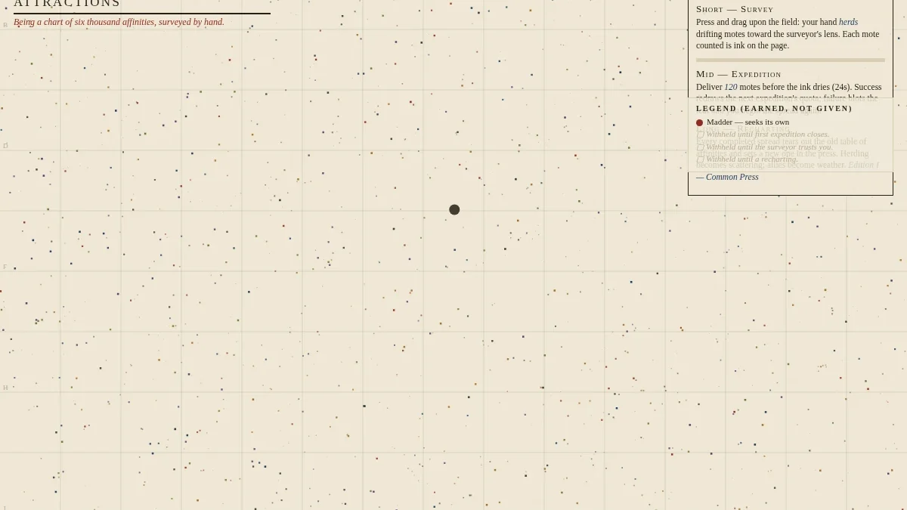
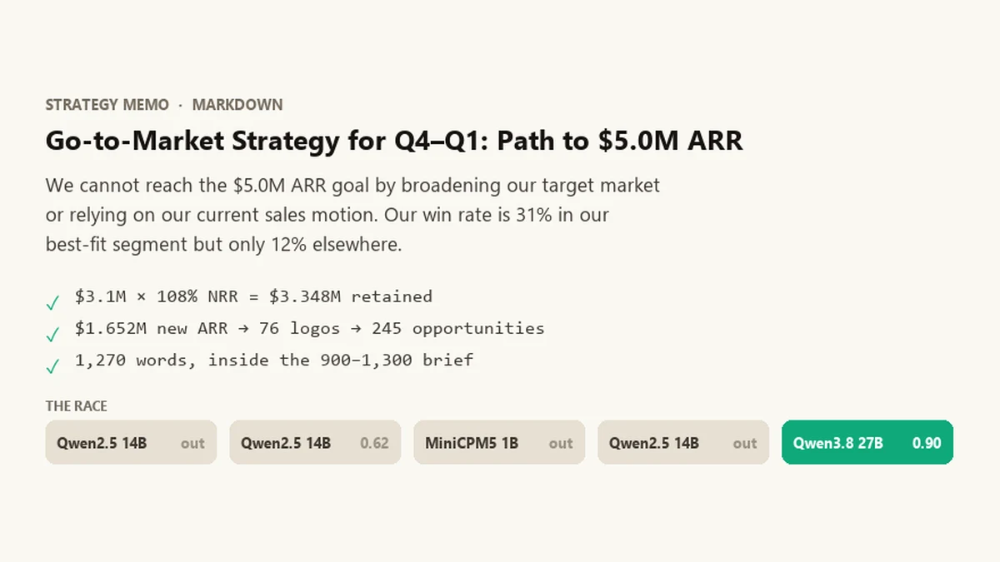
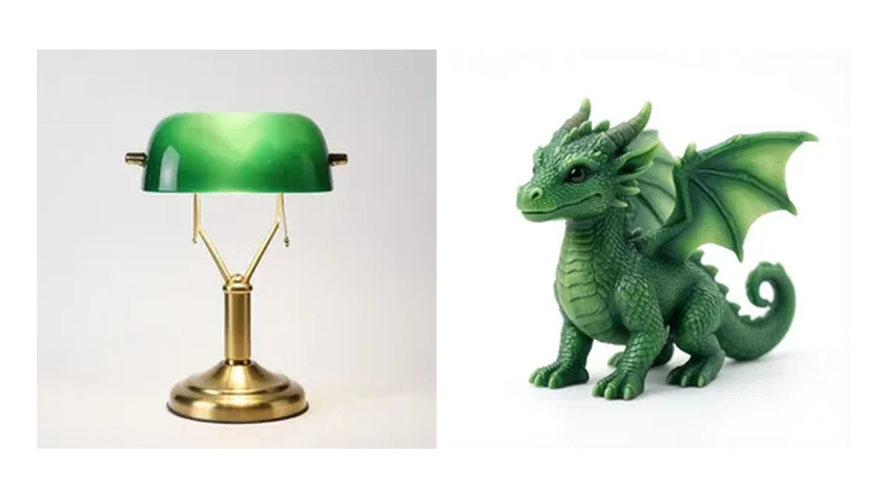
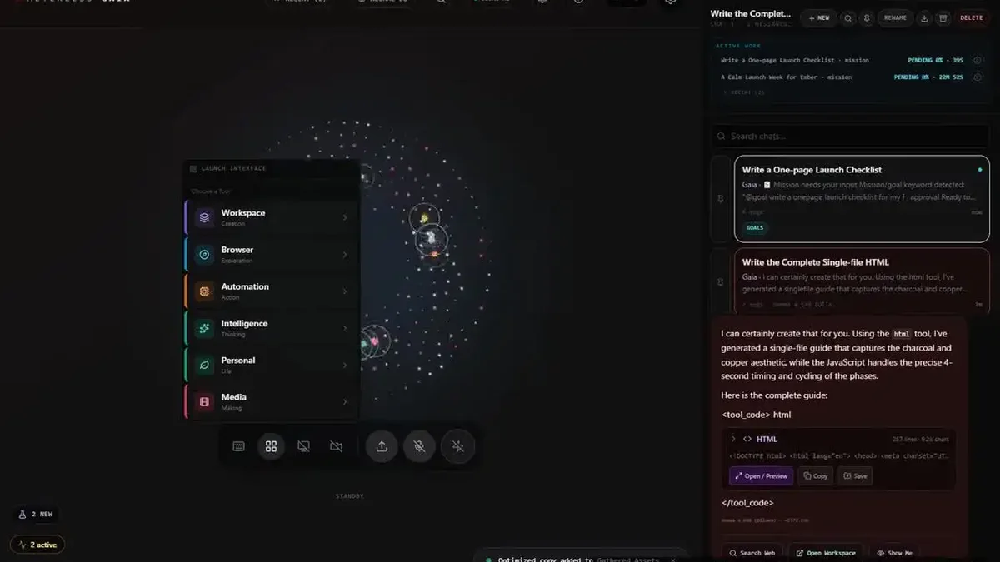
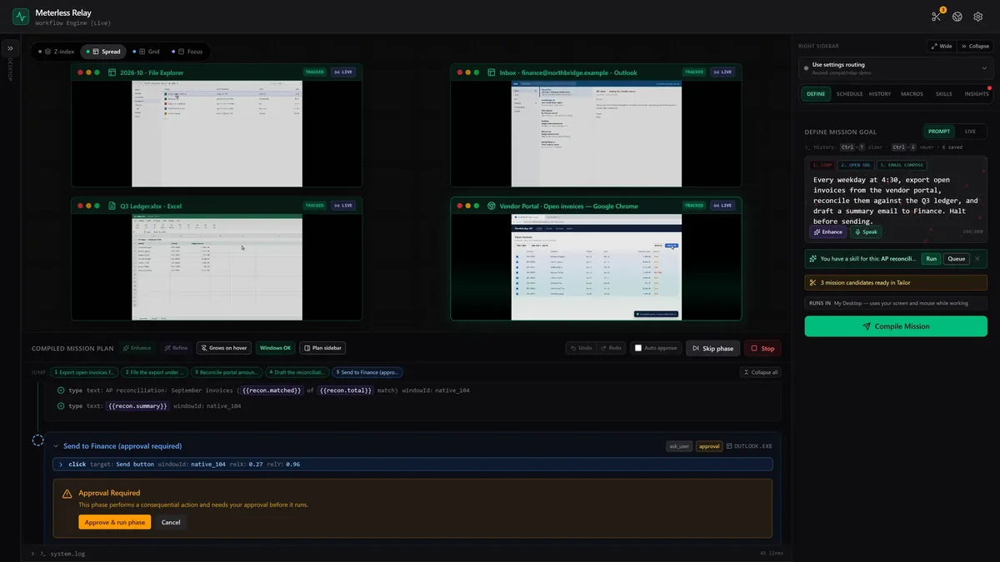
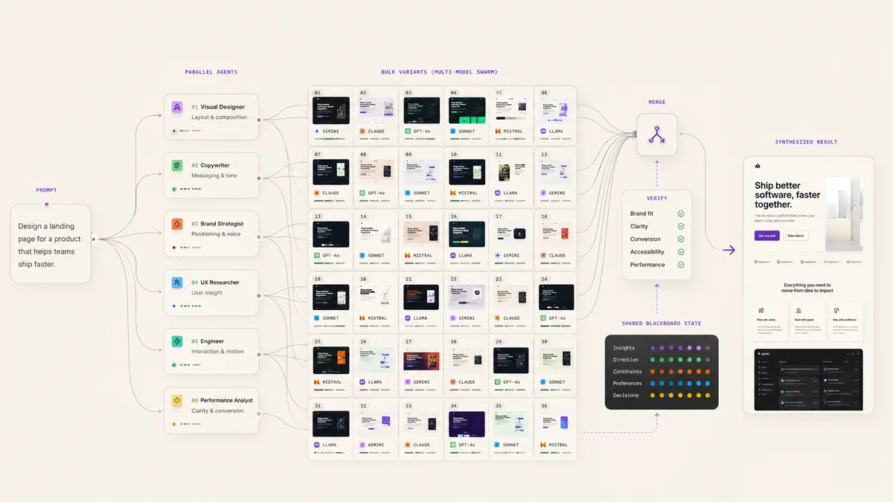
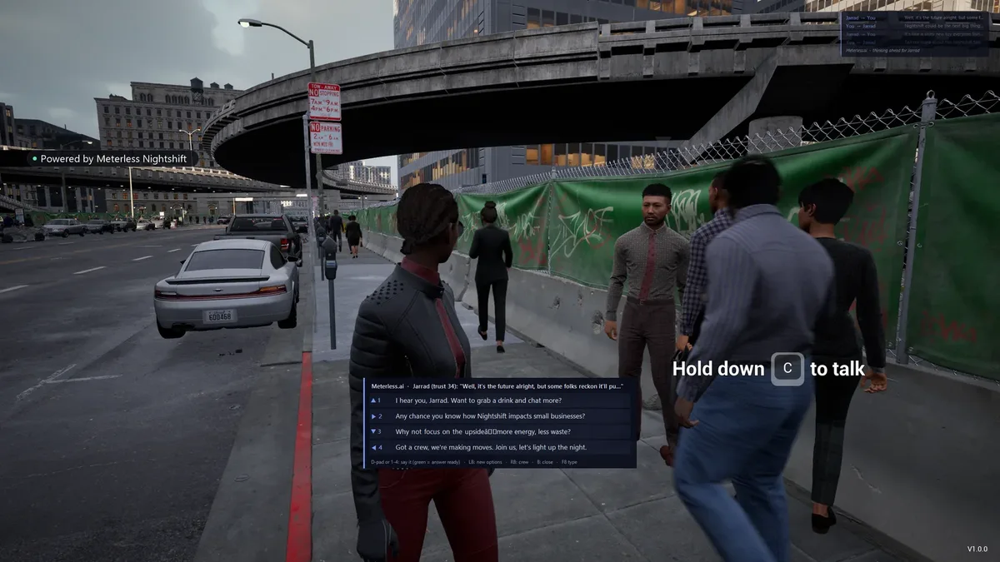
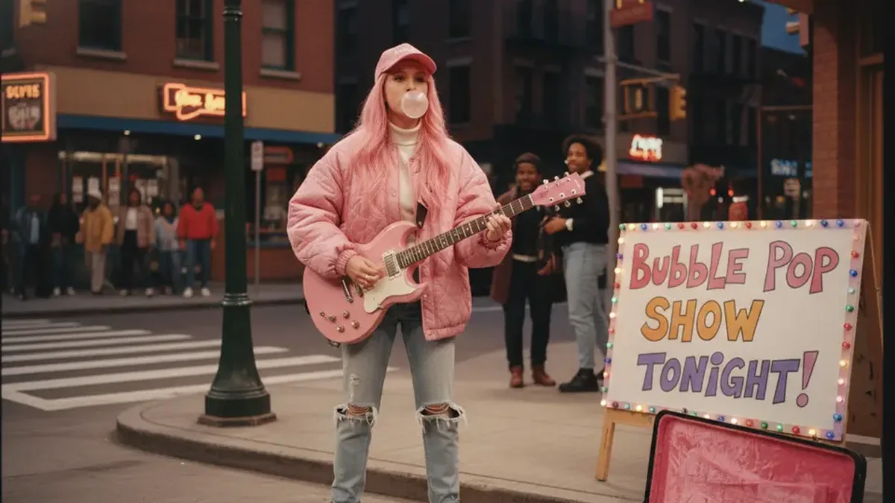
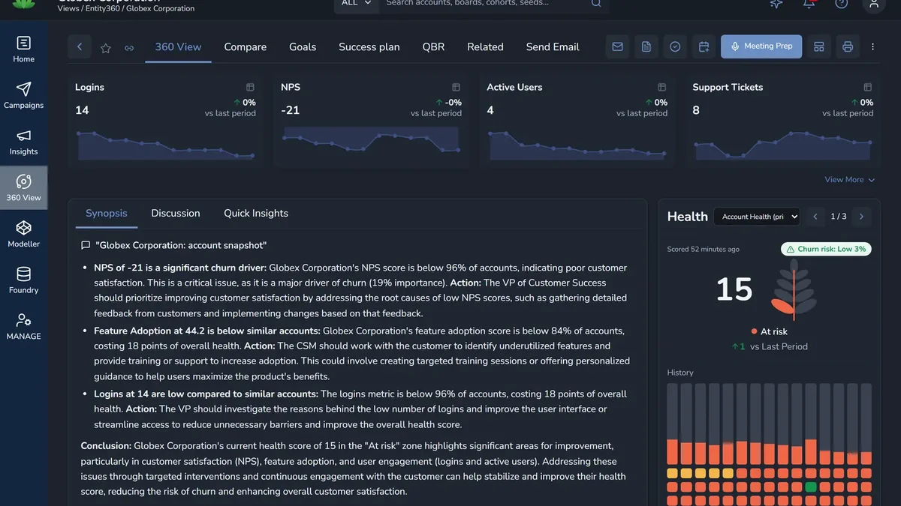
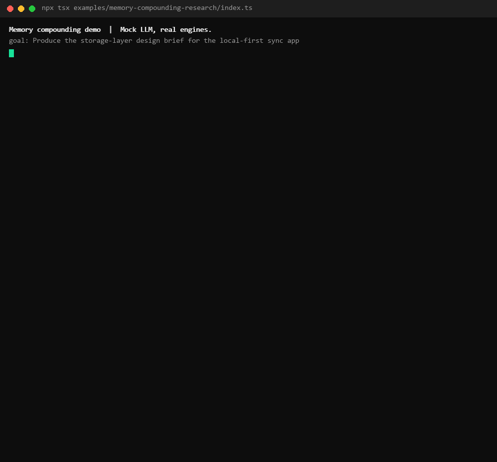

<div align="center">

# Meterless Nightshift

**Turn your computer into an AI hotspot.**

Your Mac or DGX Spark answers your apps while you work, then races hundreds of attempts at the jobs you leave it overnight.<br/>
In the morning you get the files that passed, with a receipt for every check.

[**Try it free in your browser**](https://meterless.ai/Nightshift/WEB/) · [Mac](https://www.meterless.ai/mac.html) · [DGX Spark](https://www.meterless.ai/dgx-spark.html) · [See real output](#open-the-files) · [Benchmarks](docs/benchmarks/README.md) · [Free apps](docs/products/README.md)

[](https://github.com/meterless/meterless/stargazers)
[](https://www.producthunt.com/products/meterless-ai)
[](https://www.nvidia.com/en-us/startups/)
[](LICENSE)
[](docs/benchmarks/README.md)

<a href="#open-the-files"></a>

<sub>Every frame is real output from a Nightshift night, with the numbers from its job log.</sub>

| One published night on one DGX Spark | |
|:--|:--|
| Attempts | **202** across three local models |
| Accepted | **1**, after 12 were judged and 3 of 3 files verified |
| Unattended | **5h 15m**, with 72 lane errors survived |
| Cloud spend | **$0.00** |

</div>

---

## Pick your way in

| You want to | Do this | Time |
|---|---|---|
| See what it makes | [Open the files](#open-the-files) from real nights | 1 min |
| Run a job yourself | [Try Nightshift free in your browser](https://meterless.ai/Nightshift/WEB/). Nothing to install. | 2 min |
| Put your own machine to work overnight | [Preorder for Mac](https://www.meterless.ai/mac.html) ($199 one-time, M5 or later) or [ask about DGX Spark](https://www.meterless.ai/dgx-spark.html) | |
| Point Cursor or Claude Code at your own hardware | Paste the [provider prompt](docs/agent-ready/add-meterless-provider.md) into your coding agent | 5 min |
| Use free AI apps | [Gaia, Relay and Swarms](#free-apps-on-the-same-runtime) | 2 min |
| Build on the open engines | Run the [90-second memory proof](#the-open-engines), no API keys | 90 s |

---

## Open the files

These came out of overnight Nightshift runs. Each one opens the original file on meterless.ai.

<table>
  <tr>
    <td width="33%" valign="top"><a href="https://www.meterless.ai/orbit-daylight-assets/cistern.html"></a><br/><b>A cistern, lit from above</b><br/><sub>One HTML file. 200 attempts, 94 validated, attempt 148 kept.</sub><br/><a href="https://www.meterless.ai/orbit-daylight-assets/cistern.html">Open it ↗</a></td>
    <td width="33%" valign="top"><a href="https://www.meterless.ai/orbit-daylight-assets/atlas.html"></a><br/><b>The Atlas of Small Attractions</b><br/><sub>A world to play in. Herd a living field with shifting rules.</sub><br/><a href="https://www.meterless.ai/orbit-daylight-assets/atlas.html">Play it ↗</a></td>
    <td width="33%" valign="top"><a href="https://www.meterless.ai/orbit-daylight-assets/after-hours.mp4"></a><br/><b>After hours, and a scene scored</b><br/><sub>Film plus music. 141 attempts, 3 local models.</sub><br/><a href="https://www.meterless.ai/orbit-daylight-assets/after-hours.mp4">Watch</a> · <a href="https://www.meterless.ai/orbit-daylight-assets/scene-score.wav">Listen ↗</a></td>
  </tr>
  <tr>
    <td width="33%" valign="top"><a href="https://www.meterless.ai/orbit-daylight-assets/last-light.png"></a><br/><b>Last light, and 29 more frames</b><br/><sub>Stills from a story bible. 299 attempts, 1 local model, 5h 35m.</sub><br/><a href="https://www.meterless.ai/orbit-daylight-assets/last-light.png">Full size ↗</a></td>
    <td width="33%" valign="top"><a href="https://meterless.ai/Benchmarks/KnowledgeWork/nights/D1-gtm-strategy_1.3.0/index.html"></a><br/><b>18 business deliverables</b><br/><sub>Memos, plans and RFP answers, each checked against an answer key. Every draft is published.</sub><br/><a href="https://meterless.ai/Benchmarks/KnowledgeWork/">Read them ↗</a> · <a href="https://meterless.ai/Benchmarks/KnowledgeWork/nights/D1-gtm-strategy_1.3.0/index.html">Replay a night in 3D ↗</a></td>
    <td width="33%" valign="top"><a href="https://meterless.ai/Benchmarks/3D/"></a><br/><b>50 textured 3D models</b><br/><sub>From a sentence, a photo or a sketch. 246 of 246 pass the Khronos glTF validator.</sub><br/><a href="https://meterless.ai/Benchmarks/3D/">Turn them ↗</a></td>
  </tr>
</table>

More in the [gallery](docs/products/nightshift/gallery.md). The source records for these files are in [provenance.json](https://www.meterless.ai/orbit-daylight-assets/provenance.json).

---

## Many answers, not one

A prompt to one model returns one answer, and different models' first answers tend to look alike. Nightshift runs a job hundreds of times across several local models and groups the results into distinct approaches. In four real races, new approaches were still appearing after attempt 250.


Each night ends by condensing its strongest cluster into an insight pack. The next night starts from that pack instead of a blank prompt, and recipes that keep winning are saved as Methods and Skills you can read. No model is retrained.


[How a night works](docs/products/nightshift/how-it-works.md) · [Every job mode, measured](docs/products/nightshift/job-modes.md)

---

## How it compares

| | A chat with a model | A cloud agent | Nightshift |
|---|---|---|---|
| Approaches per task | One answer | One path through the task | 25 to 37 distinct approaches per race |
| What comes back | A reply | A result | Files, plus a signed receipt for each check |
| How it is checked | You read it | The agent reports success | A judge model, validators, a browser sandbox and media checks. A check that could not run never counts as a pass. |
| Cost model | Subscription or per token | Per token | Electricity on hardware you own. About 5 cents per verified business deliverable. |
| Where the work lives | Their chat history | Their cloud | Your disk |
| The next run | Starts from zero | Starts from zero | Starts from last night's insight pack |

During the day the same machine is an AI hotspot. Any app that speaks the OpenAI API can use it: Cursor, Claude Code, the Meterless apps, and the experiments below. [How the hotspot works](docs/products/nightshift/hotspot.md).

---

## Benchmarks, failures included

Every number comes from a job log, a harness record or a test report, and names its machine.

| What we measured | Result |
|---|---|
| A month of real nights on one DGX Spark | 361 jobs, 5,361 landed attempts, 1,828 signed receipts, 98% of app requests served locally |
| Verified business deliverables per run, same briefs, four builds | 0, then 3, then 4, then 11 |
| Business briefs within a point of a frontier cloud model, same graders | 13 of 25 |
| Meterless context layer on Haiku 4.5, hidden graders | +4.29 quality points over the same-model baseline |
| Mac M5, 16 GB, catalog fleets after fixes | 24 of 24 jobs completed, 24 of 24 winners correct |
| What did not work, published anyway | Judging covered only 8% of shortlisted candidates until a dedicated judge model fixed it. 12 of 12 generated apps passed "verified", but only 6 of 12 worked. |

[All benchmarks](docs/benchmarks/README.md) · [What they taught us](docs/architecture/learnings.md)

---

## Free apps on the same runtime

Nightshift is the paid product. These are free, and each can use your Nightshift hotspot as its model provider.

<table>
  <tr>
    <td width="33%" valign="top"><a href="docs/products/gaia/README.md"></a><br/><b>Gaia</b><br/><sub>A workspace that keeps projects, memory, decisions and artifacts across sessions and models. <a href="docs/products/gaia/media/gaia-builds-an-app.mp4">Watch it build an app</a>.</sub></td>
    <td width="33%" valign="top"><a href="docs/products/relay/README.md"></a><br/><b>Relay</b><br/><sub>Describe a desktop job in one sentence. Relay plans it, runs it, checks each step, and replays it later with almost no model calls. <a href="docs/products/relay/media/relay-ap-reconciliation.mp4">Watch a run</a>.</sub></td>
    <td width="33%" valign="top"><a href="docs/products/swarms/README.md"></a><br/><b>Swarms</b><br/><sub>Type one goal and Swarms designs an agent team of 300+ agents in your browser. You keep the graph and can rerun it. <a href="https://meterless.ai/Swarms/">Launch it</a>.</sub></td>
  </tr>
</table>

### Experiments

Apps that only make sense when a model call costs electricity instead of a per-token fee. [All experiments](docs/experiments/README.md).

<table>
  <tr>
    <td width="33%" valign="top"><a href="docs/experiments/meterless-city/README.md"></a><br/><b>Meterless City</b><br/><sub>Talk out loud to anyone in a photoreal city. About 700 NPC turns an active hour, $0 per conversation.</sub></td>
    <td width="33%" valign="top"><a href="docs/experiments/sitcomify/README.md"></a><br/><b>Sitcomify</b><br/><sub>One photo in, a 90s sitcom pilot out. Dream Mode keeps writing and filming until you stop it.</sub></td>
    <td width="33%" valign="top"><a href="docs/experiments/dataplant/README.md"></a><br/><b>DataPlant</b><br/><sub>A customer-success platform that re-scores every account in the background. 0 cloud calls.</sub></td>
  </tr>
</table>

---

## The open engines

Everything above runs on four open context engines: memory, state, long-run reasoning and intent routing. Each one is an AGENTS.md implementation spec with a runnable reference and a conformance suite, so a coding agent can build it into your stack and prove it got it right.

The proof runs on your machine in 90 seconds with no API keys. The same 12-step task runs cold, then warm. The warm run starts with H-MEM memory and finishes in 8 chunks instead of 12. The output below is real; tokens are estimated at chars/4.



```bash
npx tsx examples/memory-compounding-research/index.ts
```

| Engine | Role | Runs in | Verify |
|---|---|---|---|
| [H-MEM](engines/hmem/) | Hierarchical memory with provenance, dreaming, sleep and an audit trail | Gaia, Meterless City | [conformance](engines/hmem/conformance/) |
| [World Model](engines/world-model/) | Event-sourced state for users, tasks and environments | Relay, Sitcomify, Meterless City | [conformance](engines/world-model/conformance/) |
| [Markovian](engines/markovian/) | Bounded state for long runs, so cost per step stays flat | Nightshift `deliberate` jobs, Meterless City, Swarms | [conformance](engines/markovian/conformance/) |
| [Scout Intent](engines/scout-intent/) | Intent detection, risk checks, tool routing and signed execution contracts | Relay, Swarms | [eval harness](engines/scout-intent/evals/) |

Clone one engine and hand it to your coding agent:

```bash
npx degit meterless/meterless/engines/hmem my-hmem
cd my-hmem/reference && npm install && npm test    # a working reference, green in about a minute
```

Your agent is done when the conformance suite passes: `HMEM_IMPL=<your build> npx tsx conformance/runner.ts`. Read the [engines overview](engines/README.md) and the [architecture](docs/architecture/stack-overview.md).

---

## Paste one prompt

Any AI that can read a link can read this repo. Paste this into ChatGPT, Claude, Cursor or Copilot:

```text
Read the Meterless open-source repo at https://github.com/meterless/meterless.
Start with llms.txt and README.md, then AGENTS.md.
1. Tell me in five bullets what Nightshift and each engine do.
2. Ask me three questions about what I'm building.
3. Give me the exact steps for the one thing I should try first.
```

More in the [prompt library](docs/agent-ready/prompt-library.md).

---

## What we learned

From the benchmarks. The full list, with the run behind each lesson, is in [learnings.md](docs/architecture/learnings.md).

1. Count finished, accepted work. Tokens per second does not tell you that.
2. Use cloud models when someone is waiting. Use your own hardware for work nobody is waiting on.
3. Judging was the bottleneck. A dedicated judge model fixed it.
4. A generated app that loads may still not work. A check that could not run never counts as a pass.
5. Save what worked as written methods. No retraining is needed.

---

## Community

- **Hackathons.** The Open Agent Hackathon 2026 runs October 15 to 20, online, with up to $20,000 in prizes. Meterless has hosted 9 global hackathons with 30,000+ builders through GenAI.Works. [Hackathon guide](docs/community/hackathon-guide.md).
- **Roadmap.** Nightshift for Mac ships Q4 2026. The next engine specs are swarm-orchestration and runtime. [ROADMAP.md](ROADMAP.md).
- **Contributing.** Start with [CONTRIBUTING.md](CONTRIBUTING.md). Coding agents start at [AGENTS.md](AGENTS.md); other agents at [llms.txt](llms.txt).

Everything in this repo is [Apache 2.0](LICENSE). App installers ship from each app's own repo and from [meterless.ai](https://www.meterless.ai).
