# Meterless Roadmap

This page tracks what has shipped and what is next. New engine specs arrive as folders under `engines/`, each with a tagged release (`<engine>-v<semver>`) and its own announcement.

## Shipped

| What | Status |
|---|---|
| H-MEM | Spec + runnable reference at `engines/hmem/` |
| World Model | Spec + runnable reference at `engines/world-model/` |
| Markovian | Spec + runnable reference at `engines/markovian/` |
| Scout Intent | Spec at `engines/scout-intent/`, with a runnable eval harness |
| Gaia, Relay, Swarms | Free apps. Docs at `docs/products/` |
| Meterless City, Sitcomify, DataPlant | Free experiments. Docs at `docs/experiments/` |
| Nightshift web edition | Free, live at meterless.ai |
| Nightshift for Windows | Windows edition 1.2.1, out now. [Measured on an RTX 3090](docs/benchmarks/windows.md) |
| Nightshift Mac M1+ edition | Free download for M1 to M4 Macs. [Measured in the app](docs/benchmarks/mac-m1-m4.md) |
| Benchmarks on every edition | Windows, Mac M5, Mac M1 to M4 and DGX Spark, in `docs/benchmarks/` |
| Meterless provider contract | Runtime 0.90.0, documented at `docs/agent-ready/add-meterless-provider.md` |

## Next

| What | Role | Status |
|---|---|---|
| Nightshift for Mac | Hotspot and night shift on Apple Silicon M5 and later | Preorder open. Delivery Q4 2026 |
| Nightshift for DGX Spark | Hotspot and long-running jobs on GB10 | Installer on request |
| swarm-orchestration spec | DAG planning, dynamic specialists, merge and verify | Runs inside Gaia and Swarms today. Spec drop pending |
| runtime spec | Quality, cost and latency routing and the execution substrate | Powers Nightshift today. Spec drop pending |
| fulcrum | To be announced | Planned |
| More benchmarks | The M1 to M4 edition on an actual M1 to M4 Mac, a Windows PC with a 12 GB or 8 GB card, the Windows media engines | Results land when the runs are read |

These are targets, and dates can move. Unreleased engines have no folder in this repo until the day the full spec ships.

## Docs and templates

- [x] Nightshift docs, benchmark summaries and learnings
- [x] Prompt library and the Meterless provider contract for coding agents
- [x] Hackathon starter: `templates/agentathon-starter/` (memory notebook agent, runs in two minutes, no keys)
- [x] First cross-stack example: `examples/memory-compounding-research/` (H-MEM + Markovian, runnable, no keys)
- More agent-ready guides for more coding agents

## Future gates

- `apps/<name>/` appears only on the day an app's source ships in this repo.
- `packages/` (CLI, SDK, MCP server) appears only when working code exists.
- Root `evals/` and `benchmarks/` folders appear only with real harnesses and real data. Until then, benchmark summaries live in `docs/benchmarks/` and the full reports live on meterless.ai.
