# Stack Overview

The Meterless Runtime sits in the middle of the stack. During the day it answers requests from your apps. At night, Nightshift uses the same machine to run queued jobs.



```text
Your apps        Cursor, Claude Code, Gaia, Relay, Swarms, Meterless City, Sitcomify, DataPlant
   ↓
Meterless provider   OpenAI-compatible, 127.0.0.1:8088/v1, meterless/* routing modes
   ↓
Meterless Runtime + Nightshift
   ├─ Day (Depth posture)     serve every connected app, one lane per request
   └─ Night (Swarm posture)   race queued jobs, scribes read, clusters form,
                              judges and checks settle the Outcome Contract
   ↓
Open engines     Scout Intent · H-MEM · World Model · Markovian · Swarm
   ↓
Your hardware    Apple Silicon Mac · NVIDIA DGX Spark · Windows PC
   ↓
Kept work + signed receipts + Methods and Skills, on your disk
```

## Layer by layer

| Layer | What it is | Status |
|---|---|---|
| Apps | Coding agents, the free Meterless apps, the experiments, anything that speaks the OpenAI API | [Free apps](../products/README.md) and [experiments](../experiments/README.md) shipping |
| Provider | One OpenAI-compatible endpoint with routing modes instead of model names | Contract public: [add-meterless-provider.md](../agent-ready/add-meterless-provider.md) |
| Runtime and Nightshift | Local AI production control plane: jobs, fleets, lanes, checks, Outcome Contract, makes, receipts, two postures | [Nightshift](../products/nightshift/README.md): web live, Mac preorder, DGX on request |
| Intent detection and routing | [Scout Intent](../../engines/scout-intent/) | Spec + eval harness |
| Durable memory | [H-MEM](../../engines/hmem/) | Spec + runnable reference |
| State modeling | [World Model](../../engines/world-model/) | Spec + runnable reference |
| Reasoning compression | [Markovian](../../engines/markovian/) | Spec + runnable reference |
| Multi-agent coordination | Swarm orchestration | Ships inside the apps. Spec drop next, see [roadmap](../../ROADMAP.md) |
| Quality, cost and latency routing | Runtime | Ships inside Nightshift. Spec drop next, see [roadmap](../../ROADMAP.md) |

## How the engines compose

- **H-MEM feeds Markovian.** Memory seeds chunk zero of a long run and mines the output back into memory. The [memory-compounding demo](../../examples/memory-compounding-research/) shows the warm run finishing in 8 chunks instead of 12.
- **World Model feeds H-MEM.** Sourced facts replicate into memory and answer scoped queries planned upstream.
- **Scout plans before anything acts.** Downstream engines act only on its signed execution contracts.
- **Markovian is the `deliberate` job kind.** In Nightshift, one long chain of chunks carries a compressed summary forward and checkpoints.
- **All three together make a small model feel large.** Meterless City runs an 8B model with Markovian state, H-MEM memory and a World Model event log per character.

Each engine's examples folder shows these pairings from its own side.

## Product surfaces

| Surface | Role | Docs |
|---|---|---|
| Nightshift | The flagship: AI hotspot by day, overnight production by night | [docs/products/nightshift/](../products/nightshift/README.md) |
| Gaia | Persistent workspace | [docs/products/gaia/](../products/gaia/README.md) |
| Relay | Repeatable desktop workflows | [docs/products/relay/](../products/relay/README.md) |
| Swarms | Coordinated, divergent generation | [docs/products/swarms/](../products/swarms/README.md) |
| Experiments | What the runtime unlocks | [docs/experiments/](../experiments/README.md) |
