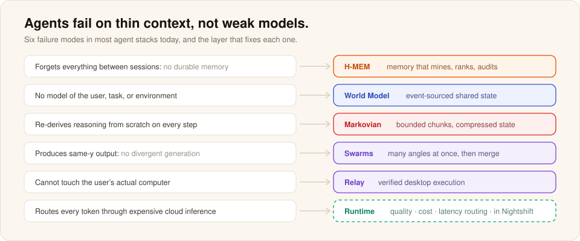

# Why Meterless

Meterless builds software that keeps the results of AI work on your own machine. A useful run should leave behind more than an answer: the files, the decisions, and the method that worked, so the next run can start from them.

## What we believe

1. **You own the work AI does for you.** Every run leaves files, decisions and the method that worked. They belong on your disk in formats you can read, not locked in someone's chat history. Switch models or providers and all of it comes with you.
2. **Each run should build on the last.** Most AI tools start from zero every session. In Meterless, each run adds to a record of what worked, so the next run starts further ahead.
3. **Many attempts beat one.** A single answer is one sample. Hundreds of attempts, filtered and compared, show which approaches hold up. On hardware you own there is no per-call bill, so the machine can keep working through the night.

## The problem

Useful models now fit on a desk. The gap is utilization. A local AI computer works a few hours a day and idles the rest. Meanwhile most agent stacks:

- Forget everything between sessions. No durable memory.
- Have no model of the user, task or environment. No world model.
- Re-derive reasoning from scratch on every step. No reasoning compression.
- Produce same-y output. No divergent generation.
- Cannot touch the user's actual computer. No execution layer.
- Route every token through metered cloud inference. No runtime quality or cost control.

## The Meterless answer

- **[Nightshift](../products/nightshift/README.md)** gives the idle hours a standing job. By day it is an AI hotspot for your apps. By night it races hundreds of attempts, reads, clusters, judges and checks them, and keeps only what clears your bar.
- **The open engines** are the context layer underneath: H-MEM for memory, World Model for state, Markovian for long runs, Scout Intent for routing. They are specs you can implement and verify yourself.
- **The free apps** (Gaia, Relay, Swarms) and the **experiments** (Meterless City, Sitcomify, DataPlant) prove what the runtime unlocks.

See [stack-overview.md](stack-overview.md) for the full flow and [learnings.md](learnings.md) for what the benchmarks taught us.

## What each part does

| Part | What it does |
|---|---|
| Nightshift | Runs long jobs on the AI computer you already own and serves your other apps by day |
| Gaia | Keeps projects, memory, decisions and artifacts in one workspace across sessions |
| Relay | Automates a desktop job once, then replays it with few or no model calls |
| Swarms | Turns one prompt into many distinct variants, then ranks and refines them |
| Engines | Open specs for the memory, state, reasoning and routing layers the products are built on |

## Why local-first

- **Ownership.** Memory, world state, methods and receipts stay on the user's machine.
- **Cost.** A verified business deliverable cost about 5 cents of electricity. An hour of Meterless City conversation costs 2 to 6 cents on your own runtime.
- **Throughput.** A local machine is slow for interactive use but cheap for overnight work. Owned hardware turns idle hours into finished work.
- **Control.** Teams can run agent infrastructure inside their own perimeter.

Read more: [local-first-agentic-context.md](local-first-agentic-context.md).

## Work with Meterless

Meterless helps teams turn promising AI experiments into repeatable, governed work: internal agentathons to find useful workflows, hands-on implementation, and engine integration and runtime licensing for the systems you build. Contact partnerships@meterless.ai.
