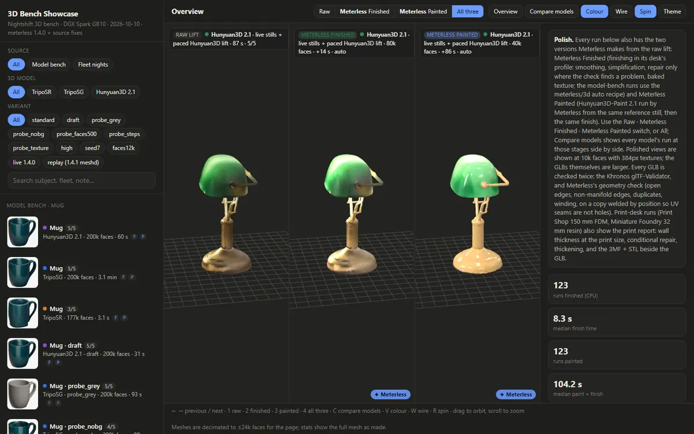

# 3D bench

**NVIDIA DGX Spark, GB10 · October 10, 2026 · Measured**

A photo, a sketch or a sentence in. A valid 3D model out. Three open image-to-3D models raced on 16 test stills, then 14 Nightshift 3D desks ran as real nights. Meterless finished and painted every model and checked each one twice: its own geometry check, then the Khronos glTF validator.

[**Open the 3D bench ↗**](https://meterless.ai/Benchmarks/3D/) · [All benchmarks](README.md)

| 246 / 246 | 50 | 2.0 s | 4.3 / 5 |
|:--:|:--:|:--:|:--:|
| polished GLBs, 0 validator errors, 0 warnings | models from 14 desks | median TripoSR lift | Hunyuan3D 2.1 mean grade |

---

<table>
  <tr>
    <td width="50%" valign="top"> <b>Dragon</b> Model bench · Hunyuan3D 2.1 · grade 5 of 5</td>
    <td width="50%" valign="top"> <b>Green glass desk lamp</b> A finished model from the bench</td>
  </tr>
</table>

| Model | Median lift | Peak memory | Mean grade of 5 |
|---|---:|---:|---:|
| TripoSR | 2.0 s | 4.7 GB | 3.3 |
| TripoSG 1.5B | 167 s | 11.6 GB | 4.1 |
| Hunyuan3D 2.1 | 85 s | 12.3 GB | 4.3 |

| Measure | Value |
|---|---|
| Valid GLBs | 246 of 246 |
| Median finish | 8.3 s |
| Paint plus finish | 104 s |
| Closed and manifold | 82 of 127 raw lifts |

## What is weak

- **Heat.** Hunyuan3D shut the box down 4 times unpaced in a warm room. With cool-down pacing it ran 9 jobs in a row at 83 °C or less.
- **Licence.** Hunyuan3D's Tencent community licence excludes the EU, UK and South Korea.
- **Grades are one reviewer's read** of turntable renders. 4 of the 14 desks (20 models) were re-lifted with the fixed 1.4.1 mesh engine.
- **The bench page is about 65 MB.** The list appears first; the 3D models stream in after it.
