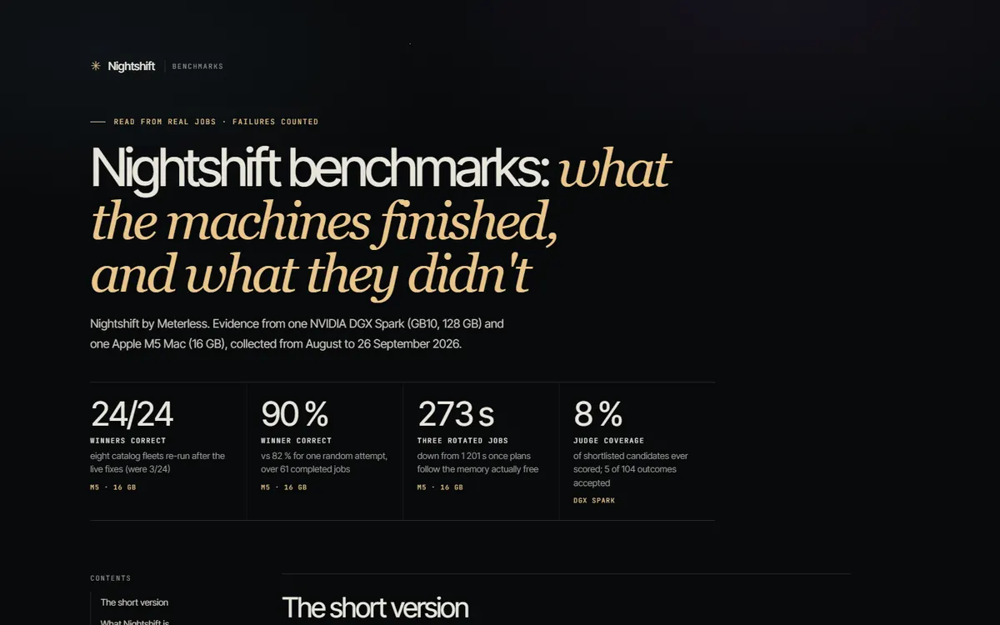
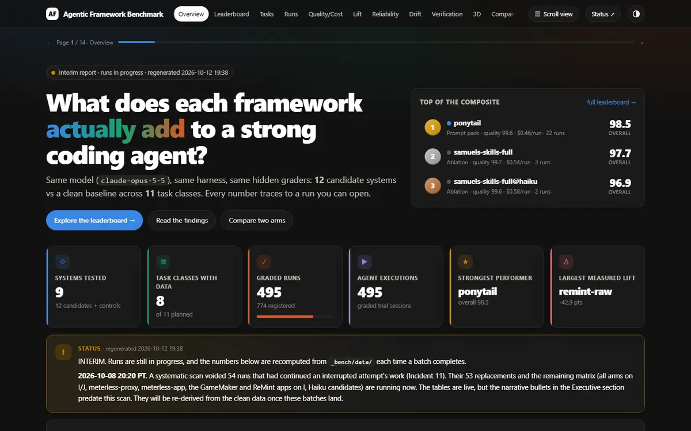

# Benchmarks

**Stop benchmarking your AI computer like a chatbot.**

Tokens per second tells you how fast a model writes. These benchmarks measure how much useful work a machine finished, and how much of it was good enough to keep. 
Every run is published with its failures. Every number names its machine, build and date.

[**Interactive reports on meterless.ai ↗**](https://www.meterless.ai/benchmarks.html) · [Watch the live jobs](#live-jobs-you-can-open) · [Read the example output](examples/README.md) · [What they taught us](../architecture/learnings.md)

---

## Every machine Nightshift runs on, measured

| Edition | Machine measured | Dates | Headline | Weakest point | Report |
|---|---|---|---|---|---|
| **Windows** 1.2.1 | RTX 3090 24 GB, Windows 10 | Oct 18 to 19, 2026 | 108 / 108 catalog jobs, 100 winners correct; 553 / 553 jobs in 3 hours | a 3B judge crowned a wrong answer in 19 of 42 grid jobs | [Windows](windows.md) |
| **Mac M1 to M4** 0.90.0 | Apple M5 16 GB, M1 to M4 app | Oct 14 to 15, 2026 | engine restarts 19 → 0; Llama 3.2 3B 32 / 34 | run on an M5, not an actual M1 to M4 Mac | [Mac M1 to M4](mac-m1-m4.md) |
| **Mac M5+** | Apple M5 16 GB, fanless | Sep 22 to 26, 2026 | 24 / 24 winners correct, was 3 / 24; 301 / 301 soak jobs | 14B models never fit beside the owner's apps | [Mac M5](mac-m5.md) |
| **DGX Spark** | GB10, 128 GB | Aug to Oct 2026 | 361 jobs, 5,361 attempts, 1,828 signed receipts | only 8% of shortlisted candidates judged, until the job-modes fix | [DGX Spark](dgx-spark.md) |

<table>
  <tr>
    <td width="50%" valign="top"> <b>Windows PC, RTX 3090</b> NEW The Mac campaign's harnesses, ported to Windows and run on a gaming PC in daily use. 1.5 to 115× faster than the 16 GB Mac on the same fleets. <a href="windows.md">Numbers</a> · <a href="https://meterless.ai/Benchmarks/WIN/NIGHTSHIFT_WINDOWS_FINDINGS.html">Findings ↗</a> · <a href="https://meterless.ai/Benchmarks/WIN/">Raw files ↗</a></td>
    <td width="50%" valign="top"> <b>Mac M1 to M4 edition</b> NEW Eight small models on the Mac's GPU through WebGPU, graded inside the shipped app over 17 launches. Seven problems found, seven fixed. <a href="mac-m1-m4.md">Numbers</a> · <a href="https://meterless.ai/Benchmarks/MAC/M1-M4/benchmark-dashboard.html">Dashboard ↗</a> · <a href="https://meterless.ai/Benchmarks/MAC/M1-M4/">Raw files ↗</a></td>
  </tr>
  <tr>
    <td width="50%" valign="top"> <b>Mac M5, 16 GB</b> Every installed catalog fleet on a fanless laptop with its owner's apps open, then a three-hour soak through a real sleep. <a href="mac-m5.md">Numbers</a> · <a href="https://meterless.ai/Benchmarks/MAC/M5+/">Report ↗</a></td>
    <td width="50%" valign="top"> <b>DGX Spark: real nights and the hardware card</b> A month of real jobs from one working Spark. Prefill and decode, always separately. <a href="dgx-spark.md">Numbers</a> · <a href="https://www.meterless.ai/benchmarks.html">Benchmarks page ↗</a></td>
  </tr>
</table>

### Same fleets, three machines

| | Mac M5, 16 GB | Windows PC, RTX 3090 24 GB | DGX Spark, 128 GB |
|---|---|---|---|
| Fleet | about 10 GB resident; most fleets rotate | five or six 1B to 8B lanes; 8 of 12 fleets fully resident | three 27B to 32B lanes, an embedder and a media server |
| Decode | 120 to 144 tok/s on a 1B | 190 to 355 tok/s on a 1B · 50 to 70 on an 8B | 6.2 to 7.7 tok/s per 27B to 32B lane |
| Same 12 catalog fleets | 36 / 36 completed · 31 / 36 correct · 6 to 472 s | 108 / 108 completed · 100 / 108 correct · 3 to 33 s | not run on this suite |
| Cloud spend | $0.00 | $0.00 | $0.00 |

---

## Is the work any good

Device runs ask what one machine finishes while nobody is watching. Task runs ask whether the work is any good.

<table>
  <tr>
    <td width="50%" valign="top"> <b>Knowledge work</b> 18 business deliverables written overnight and checked against an answer key. Verified per run went 0, 3, 4, then 11 across four builds. <a href="knowledge-work.md">Numbers</a> · <a href="examples/knowledge-work/README.md">Read all 18</a> · <a href="https://meterless.ai/Benchmarks/KnowledgeWork/">Morning Desk ↗</a></td>
    <td width="50%" valign="top"> <b>Job modes</b> Every mode beyond best-of-n. A dedicated judge lane took scoring from 8% to 306 of 310 candidates. Only 6 of 12 "verified" apps worked. <a href="job-modes.md">Numbers</a> · <a href="https://meterless.ai/Benchmarks/DGX/modes/NIGHTSHIFT_MODES_BENCHMARKS.html">Report ↗</a></td>
  </tr>
  <tr>
    <td width="50%" valign="top"> <b>3D bench</b> A photo, a sketch or a sentence in. 246 of 246 polished GLBs pass the Khronos glTF validator. <a href="3d-bench.md">Numbers</a> · <a href="https://meterless.ai/Benchmarks/3D/">Turn the models ↗</a></td>
    <td width="50%" valign="top"> <b>Agent frameworks</b> INTERIM Twelve frameworks against one plain baseline on Claude. On Haiku 4.5, only the two Meterless arms cleared the bar. <a href="agent-frameworks.md">Numbers</a> · <a href="https://meterless.ai/Benchmarks/AgenticFrameworks/">Report ↗</a></td>
  </tr>
</table>

---

## Live jobs you can open

Every Morning Desk night was exported with Nightshift's job export and is replayed in 3D on meterless.ai: every draft, every judge score and the winning answer. The deliverable from each night is in this repo, verbatim.

| Night | Build | Judge | Replay | Output |
|---|---|---:|---|---|
| Go-to-market plan to $5M ARR | 1.3.0 | 0.90 | [Replay in 3D ↗](https://meterless.ai/Benchmarks/KnowledgeWork/nights/D1-gtm-strategy_1.3.0/index.html) | [Read](examples/knowledge-work/d1-gtm-strategy-1-3-0.md) |
| Security RFP answers | 1.3.0 | 0.95 | [Replay in 3D ↗](https://meterless.ai/Benchmarks/KnowledgeWork/nights/D9-rfp-security-response_1.3.0/index.html) | [Read](examples/knowledge-work/d9-rfp-security-response-1-3-0.md) |
| Company OKRs from strategy | 1.3.0 | 0.95 | [Replay in 3D ↗](https://meterless.ai/Benchmarks/KnowledgeWork/nights/D13-okrs-from-strategy_1.3.0/index.html) | [Read](examples/knowledge-work/d13-okrs-from-strategy-1-3-0.md) |
| Churn cohort analysis | 1.3.0 | 0.95 | [Replay in 3D ↗](https://meterless.ai/Benchmarks/KnowledgeWork/nights/D11-churn-analysis_1.3.0/index.html) | [Read](examples/knowledge-work/d11-churn-analysis-1-3-0.md) |
| Contract risk register | 1.3.0 | 0.92 | [Replay in 3D ↗](https://meterless.ai/Benchmarks/KnowledgeWork/nights/D6-contract-risk-register_1.3.0/index.html) | [Read](examples/knowledge-work/d6-contract-risk-register-1-3-0.md) |
| Release notes in three languages | 1.3.0 | 0.92 | [Replay in 3D ↗](https://meterless.ai/Benchmarks/KnowledgeWork/nights/D14-localized-release-notes_1.3.0/index.html) | [Read](examples/knowledge-work/d14-localized-release-notes-1-3-0.md) |
| Incident postmortem, the one that got worse | 1.3.0 | 0.85 | [Replay in 3D ↗](https://meterless.ai/Benchmarks/KnowledgeWork/nights/D3-incident-postmortem_1.3.0/index.html) | [Read](examples/knowledge-work/d3-incident-postmortem-1-3-0.md) |

[All 18 nights and deliverables](examples/knowledge-work/README.md) · [Files from real nights: HTML scenes, film, music, a deck](examples/overnight-gallery/README.md)

---

## The public benchmark format: one real night

`job_mtrtl3j401` · "a compelling 3D landing page, one HTML file" · DGX Spark · three local lanes · local only · September 7 to 8, 2026.

| Attempts | Clusters | Finalists | Judged | Accepted | Window | Attempts per accepted | Judge coverage | Lane errors survived | Cloud |
|---:|---:|---:|---:|---:|---|---:|---:|---:|---:|
| 202 | 2 | 20 | 12 | 1 | 5h 15m | 200 | 60% | 72 | $0.00 |

Settled by the Outcome Contract: accepted, 3 of 3 artifacts verified at the static tier (2 not runtime-checked: no browser). Details in [DGX Spark](dgx-spark.md).

---

## What is in this folder

| Path | What it holds |
|---|---|
| [windows.md](windows.md) | Windows edition 1.2.1 on an RTX 3090 |
| [mac-m1-m4.md](mac-m1-m4.md) | The free Mac M1 to M4 edition, graded inside the app |
| [mac-m5.md](mac-m5.md) | Nightshift for Mac on a fanless 16 GB M5 |
| [dgx-spark.md](dgx-spark.md) | Real nights, the public format and the hardware card |
| [job-modes.md](job-modes.md) | Every job mode, measured |
| [knowledge-work.md](knowledge-work.md) | The Morning Desk, with all 18 live replays |
| [3d-bench.md](3d-bench.md) | Image-to-3D models, finished and validated |
| [agent-frameworks.md](agent-frameworks.md) | The engines against twelve frameworks, on Claude |
| [examples/](examples/README.md) | Example output, copied unmodified from published jobs |
| [media/](media/) | Report captures from meterless.ai and the charts on these pages |

Not yet published: the M1 to M4 edition on an actual M1 to M4 Mac, a Windows PC with a 12 GB or 8 GB card, and the Windows media engines. Results land here when the runs are read.

## How to read these numbers

- Failures, refusals and wiped jobs stay in the denominators or are reported apart.
- "Measured" means read from a job log, a harness record or a test report. "Projected" means computed from a measured run and labelled.
- Attempts are not results. Throughput counts work produced. Acceptance counts work you would keep.
- "Winner correct" scores the attempt Nightshift crowned, not the best one it had.

The lessons these runs taught are collected in [learnings.md](../architecture/learnings.md).
