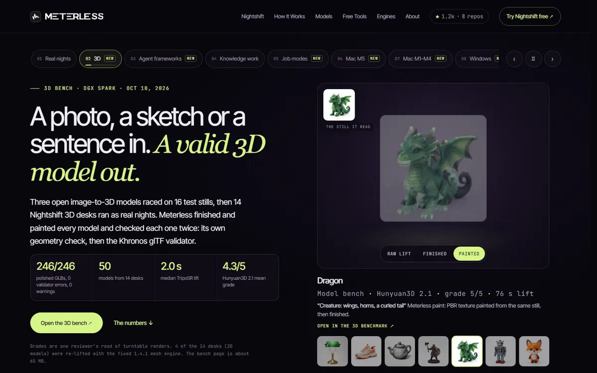

# DGX Spark: real nights and the hardware card

**NVIDIA DGX Spark, GB10, 128 GB · August to September 2026 · Measured**

A month of real jobs read from one working DGX Spark's job log. It is the source of the public benchmark format, the hardware card and the prefill and decode figures.

[**Open the benchmarks page ↗**](https://www.meterless.ai/benchmarks.html) · [Nightshift for DGX Spark ↗](https://www.meterless.ai/dgx-spark.html) · [All benchmarks](README.md)

| 361 | 5,361 | 1,828 | 98% |
|:--:|:--:|:--:|:--:|
| jobs | landed attempts | signed receipts | app turns served locally |

---

## The public benchmark format: one real night

`job_mtrtl3j401` · "a compelling 3D landing page, one HTML file" · DGX Spark · three local lanes · local only · September 7 to 8, 2026.

| Attempts | Clusters | Finalists | Judged | Accepted outcome |
|---:|---:|---:|---:|---:|
| 202 | 2 | 20 | 12 | 1 |

| Window | Attempts per accepted | Judge coverage | Verifier abstentions | Lane errors survived | Cloud escalation |
|---|---:|---:|---:|---:|---:|
| 5h 15m | 200 | 60% | 4 | 72 | $0.00 |

Settled by the Outcome Contract: accepted, 3 of 3 artifacts verified at the static tier (2 not runtime-checked: no browser). Substrate: llama.cpp, Q4, 128 GB.

## Real nights

| Measure | Value |
|---|---|
| Jobs | 361 |
| Landed attempts | 5,361 |
| Signed receipts | 1,828 |
| App turns served locally | 98% |
| Distinct solution clusters per race of 250 to 300 attempts | 25 to 37, still arriving in the last 50 attempts |
| Cloud spend on the published night | $0.00 |
| Interactive latency | median 36.8 s, p95 5 min 7 s |

**The weak point is judging.** Only 8% of shortlisted candidates were scored (14 of 169), and 92 of 104 recorded outcomes are not yet decided. The trust funnel shows the same thing: 3,034 artifacts, 2,020 static-valid, 167 of 261 tested actually ran. 44% of seated lanes landed nothing. Media makes went 832 requested, 468 rendered, 0 accepted. The [job modes](job-modes.md) campaign found and fixed the mechanism.

---

## The hardware card

Every machine gets the same five-part card: the machine, what fits, how fast it reads and writes, what a night produces and what it costs. The DGX Spark is measured. The Macs are scaled from that run. The [Windows PC](windows.md), the [Mac M5](mac-m5.md) and the [M1 to M4 edition](mac-m1-m4.md) have their own measured runs.

### Prefill and decode, always separately

Prefill is how fast the machine reads. Decode is how fast it writes. They are limited by different silicon and differ by almost two orders of magnitude. Averaging them into one "speed" hides the only thing you need to route work.

| Lane · model | Prompt tokens | Prefill tok/s | TTFT | Decode tok/s |
|---|---:|---:|---:|---:|
| coder · Qwen2.5-Coder-32B Q4_K_M | 823 | 424 | 1.9 s | 6.7 |
| | 6,263 | 458 | 13.7 s | 6.2 |
| vision · Qwen3.8-27B UD-Q4_K_XL | 816 | 454 | 1.8 s | 7.6 |
| | 6,274 | 512 | 12.3 s | 7.7 |
| judge · Muse-Glimmer-30B UD-Q4_K_XL | 438 | 490 | 0.9 s | 7.6 |
| | 3,282 | 596 | 5.5 s | 7.4 |

Measured September 17, 2026 on the three resident chat lanes. llama.cpp 0865990, flash attention on, KV cache q8_0, prompt cache disabled so prefill is real.

### Running lanes side by side

| Lanes running | Aggregate decode | TTFT on an 820-token prompt |
|---:|---:|---:|
| 1 | 6.7 tok/s | 1.9 s |
| 2 | 7.0 tok/s | 3.3 s |
| 3 | 9.7 tok/s | 4.1 s |

Separate models share one memory bus, so the aggregate grows far slower than the seat count. Overnight, that trade buys three independent approaches to one problem for roughly the price of one stream. At 2 PM in an editor it would be unacceptable, which is why posture exists.

| When someone is waiting | When nobody is waiting |
|---|---|
| An agent that re-reads 100K tokens of context pays about 3 min 38 s of prefill here before the first word. Cloud wins. Rent latency. | The same model at the same 6.2 tok/s, left alone from 23:17 to 04:32, landed 36 full attempts while two other models landed 92 more beside it. Time wins. Own throughput. |

The full machine card, with the projected Mac rows, is in [editions.md](../products/nightshift/editions.md).
