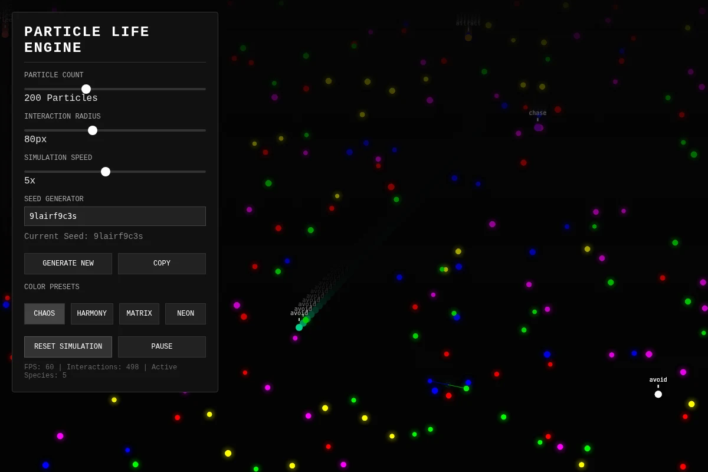
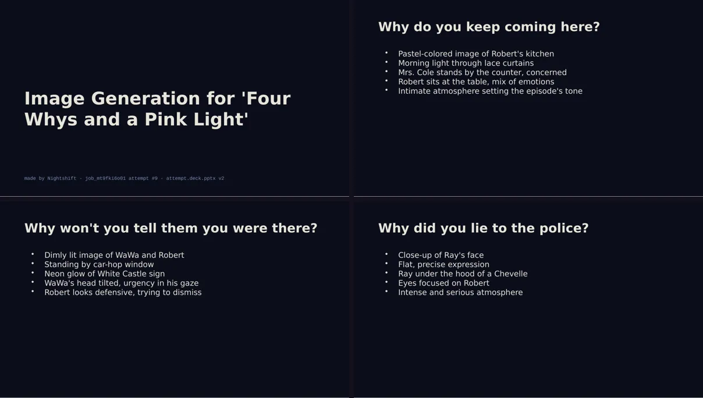
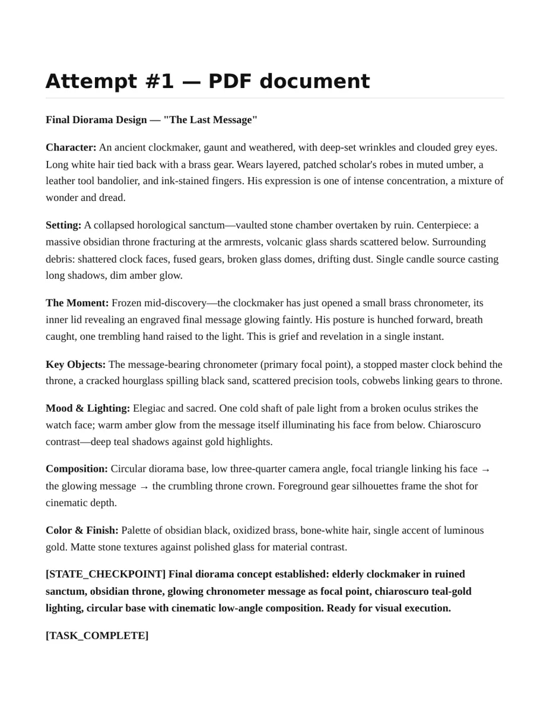

# Overnight gallery: files from real nights

These came out of overnight Nightshift runs on one DGX Spark. Each file is published unmodified on meterless.ai, and its job id, attempt number and SHA-256 hash are in [provenance.json](https://www.meterless.ai/orbit-daylight-assets/provenance.json). The two text files in this folder are byte-identical copies; their hashes match that record.

[All benchmarks](../../README.md) · [Knowledge work examples](../knowledge-work/README.md) · [Nightshift gallery](../../../products/nightshift/gallery.md)

## In this folder

| File | What it is | Job | Attempt | SHA-256 |
|---|---|---|---:|---|
| [war-room-brief.md](war-room-brief.md) | A ten-section market-entry brief, written and judged across 230 attempts on a local model. Favorited job. | `job_mtdy5a8f09` | 156 | `778cb549…e82c88` |
| [particle-engine.js](particle-engine.js) | A seeded particle engine with no dependencies: three species, one interaction matrix, a deterministic random generator. | `job_mt4c8e3302` | 64 | `78a45fc0…eae13` |

## Live on meterless.ai

Open these in a browser. They are the original files.

<table>
  <tr>
    <td width="33%" valign="top"> <b>A cistern, lit from above</b> One HTML file, no libraries. <code>job_mt5do3q303</code>, attempt 148 of 200. <a href="https://www.meterless.ai/orbit-daylight-assets/cistern.html">Enter the scene ↗</a></td>
    <td width="33%" valign="top"> <b>The Atlas of Small Attractions</b> A world to play in, in a single file. <code>job_mtpechkc03</code>, attempt 38. <a href="https://www.meterless.ai/orbit-daylight-assets/atlas.html">Play it ↗</a></td>
    <td width="33%" valign="top"> <b>A small universe, your rules</b> Change the seed and tune the forces. <code>job_mt42qc9m01</code>, attempt 5. <a href="https://www.meterless.ai/orbit-daylight-assets/particle-life.html">Run it ↗</a></td>
  </tr>
  <tr>
    <td width="33%" valign="top"> <b>After hours, and a scene scored</b> Clip from attempt 17, score from attempt 9. <code>job_mtb79ykt04</code>. <a href="https://www.meterless.ai/orbit-daylight-assets/after-hours.mp4">Watch ↗</a> · <a href="https://www.meterless.ai/orbit-daylight-assets/scene-score.wav">Listen ↗</a></td>
    <td width="33%" valign="top"> <b>Six slides, one shot list</b> A deck that opens in PowerPoint or Keynote. <code>job_mt9fki6o01</code>, attempt 9. <a href="https://www.meterless.ai/orbit-daylight-assets/shot-list.pptx">Download the deck ↗</a></td>
    <td width="33%" valign="top"> <b>The brief behind the clockmaker</b> A PDF design brief, and the <a href="https://www.meterless.ai/orbit-daylight-assets/clockmaker.png">still</a> made from it. <code>job_mt7nu09v01</code>. <a href="https://www.meterless.ai/orbit-daylight-assets/diorama-brief.pdf">Read the PDF ↗</a></td>
  </tr>
</table>

Some of it is rough. Some of it is ready. Titles were added for the collection; the files were not edited.
