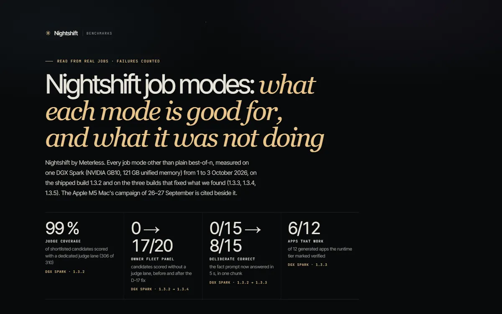

# Job modes

**NVIDIA DGX Spark, GB10 · builds 1.3.2 to 1.3.5 · October 1 to 3, 2026 · Measured**

Every Nightshift job mode beyond best-of-n, measured on ten fixtures with deterministic scorers, three runs per cell: a controlled fleet of three 8B to 14B racers and a dedicated 30B judge lane. Selectors, judges, deliberate, batch, bulk, deadlines, app generation and repair.

[**Read the job-modes report ↗**](https://meterless.ai/Benchmarks/DGX/modes/NIGHTSHIFT_MODES_BENCHMARKS.html) · [Markdown ↗](https://meterless.ai/Benchmarks/DGX/modes/NIGHTSHIFT_MODES_BENCHMARKS.md) · [Mode-by-mode guide](../products/nightshift/job-modes.md) · [All benchmarks](README.md)

| 306 / 310 | 220 / 220 | ~1,000 | 35 |
|:--:|:--:|:--:|:--:|
| shortlisted candidates scored | bulk units correct, 0 duplicates | bulk units an hour | defects fixed, each with a regression test |

---

| Measure | Value |
|---|---|
| Deliberate, correct | 0 of 15, then 8 of 15 |
| Gate repair | 6 of 6 |
| Refine, seeded bugs | 6 of 6 |
| Bulk | 220 of 220 units correct, lossless pause |
| Model-free conversion | 6,700 to 8,300 files an hour |
| Malformed requests refused at submit | 11 of 11, with a reason |
| Generated apps "verified" vs working | 12 of 12 vs 6 of 12 |
| Auto planning | 256 attempts for answers a best-of-4 found in under 2 minutes |

## What is weak

- **"Verified" apps load; 6 of 12 actually worked.**
- **Auto planned 256 attempts per task** for answers a best-of-4 found in under 2 minutes.
- **Three runs per cell cannot rank close settings.** Electricity was not measured.

The same grid of 156 jobs later ran on the Windows PC. Every mode finished in seconds there, and the 3B judge became the ceiling. See [Windows](windows.md).
