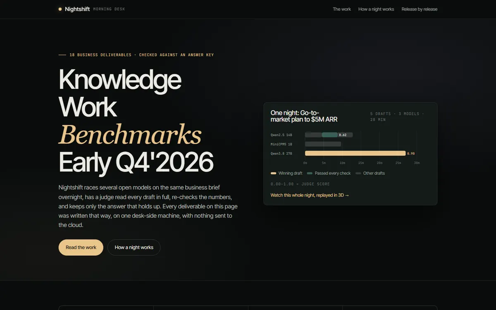
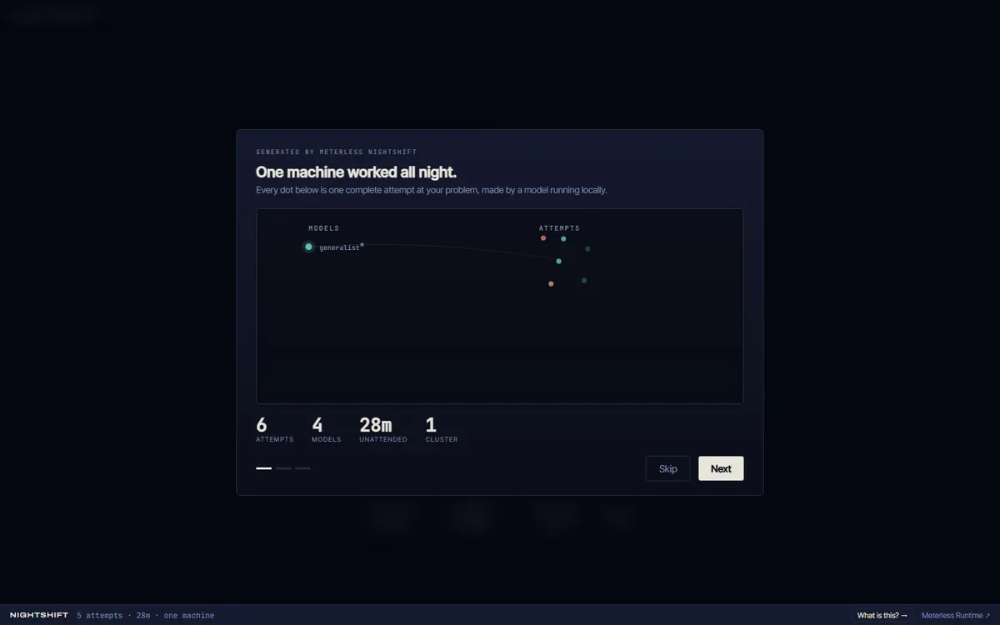

# Knowledge work: the Morning Desk

**One desk-side machine, local only · Nightshift builds 1.2.3 to 1.3.0 · September 23 to 28, 2026 · Measured**

Real business briefs raced overnight by open models. A local judge read every draft in full, proofs re-checked the arithmetic, and each accepted deliverable was confirmed against an answer key. Every deliverable and every night is published.

[**Read the Morning Desk ↗**](https://meterless.ai/Benchmarks/KnowledgeWork/) · [**18 deliverables, verbatim**](examples/knowledge-work/README.md) · [All benchmarks](README.md)

| 18 | 10 | 26 min | 91 | 15,424 |
|:--:|:--:|:--:|:--:|:--:|
| finished deliverables | business functions | each, unattended | drafts, every one judged | words, checked |

---

## Watch a night, then read what it wrote

Each replay opens the exported job in 3D: every draft, every judge score and the winning answer, exactly as Nightshift exported it. Each "read" link opens the deliverable in this repo.

| Deliverable | Build | Judge | Winner | Live replay | Output |
|---|---|---:|---|---|---|
| Go-to-market plan to $5M ARR | 1.3.0 | 0.90 | Qwen3.8 27B | [Replay ↗](https://meterless.ai/Benchmarks/KnowledgeWork/nights/D1-gtm-strategy_1.3.0/index.html) | [Read](examples/knowledge-work/d1-gtm-strategy-1-3-0.md) |
| Incident postmortem | 1.3.0 | 0.85 | Qwen2.5 14B | [Replay ↗](https://meterless.ai/Benchmarks/KnowledgeWork/nights/D3-incident-postmortem_1.3.0/index.html) | [Read](examples/knowledge-work/d3-incident-postmortem-1-3-0.md) |
| Incident postmortem | 1.2.9 | 0.95 | Qwen3.8 27B | [Replay ↗](https://meterless.ai/Benchmarks/KnowledgeWork/nights/D3-incident-postmortem_1.2.9/index.html) | [Read](examples/knowledge-work/d3-incident-postmortem-1-2-9.md) |
| Product launch content pack | 1.3.0 | 0.88 | Qwen3.8 27B | [Replay ↗](https://meterless.ai/Benchmarks/KnowledgeWork/nights/D4-launch-content-pack_1.3.0/index.html) | [Read](examples/knowledge-work/d4-launch-content-pack-1-3-0.md) |
| Pricing and positioning | 1.3.0 | 0.78 | Qwen2.5 14B | [Replay ↗](https://meterless.ai/Benchmarks/KnowledgeWork/nights/D5-pricing-positioning_1.3.0/index.html) | [Read](examples/knowledge-work/d5-pricing-positioning-1-3-0.md) |
| Contract risk register | 1.3.0 | 0.92 | Qwen3.8 27B | [Replay ↗](https://meterless.ai/Benchmarks/KnowledgeWork/nights/D6-contract-risk-register_1.3.0/index.html) | [Read](examples/knowledge-work/d6-contract-risk-register-1-3-0.md) |
| Contract risk register, against a rubric | 1.2.9 | rubric | Qwen3.8 27B | [Replay ↗](https://meterless.ai/Benchmarks/KnowledgeWork/nights/D6b-contract-risk-register-rubric_1.2.9/index.html) | [Read](examples/knowledge-work/d6b-contract-risk-register-rubric-1-2-9.md) |
| Contract risk register, against a rubric | 1.2.7 | rubric | Qwen3.8 27B | [Replay ↗](https://meterless.ai/Benchmarks/KnowledgeWork/nights/D6b-contract-risk-register-rubric_1.2.7/index.html) | [Read](examples/knowledge-work/d6b-contract-risk-register-rubric-1-2-7.md) |
| PRD from customer interviews | 1.3.0 | 0.78 | Qwen2.5 14B | [Replay ↗](https://meterless.ai/Benchmarks/KnowledgeWork/nights/D7-prd-from-interviews_1.3.0/index.html) | [Read](examples/knowledge-work/d7-prd-from-interviews-1-3-0.md) |
| Security RFP answers | 1.3.0 | 0.95 | Qwen3.8 27B | [Replay ↗](https://meterless.ai/Benchmarks/KnowledgeWork/nights/D9-rfp-security-response_1.3.0/index.html) | [Read](examples/knowledge-work/d9-rfp-security-response-1-3-0.md) |
| Security RFP answers | 1.2.9 | 0.92 | Qwen2.5 14B | [Replay ↗](https://meterless.ai/Benchmarks/KnowledgeWork/nights/D9-rfp-security-response_1.2.9/index.html) | [Read](examples/knowledge-work/d9-rfp-security-response-1-2-9.md) |
| Security RFP answers | 1.2.7 | 0.85 | Qwen2.5 14B | [Replay ↗](https://meterless.ai/Benchmarks/KnowledgeWork/nights/D9-rfp-security-response_1.2.7/index.html) | [Read](examples/knowledge-work/d9-rfp-security-response-1-2-7.md) |
| Hiring pack | 1.3.0 | 0.95 | Qwen3.8 27B | [Replay ↗](https://meterless.ai/Benchmarks/KnowledgeWork/nights/D10-hiring-pack_1.3.0/index.html) | [Read](examples/knowledge-work/d10-hiring-pack-1-3-0.md) |
| Hiring pack | 1.2.9 | 0.92 | Qwen3.8 27B | [Replay ↗](https://meterless.ai/Benchmarks/KnowledgeWork/nights/D10-hiring-pack_1.2.9/index.html) | [Read](examples/knowledge-work/d10-hiring-pack-1-2-9.md) |
| Churn cohort analysis | 1.3.0 | 0.95 | Qwen3.8 27B | [Replay ↗](https://meterless.ai/Benchmarks/KnowledgeWork/nights/D11-churn-analysis_1.3.0/index.html) | [Read](examples/knowledge-work/d11-churn-analysis-1-3-0.md) |
| Churn cohort analysis | 1.2.7 | 0.90 | Qwen2.5 14B | [Replay ↗](https://meterless.ai/Benchmarks/KnowledgeWork/nights/D11-churn-analysis_1.2.7/index.html) | [Read](examples/knowledge-work/d11-churn-analysis-1-2-7.md) |
| Company OKRs from strategy | 1.3.0 | 0.95 | Qwen3.8 27B | [Replay ↗](https://meterless.ai/Benchmarks/KnowledgeWork/nights/D13-okrs-from-strategy_1.3.0/index.html) | [Read](examples/knowledge-work/d13-okrs-from-strategy-1-3-0.md) |
| Release notes in three languages | 1.3.0 | 0.92 | Qwen3.8 27B | [Replay ↗](https://meterless.ai/Benchmarks/KnowledgeWork/nights/D14-localized-release-notes_1.3.0/index.html) | [Read](examples/knowledge-work/d14-localized-release-notes-1-3-0.md) |

One proof from the go-to-market night, judge 0.90, 28 minutes: $3.1M × 108% = $3.348M retained → $1.652M new ARR → 76 new logos → 245 opportunities at a 31% win rate.

| Measure | Value |
|---|---|
| Verified per run, by build (1.2.3, 1.2.7, 1.2.9, 1.3.0) | 0, 3, 4, 11 |
| Winning models | Qwen3.8 27B won 12 of 18. Qwen2.5 14B won 6. |
| Security RFP answers, build over build | judge 0.85, 0.92, 0.95. Time 27.8 to 19.8 min. |
| Judge | a local model, Muse-Glimmer-30B. Answer keys are curated facts per brief. |

## What is weak

- **Some deliverables carry dates the models invented.** They are left as written in the examples.
- **One brief got worse.** The postmortem scored lower on the newer build (0.95 to 0.85).
- **18 deliverables come from 12 distinct briefs**, one night each.
