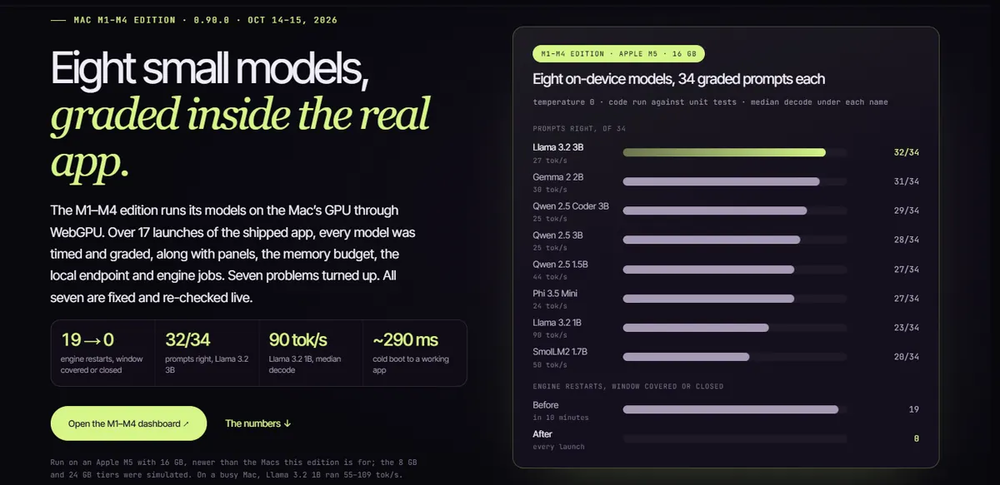
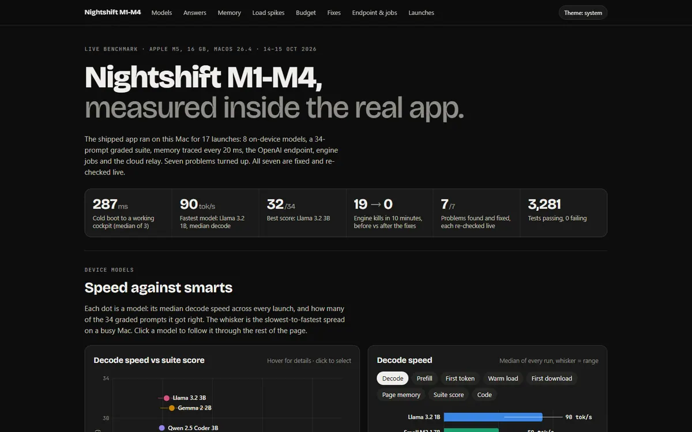

# Mac M1 to M4 edition

**Nightshift M1-M4 0.90.0 · run on an Apple M5, 16 GB, macOS 26.4 · October 14 to 15, 2026 · Measured**

The free Mac app for M1 to M4 chips runs eight small models (1B to 4B) on the Mac's GPU through WebGPU. Over 17 launches of the shipped app, every model was timed and graded on 34 prompts, along with multi-model panels, the memory budget, the local OpenAI endpoint, engine jobs and the cloud relay. Seven problems turned up. All seven are fixed and re-checked live.

[**Open the M1 to M4 dashboard ↗**](https://meterless.ai/Benchmarks/MAC/M1-M4/benchmark-dashboard.html) · [Raw files ↗](https://meterless.ai/Benchmarks/MAC/M1-M4/) · [Full results ↗](https://meterless.ai/Benchmarks/MAC/M1-M4/BENCHMARK_RESULTS.md) · [All benchmarks](README.md)

| 19 → 0 | 32 / 34 | 90 tok/s | ~290 ms | 7 / 7 |
|:--:|:--:|:--:|:--:|:--:|
| engine restarts, window covered or closed | prompts right, Llama 3.2 3B | Llama 3.2 1B, median decode | cold boot to a working app | problems found and fixed |

---

## Eight on-device models

| Model | Decode tok/s, median (range) | Prefill tok/s | First token | Warm load | Page memory resident | Suite, of 34 | Code, of 6 |
|---|---|---|---|---|---|---:|---:|
| Llama 3.2 1B | **90** (55 to 109) | 337 to 345 | 0.15 to 0.19 s | 13.6 to 14.4 s | 3.0 GB | 23 | 3 |
| Qwen 2.5 1.5B | 44 (35 to 62) | 200 to 240 | 0.21 to 0.23 s | 14.6 to 15.8 s | 3.0 GB | 27 | 5 |
| SmolLM2 1.7B | 50 (35 to 74) | 192 to 215 | 0.29 to 0.30 s | 13.7 to 20.2 s | 3.3 GB | 20 | 4 |
| Gemma 2 2B | 30 (24 to 48) | 143 to 150 | 0.35 to 0.39 s | 17 to 23 s | 4.5 GB | 31 | 5 |
| Llama 3.2 3B | 27 (23 to 33) | 112 to 121 | 0.45 to 0.49 s | 14.1 to 14.8 s | 4.2 GB | **32** | 5 |
| Qwen 2.5 3B | 25 (23 to 25) | 116 to 122 | 0.47 to 0.48 s | 15.1 to 17.2 s | 3.8 GB | 28 | 4 |
| Qwen 2.5 Coder 3B | 25 (23 to 25) | 115 to 123 | 0.48 s | 15.3 to 17.1 s | 3.9 GB | 29 | **6** |
| Phi 3.5 Mini | 24 (21 to 31) | 91 to 100 | 0.63 to 0.70 s | 13.5 to 18.3 s | 5.0 GB | 27 | 3 |

34 prompts at temperature 0, graded offline. Code answers were run against unit tests. On this hardware the 2B to 3B models are the sweet spot: Llama 3.2 3B and Gemma 2 2B are nearly equal in quality.

## Seven problems, seven fixes

| # | Problem | Verified live after the fix |
|---:|---|---|
| 1 | WebKit killed the whole engine whenever the window was covered or closed, taking every running job with it: 19 kills in 10 minutes | 0 restarts with the window covered or closed; closing the window now parks it |
| 2 | The memory budget allowed model sets that WebKit then killed | panels capped; the two-model peak was 6.7 GB |
| 3 | Cloud relay models could not be named directly | relay call returns `NIGHTSHIFT OK` in 2.7 to 3.8 s |
| 4 | One test failed only on macOS | passes |
| 5 | best_of_n wrapped one-answer questions in creative briefs, so small models refused or went off-topic | "Prime between 10 and 20": 11, 11, 11 in 1.0 s |
| 6 | A request naming an on-device model could send one step to a cloud model | every device-model and `meterless/local` request was `local-only` |
| 7 | Loading a model briefly swelled the page past WebKit's memory line | time above the line per load: about 0.85 s down to 0.05 s |

| Also measured | Result |
|---|---|
| Build and tests | 3,281 of 3,285 JS tests pass, 0 fail, 4 skipped |
| Cold boot | cockpit mounted in about 290 ms, engine ready in about 200 ms, 0 page errors |
| First download | 8 models, 11.5 GB, 1 h 52 min on a slow connection, no failures |

## What is weak

- **Measured on an M5**, newer than the Macs this edition is for. The 8 GB and 24 GB tiers were simulated; at 8 GB, Phi 3.5 is refused before download.
- **On 1B to 1.5B models, deliberate jobs hit the 24-step limit.**
- **A busy Mac swings speed.** VS Code, Chrome, Slack and other agents ran beside it; Llama 3.2 1B ran 55 to 109 tok/s across launches.
- **A development build:** ad-hoc signed, not notarized.

Not yet published: the M1 to M4 edition on an actual M1 to M4 Mac.
