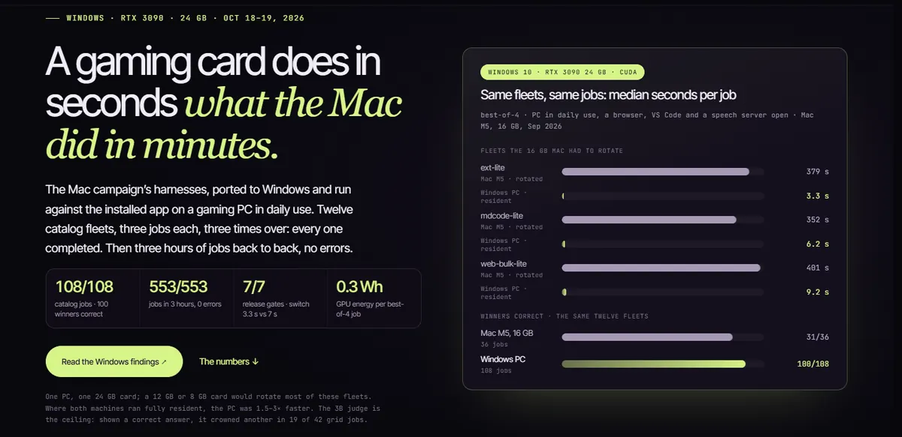
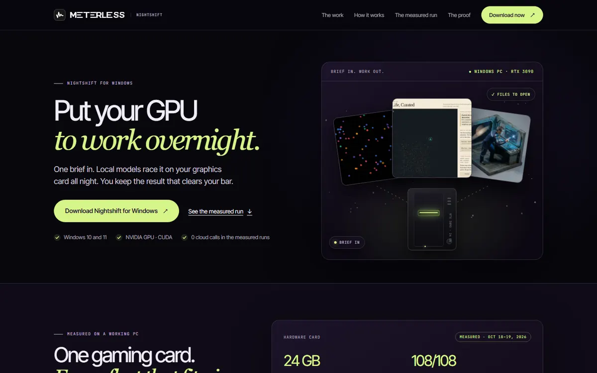
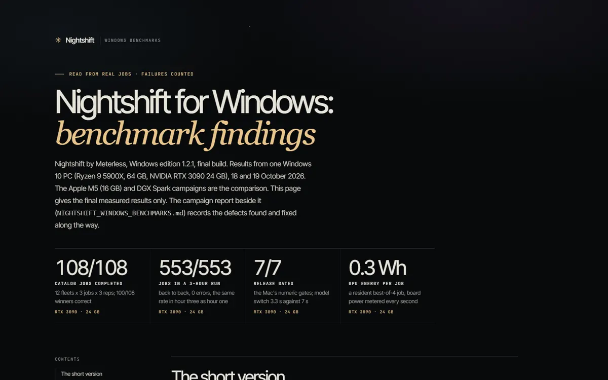

# Windows PC, RTX 3090

**Nightshift Windows edition 1.2.1 · Windows 10 Pro 22H2 · NVIDIA RTX 3090 24 GB · October 18 to 19, 2026 · Measured**

The Mac campaign's harnesses, ported to Windows and run against the installed app on a gaming PC in daily use. A browser, VS Code and a speech server stayed open the whole time.

[**Read the Windows findings ↗**](https://meterless.ai/Benchmarks/WIN/NIGHTSHIFT_WINDOWS_FINDINGS.html) · [Raw files ↗](https://meterless.ai/Benchmarks/WIN/) · [Nightshift for Windows ↗](https://www.meterless.ai/windows.html) · [All benchmarks](README.md)

| 108 / 108 | 100 / 108 | 553 / 553 | 7 / 7 | 0.3 to 0.4 Wh |
|:--:|:--:|:--:|:--:|:--:|
| catalog jobs completed | crowned winners correct (93%) | jobs in a 3-hour run, 0 errors | the Mac's release gates | GPU energy per resident best-of-4 job |

---

## Same fleets, same jobs, against the 16 GB Mac

| Fleet | Winners correct, of 9 | Candidates correct, of 36 | PC median s per job | Plan | GPU Wh per job | Mac M5 median s per job |
|---|---:|---:|---:|---|---:|---:|
| starter-16 | 8 | 33 | 3.7 | concurrent | 0.26 | 12 |
| percept-lite | 9 | 32 | 9.1 | concurrent | 0.61 | 6 |
| asr-factory | 6 | 22 | 10.3 | concurrent | 0.80 | 30 |
| xfer-lite | 8 | 33 | 6.1 | concurrent | 0.41 | 9 |
| ext-lite | 7 | 30 | 3.3 | concurrent | 0.18 | 379 |
| agentcode-lite | 9 | 29 | 9.4 | concurrent | 0.74 | 400 |
| migrate-lite | 9 | 36 | 6.2 | concurrent | 0.41 | 141 |
| testgen-lite | 9 | 26 | 33.2 | batched | 2.38 | 444 |
| mdcode-lite | 9 | 36 | 6.2 | concurrent | 0.45 | 352 |
| ops-lite | 8 | 29 | 27.6 | batched | 2.40 | 472 |
| web-bulk-lite | 9 | 36 | 9.2 | batched | 0.60 | 401 |
| ext-core | 9 | 35 | 21.2 | batched | 1.32 | 84 |
| **All twelve** | **100 / 108** | **377 / 432** | **3 to 33** | 8 resident, 4 rotating | **1.04 mean** | **6 to 472** (31 / 36 correct) |

12 fleets × 3 jobs × 3 repetitions, best-of-4, 1B to 8B models (`fleets/w5-r1..r3` in the findings). "Winners correct" scores the attempt Nightshift crowned, not the best one it had.

- **Residency decides speed.** Eight fleets kept every lane on the card at once and finished in 3 to 10 s. The four that rotate spent about 21 s of each job switching models.
- **Where both machines ran fully resident**, the PC was 1.5 to 3× faster. That is decode speed, not planning.
- **Selection adds a little on an easy suite.** The crowned winner was correct 93% of the time, against 87% for a random attempt.

## Three machines side by side

| | Mac M5, 16 GB | Windows PC, RTX 3090 24 GB | DGX Spark, 128 GB |
|---|---|---|---|
| Memory for models | about 8.6 GB granted live | 24 GB VRAM, packed against what is free, RAM as spill | 106 GB allocatable |
| Fleet | about 10 GB resident; most fleets rotate | five or six 1B to 8B lanes; 8 of 12 fleets fully resident | three 27B to 32B lanes, an embedder and a media server |
| Decode | 120 to 144 tok/s on a 1B | 190 to 355 tok/s on a 1B · 50 to 70 on an 8B | 6.2 to 7.7 tok/s per 27B to 32B lane |
| Same 12 fleets | 36 / 36 completed · 31 / 36 correct · 6 to 472 s | 108 / 108 completed · 100 / 108 correct · 3 to 33 s | not run on this suite |
| Cloud spend | $0.00 | $0.00 | $0.00 |

## Everything else that ran

| Measure | Windows | Mac M5 |
|---|---|---|
| Sustained 3-hour run, best-of-6 | **553 / 553 jobs**, 3,318 attempts, 0 errors, 185, 188 and 180 an hour, lane memory flat at 20.3 GB | 301 / 301 jobs (1B rotation) |
| Release gates | **7 / 7 pass**; generation 115 tok/s; model switch median 3.3 s against a 7 s gate | 7 s gate |
| Judge panel shown a correct candidate | 42 of 45 jobs; crowned one in 23 | raw grid: 32 of 45 |
| Bulk, 20 receipts × 9 jobs | **180 / 180 units, 179 correct**, about 3,300 to 12,600 units an hour | 1,436 to 3,918 units an hour |
| Refine a seeded off-by-one | 6 of 6 fixed, 2 to 7 s each | |
| Watcher and schedule | 3 changes, 3 fires, 0 false, 0 duplicates; schedule 9 of 9 | |
| Restart with queued work | `/health` answered 289 of 289 probes over 5 min; p95 104 ms | |
| Crash mid-chain (`taskkill /F`) | engine host restarted itself; chain re-ran from chunk 1 and completed | |
| Heat brake | 0 engagements in normal work; held the card at 76 °C under an 80 °C owner limit | |
| Auto, n = 256 as planned | 521 s, winner wrong (20 of 256 right) | 50.7 min, wrong |
| Test suites, final build | JS 4,385 pass, 0 fail, 27 skipped · Rust 415 pass, 0 fail | |

The hardware: AMD Ryzen 9 5900X, 64 GB RAM, NVIDIA GeForce RTX 3090 24 GB (driver 560.94), Windows 10 Pro 22H2, Windows edition 1.2.1 build 13. Lanes run CUDA through the app's own llama.cpp build: flash attention, q8_0 KV cache, every layer on the GPU. Models on the internal NVMe drive.

## What is weak

- **The judge is the ceiling.** Shown a correct answer, the 3B judge still crowned another in 19 of 42 grid jobs. asr-factory seats only a 1B router and a 3B verifier, neither of which can judge, so its panels came back unparseable. The 8 wrong winners: asr-factory 3, ext-lite 2, starter-16, xfer-lite and ops-lite 1 each.
- **"Verified" for a generated app means it parses.** 10 of 12 apps were verified and 6 worked.
- **Synthesis needs room.** The 8B curator rarely fit beside the fleet: 133 of 553 jobs got a synthesis.
- **Not tested.** One PC, one card. A 12 GB or 8 GB card would rotate most fleets. No image, video or music weights were installed. The 7 catalog fleets that need 12B to 14B models were not run. A 24 GB card holds no 27B to 32B model beside anything else. Wall-socket power was not measured; energy is the GPU board only.
- **The installer stops every `llama-server.exe` on the PC**, not only Nightshift's.

 

Source: [NIGHTSHIFT_WINDOWS_FINDINGS](https://meterless.ai/Benchmarks/WIN/NIGHTSHIFT_WINDOWS_FINDINGS.html) ([Markdown](https://meterless.ai/Benchmarks/WIN/NIGHTSHIFT_WINDOWS_FINDINGS.md), [figures](https://meterless.ai/Benchmarks/WIN/figs-findings.json)). Failures, refusals and timeouts stay in the denominators.
