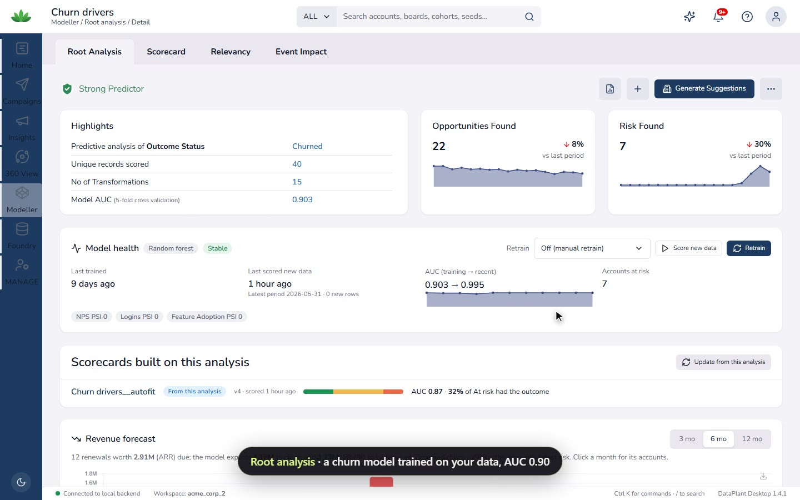
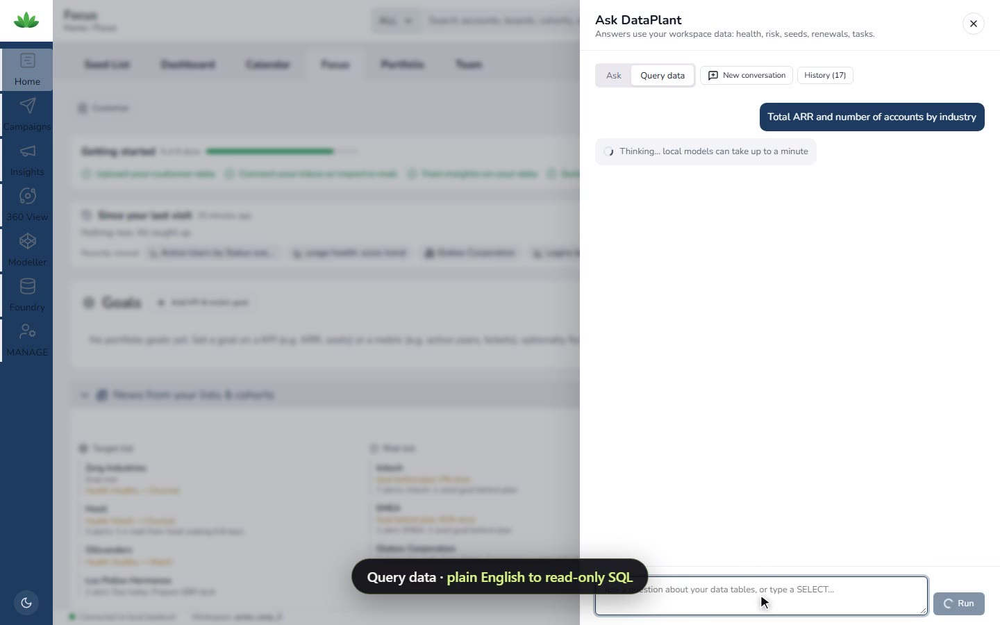
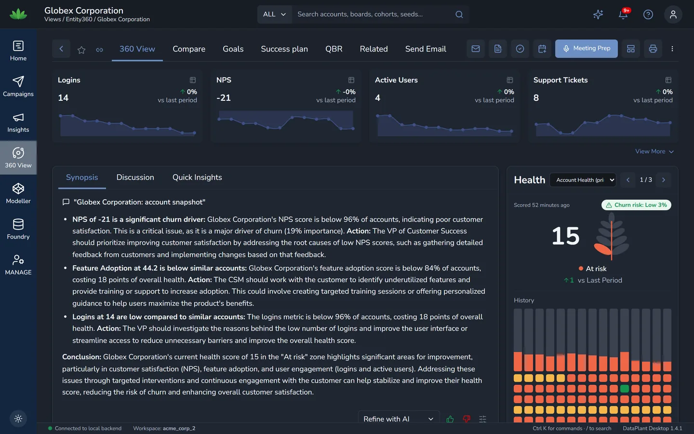
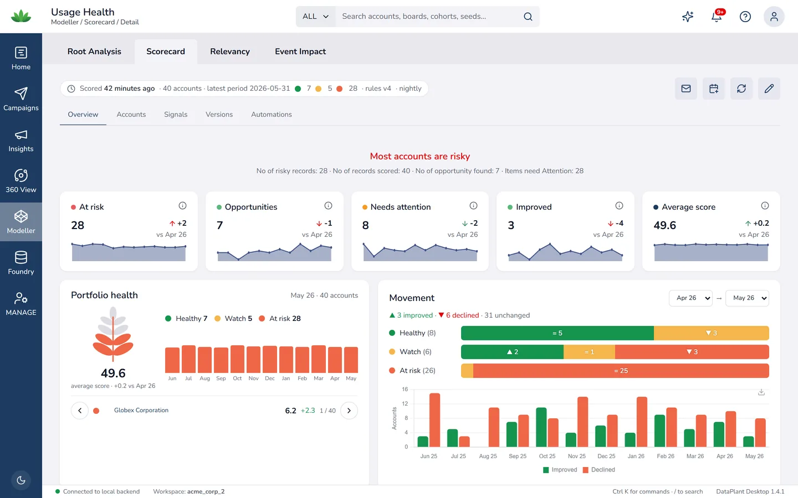
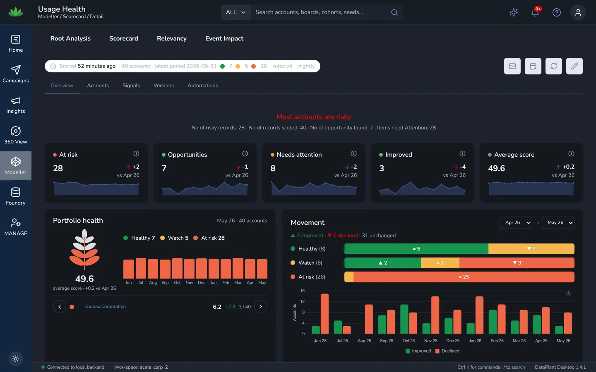

# DataPlant

**Know who's leaving before they do.**

The whole DataPlant customer-success platform, running on your own machine. Health scores, churn models, 360 views, and an assistant that answers from your data on your own models.

v1.4.1 · Windows 10 and 11 · no account · no cloud required · [meterless.ai/dataplant](https://meterless.ai/dataplant.html) · [Source on GitHub](https://github.com/meterless/dataplant)

Screen recording of DataPlant 1.4.1 on one Windows machine, with a 40-account sample workspace and a local model. <a href="media/tour.mp4">Play the tour</a>

| Demo workspace | |
|---|---|
| Accounts | 40 |
| ARR tracked | $2.67M |
| Relevant insight cards | 202 of 426 |
| Actions logged in 24 hours | 3,303 |
| Churn model AUC (5-fold CV) | 0.903 |
| Accounts at risk, scored nightly | 28 of 40 |
| Bytes sent to the cloud | 0 |

## Background jobs

A local job runner re-scores health, re-predicts churn, rebuilds cohorts and writes summaries whenever the data changes.

1. Re-score and re-predict after every upload or sync.
2. Write the 360 synopsis for each account on your model, in the background.
3. Send what is due: scheduled campaigns, digests, follow-up steps.

An excerpt of its actual log:

| Time | Job | Result |
|---|---|---|
| 02:00 | Re-score scorecards after a data change | success · 5 s |
| 02:00 | Predict after a data change | success · 5 s |
| 02:01 | Rebuild cohort fact | success · 11 s |
| 02:01 | Generate KPI insight cards | success · 20 s |
| 02:03 | Write 360 synopsis on the local model | success · 1 min 32 s |
| 07:00 | Executive Review insights digest | sent |

## Ask DataPlant

Ask DataPlant answers questions about your own accounts. Answers are grounded in your health scores, churn predictions, renewals and seed lists. Pointed at the Meterless Runtime, the model runs on hardware you own: Qwen 2.5 14B, about 25 s per answer, 0 cloud calls.

<table>
  <tr>
    <td width="50%">Query data: plain English to a read-only SELECT · <a href="media/query-data.mp4">play</a></td>
    <td width="50%">Account 360 with a locally written synopsis</td>
  </tr>
  <tr>
    <td width="50%">Usage health scorecard, light</td>
    <td width="50%">The same scorecard, dark</td>
  </tr>
</table>

## What the installer includes

The app starts its own PostgreSQL, boots the DataPlant backend and opens the interface. Your data lives in one folder you can see. AI is optional, and you choose where it runs.

| Layer | What ships |
|---|---|
| Database | PostgreSQL 17, embedded, on a private port with its own credentials |
| AI | Meterless Runtime, OpenAI, Anthropic, Gemini, OpenRouter or any OpenAI-compatible server. Or none: offline summaries still work. |
| Imports | CSV, Salesforce, HubSpot, Zendesk, S3, Slack, Google, Dynamics and Gmail Takeout |
| Modules | Home, Insights, 360, Modeller, Foundry, Campaigns, Manage |

## From cloud to desktop

DataPlant began as a cloud platform for customer-success teams at [thedataplant.com](https://thedataplant.com). Meterless DataPlant is that platform rebuilt to run on one machine: every module, your data in a folder on your PC, your own model or a local one through the Meterless Runtime. Free, with a Windows installer and no account.

Recordings use a sample workspace. Company names are fictional. Runs on [Nightshift](../../products/nightshift/README.md).
