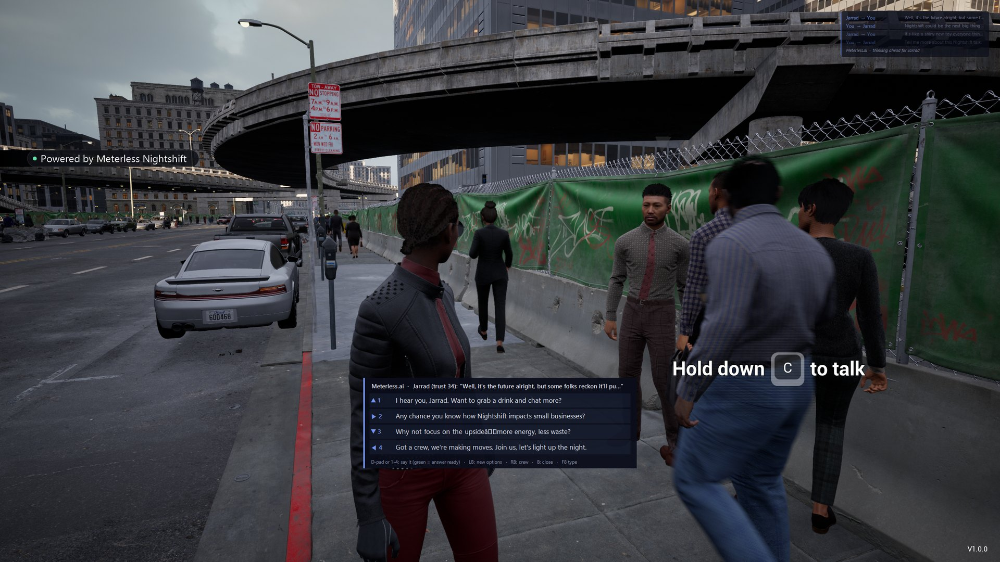
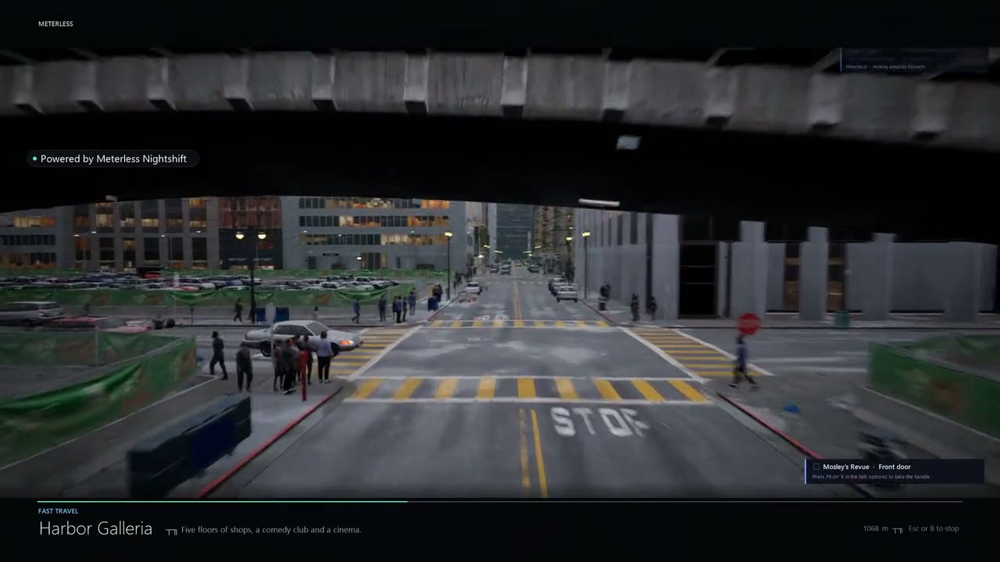
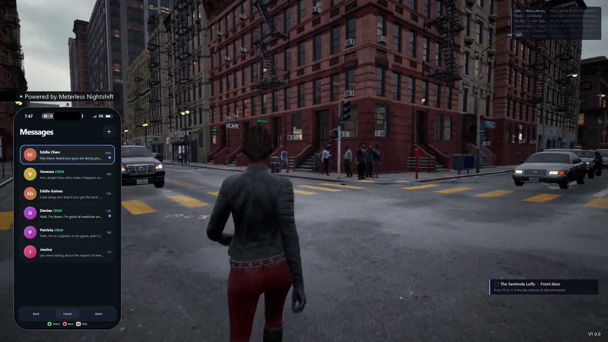

# Meterless City

**The city talks back. And remembers.**

Walk up to anyone in a photoreal city and talk out loud. They answer in their own voice, remember you next time, gossip about you to their friends, and might join your crew. Every line runs on your own Meterless Runtime, so nobody gets a bill.

Free on Steam · Windows · [meterless.ai/city](https://meterless.ai/city.html)

Recorded in play on one PC, with the Meterless Runtime on a second machine on the same network. The voices, replies, choices and memories are real output, not scripted. <a href="media/hold-c-to-talk.mp4">Play the clip</a> · <a href="https://meterless.ai/city.html">watch the full trailer</a>

## Talk is the whole game

Conversation is the core mechanic. What you say moves trust. Trust brings people into your crew. Your crew earns money, influence and rumors, and the whole city sees you through those numbers.

<table>
  <tr>
    <td width="50%">Talk to anyone. Voice, four suggested lines, instant replies.</td>
    <td width="50%">Phone up, city moving. Text anyone you have met and they text back with their memory of you.</td>
  </tr>
</table>

- **The phone.** Press L3. 31 apps: the city's front page, fight-night bets, crashpads, cars, crews. Adding an app means dropping one HTML file in a folder.
- **On the move.** Walk, jog, fly a drone, ride along in traffic, or take one of three subway lines. The people you pass still answer when you speak.
- **The city.** Greenwood, as it might have been: an alternate history where the 1917 and 1921 mobs were stopped and the 1923 Restitution Act paid what was owed. A century later Greenwood is a Chicago-sized city, and its people have opinions about everything.

## How a small model keeps up

The city runs on an 8B model on a home runtime. The systems around the model do most of the work. These are the Meterless engines doing that work inside the city.

| System | What it does |
|---|---|
| [Markovian](../../../engines/markovian/) | The 100th line costs what the first did. Each person carries a bounded state (completed, remaining, decisions, context) plus the last four turns, never the whole transcript. |
| [H-MEM](../../../engines/hmem/) | They remember last week. Short-term, working and long-term memory, with a sleep cycle that consolidates old episodes into chapters. An hour of play is a memory day. |
| [World Model](../../../engines/world-model/) | Every fact has a source. Who said what, who joined whom, who was sent where: an event log with provenance and relationships that change over time. The phone shows you all of it. |
| Think-ahead | Answers ready before you ask. While you walk, Meterless writes the lines you might say to the people near you, their answer to each, and the voice clip. Ready lines show green and play at once. |
| Multi-ask, multi-reply | Ask three things at once. Questions are split and each one answered, in up to three beats. |
| One runtime | The city reaches your runtime over one OpenAI-compatible URL. Text generation never falls back to a metered cloud. Local hearing falls back to Whisper on your GPU. |

## Cost per hour

| | Per active hour |
|---|---|
| NPC turns | ~700 |
| Answered instantly from Meterless-written pools | 66% |
| Local Whisper hearing per line | ~0.5 s |
| On your Meterless Runtime (electricity under load) | $0.02 to $0.06 |
| Same workload on metered cloud APIs | $0.46 to $6.60 |

About 445 model calls, 22,500 characters of speech and 3 minutes of transcription per active hour, at mid-2026 list prices. Estimates from play logs of 2,347 NPC turns on October 2, 2026. Cloud prices change often.

## What you need

Windows 10 or 11 with a modern NVIDIA GPU, a microphone (optional), and a Meterless Runtime on the same PC or on a second machine with hotspot mode on. Paste its connect link once and the city finds it. No microphone? Pick one of four lines Meterless writes for the moment: friendly, curious, bold, or a change of subject.

| Do this | Keyboard | Controller |
|---|---|---|
| Talk out loud | Hold C | Hold talk |
| Four things to say | Tap C, pick 1 to 4 | R3, D-pad picks, LB rerolls |
| Type anything | F8 | n/a |
| Your crew | F6 | RB in the options |
| Phone | F5 | L3 |
| Map, fast travel, subway | M | Phone, then Maps |

Meterless City is an experiment from Meterless. It runs on Epic Games' City Sample and gives new life to the Smart NPCs demo, whose original hosted service shut down. It is not affiliated with or endorsed by Epic Games or Replica Studios. Characters, places and events in Greenwood are fictional.

Runs on [Nightshift](../../products/nightshift/README.md), one AI hotspot for every app you use.
