# Sitcomify

**Turn any photo into a 90s sitcom pilot.**

Upload a photo. Sitcomify reads it like a network executive, writes a series bible, casts a world model of characters, props and running gags, then films four 4:3 scenes on a multi-camera set. Roll camera on any scene to turn it into a clip.

v0.2.0 · Web · Windows · CLI · MCP · [Open the web app](https://meterless.ai/Apps/Sitcomify/) · [Source on GitHub](https://github.com/meterless/Sitcomify)

<table>
  <tr>
    <td width="40%">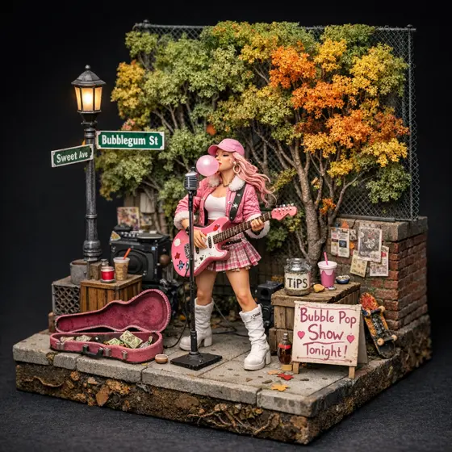<sub>The photo in</sub></td>
    <td width="60%"><a href="media/scene-1-clip.mp4">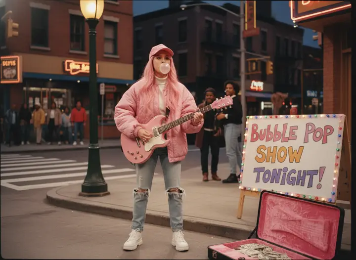</a><sub>Scene 1, The Pilot Performance · <a href="media/scene-1-clip.mp4">play the clip</a></sub></td>
  </tr>
</table>

## From photo to pilot

Four roles do the work, and each one can be a different model. The output below is a real pilot made from the photo above. Nothing was retouched, re-ordered or written by hand.

| Step | Role | What happens |
|---|---|---|
| 01 · Read the photo | Analyze | Visual forensics: who is in it, what they wear, where they are, what is funny about it |
| 02 · Write the bible | Write | Title, tagline and setting, plus a world model of characters, props, locations, themes, plot points and punchlines |
| 03 · Film the pilot | Image | Four scenes rendered as 4:3 multi-camera frames, with each character described the same way every time |
| 04 · Roll camera | Video | Press Action on any scene to animate its frame into a clip, in the background while you keep writing |

**Sweet Street Beats.** "She's got the rhythm, the pink, and a whole lot of gum." A vibrant, slightly stylized urban street corner in the fictional city of Popville, circa 1996. 4 scenes, 14 entities, 3 clips.

<table>
  <tr>
    <td width="33%">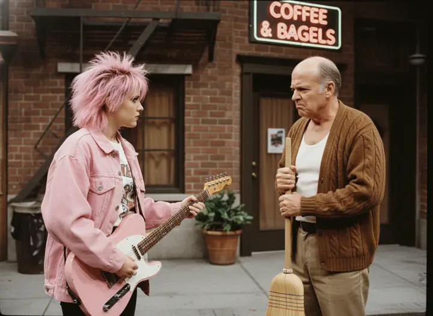<sub>Scene 2 · The Grumpy Landlord</sub></td>
    <td width="33%"><a href="media/scene-3-clip.mp4">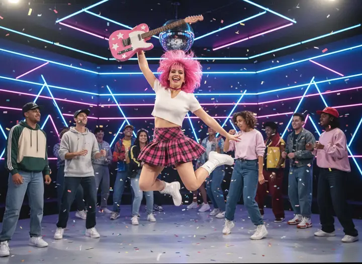</a><sub>Scene 3 · The Big Break · <a href="media/scene-3-clip.mp4">clip</a></sub></td>
    <td width="33%"><a href="media/scene-4-clip.mp4">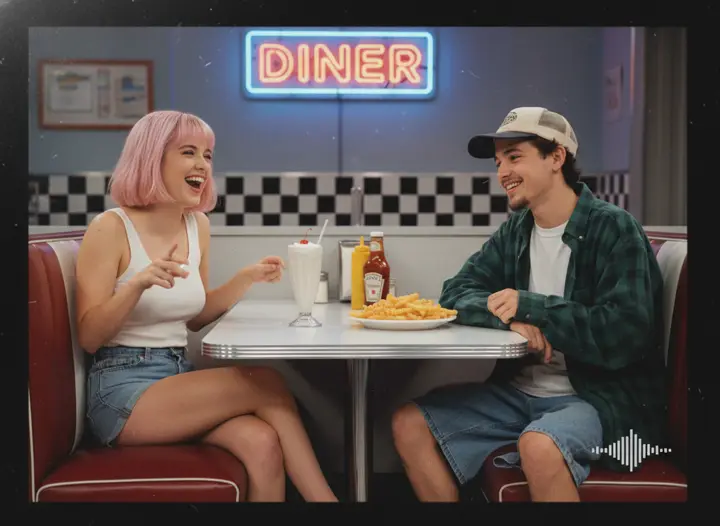</a><sub>Scene 4 · Manager Woes · <a href="media/scene-4-clip.mp4">clip</a></sub></td>
  </tr>
</table>

## Directing scenes and Dream Mode

Type a direction and mention the cast with `@`. The writers pull each entity's description from the world model, so Candy still looks like Candy in scene twelve. Or switch on Dream Mode and the showrunner model reads the bible and the scenes so far, picks a plot point or punchline from the world model, and shoots it. Leave it running and come back to an episode.

<table>
  <tr>
    <td width="50%">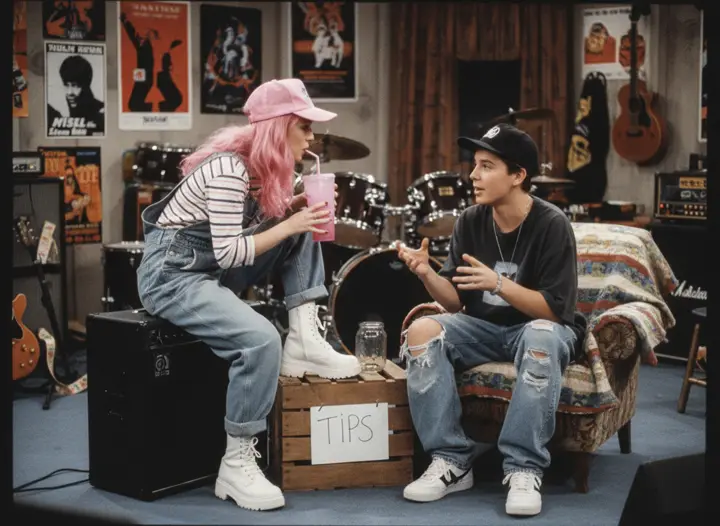<sub>Scene 5 · Backstage at the Curb · directed with @mentions</sub></td>
    <td width="50%">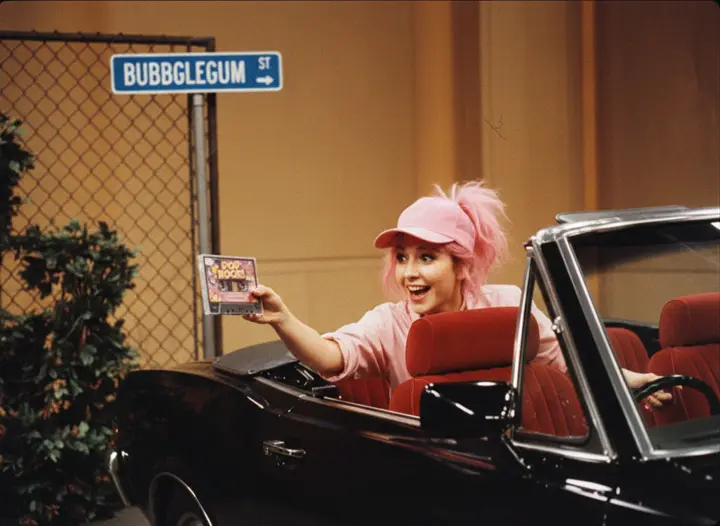<sub>Scene 6 · The Big Break (Almost) · written and filmed by Dream Mode</sub></td>
  </tr>
</table>

- **Grow the world model.** Add, edit or roll a random entity that fits the show. New characters and props become mentionable at once.
- **Reshoot, reorder, cut.** Re-render one frame, drag scenes into a new order, or cut a scene. Every change saves to your library.
- **Batch a whole album.** Pick many photos and Sitcomify makes a pilot for each.

## The studio

<table>
  <tr>
    <td width="33%">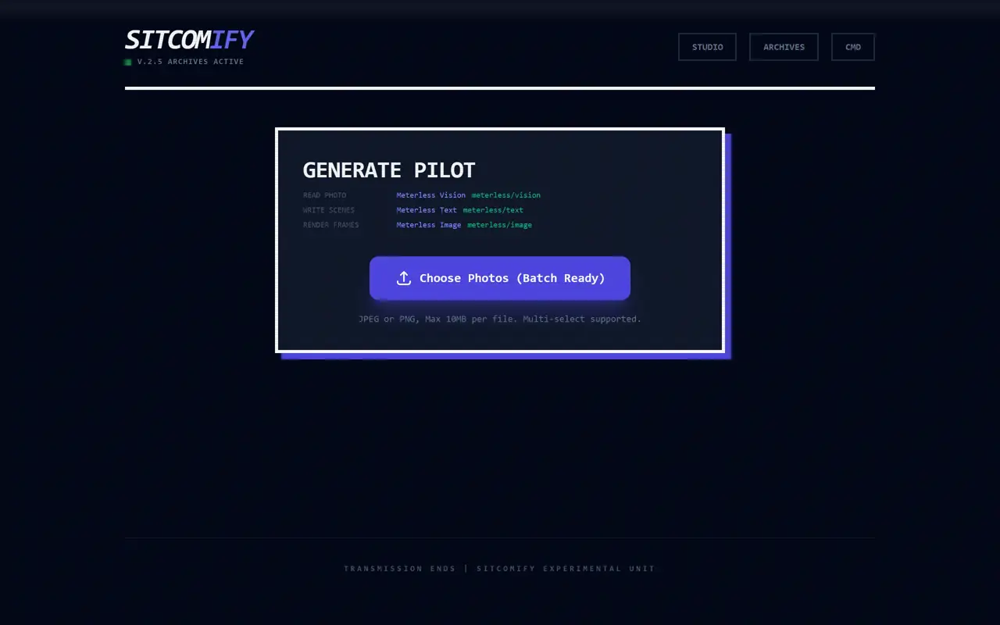<sub>Studio</sub></td>
    <td width="33%">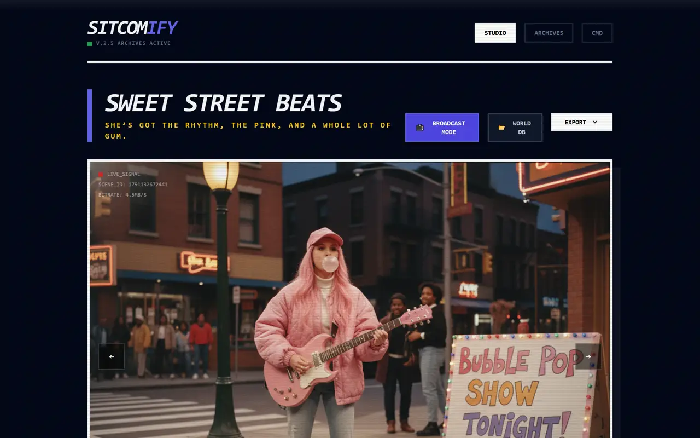<sub>A finished pilot</sub></td>
    <td width="33%">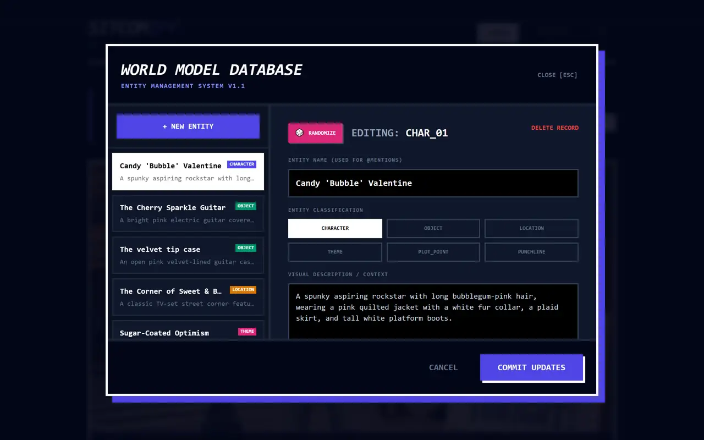<sub>World model database</sub></td>
  </tr>
  <tr>
    <td width="33%">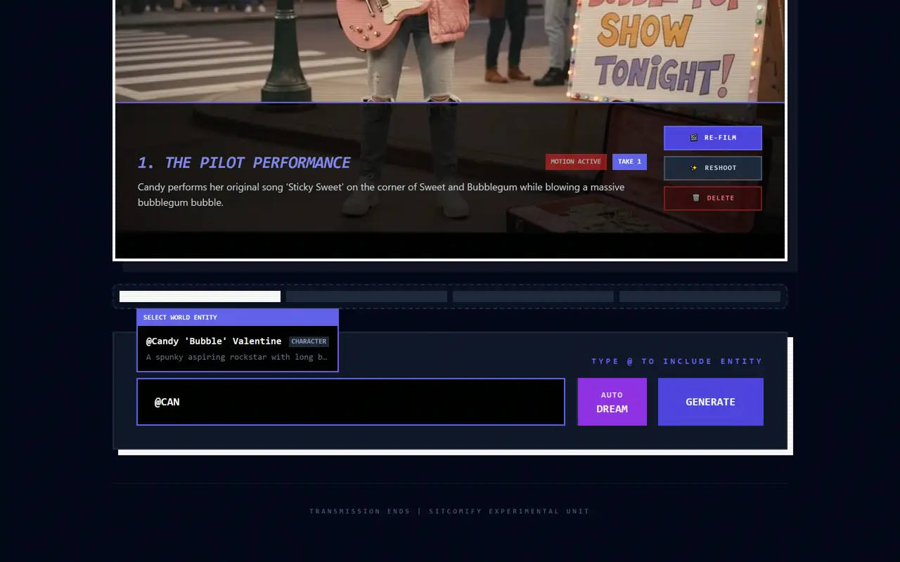<sub>@mentions</sub></td>
    <td width="33%">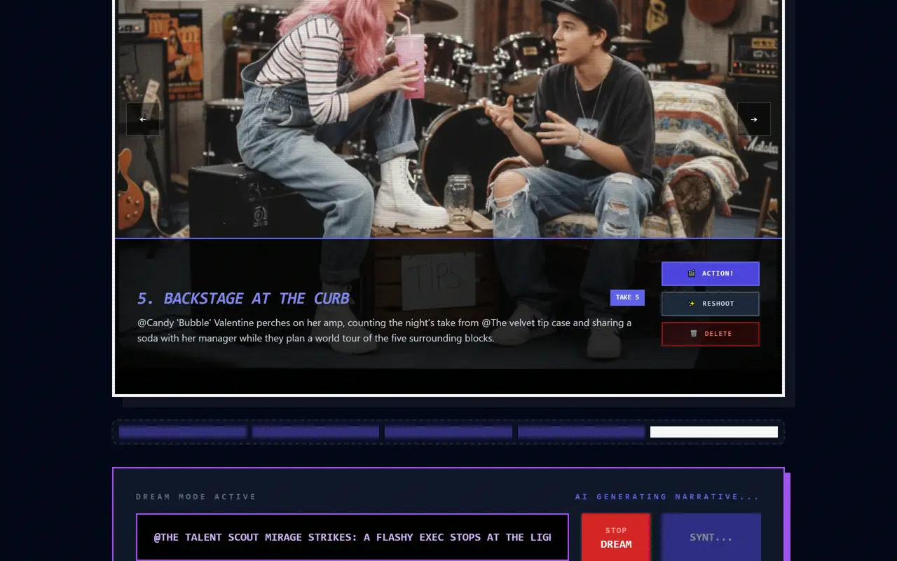<sub>Dream Mode</sub></td>
    <td width="33%">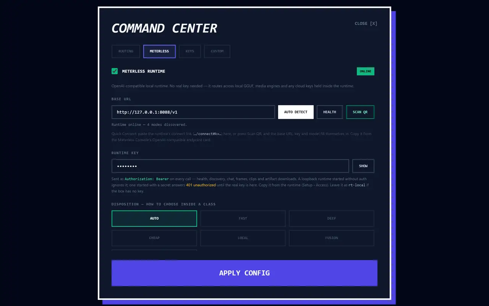<sub>Command Center</sub></td>
  </tr>
  <tr>
    <td width="33%">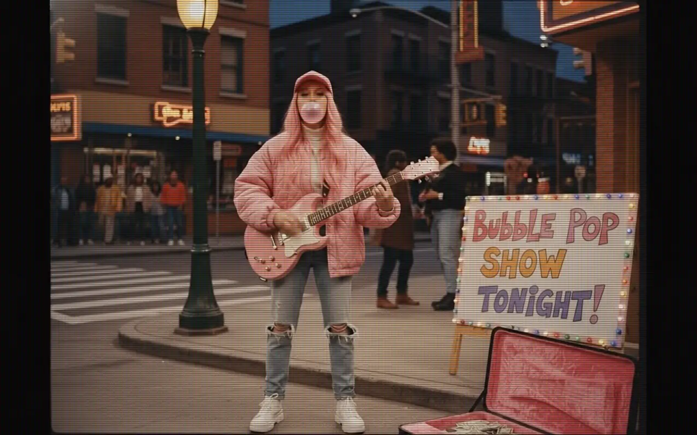<sub>Broadcast Mode</sub></td>
    <td width="33%">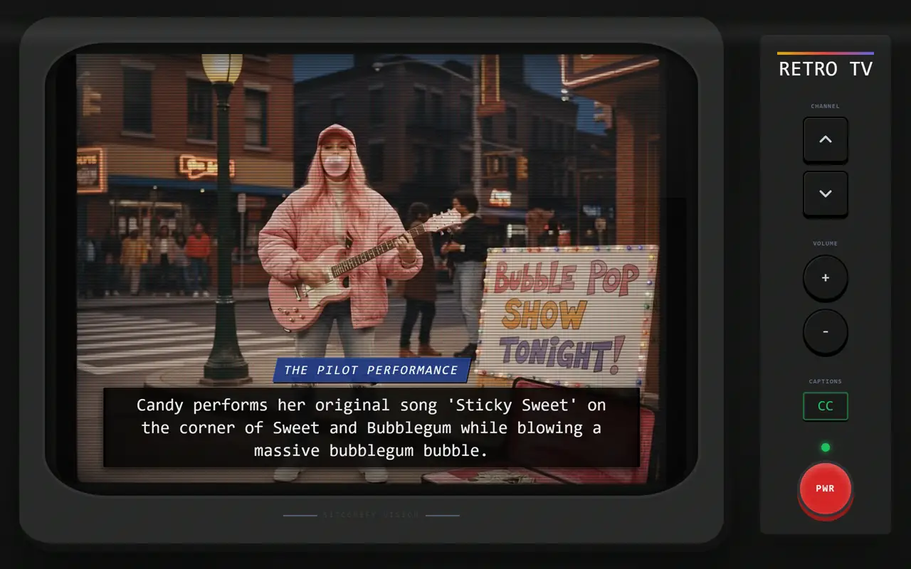<sub>Retro TV</sub></td>
    <td width="33%">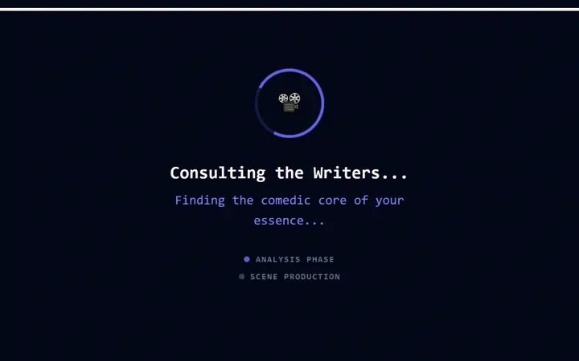<sub>Consulting the writers</sub></td>
  </tr>
</table>

Broadcast Mode plays your pilot full screen with scanlines, Ken Burns stills and your clips. Retro TV channel-surfs your archive on a CRT. Export any show as one self-contained HTML file, or as a JSON archive.

## Command line and MCP

Sitcomify also runs headless. Every action in the app is a CLI command and an MCP tool, built on the same services as the web app.

```bash
claude mcp add sitcomify -- node bin/sitcomify.mjs mcp
sitcomify mcp-config --client codex
```

33 MCP tools, 1:1 CLI commands, `--json` script output. Works with Claude Code, Codex, Cursor, VS Code, Gemini CLI, Windsurf and Claude Desktop. It ships with an Agent Skill, a showrunner subagent for Claude Code, background jobs for long renders, and an on-disk library in `~/.sitcomify`.

## Models and providers

| Role | With Meterless Runtime | Cloud defaults |
|---|---|---|
| Analyze: reads the photo, writes the bible | `meterless/vision` | Gemini 3 Flash, or Gemini 3.1 Pro, OpenAI, Anthropic, OpenRouter, any OpenAI-compatible endpoint |
| Write: next scenes, Dream Mode, new entities | `meterless/text` | Gemini 3 Flash, or Claude, GPT, OpenRouter, custom |
| Image: renders each 4:3 frame | `meterless/image` | Gemini 2.5 Flash Image, or GPT Image, DALL·E 3 |
| Video: turns a frame into a clip | `meterless/video` | Veo 3.1 Fast, or Veo 3.1, Sora, Runway, Luma |

With the Meterless Runtime on your machine Sitcomify needs no cloud key at all. With one Gemini key it covers every role. Your shows stay on your device: in browser storage for the web app and in `~/.sitcomify` for the CLI. A connected cloud provider receives the photo and prompts you send it and may charge for usage. The Windows build ships with no keys inside.

Runs on [Nightshift](../../products/nightshift/README.md). Built on the [World Model](../../../engines/world-model/) idea: every entity carries one canonical description.
