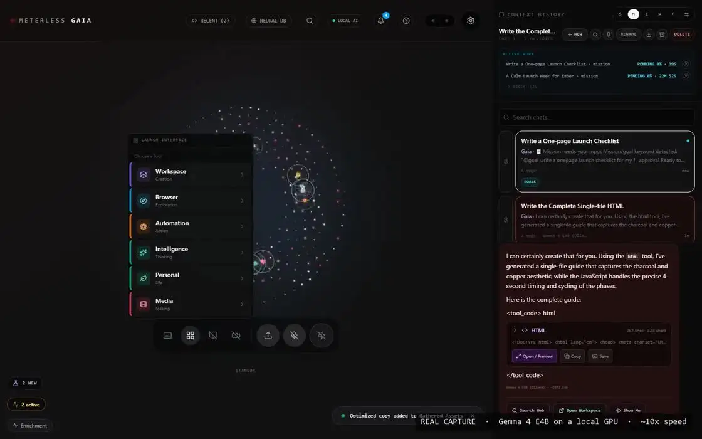

# Gaia

**Your AI work should compound.**

Gaia remembers your projects, decisions, people and preferences, then turns each useful interaction into something you can keep, inspect and use again. Your memories, missions, research and artifacts stay under your control, independent of whichever model created them.

Free app · v2.4.1 · Apache 2.0 · Web and Windows · [meterless.ai/gaia](https://meterless.ai/gaia.html) · [GitHub](https://github.com/meterless/gaia)

Gaia builds an app from a chat, unedited. <a href="media/gaia-builds-an-app.mp4">Play the 21-second capture</a>

| Brains | Context windows | Providers | Memory | Models | Your work |
|---|---|---|---|---|---|
| 12 | Boundless | 7, 2 local | Persistent, shared tiers | Local or cloud | Exportable, auditable |

## What Gaia does

- **Research with evidence, not guesswork.** Gaia browses live sources, reads pages, captures relevant evidence, and connects claims back to where they came from.
- **Move from an answer to completed work.** Gaia can navigate approved applications, enter information, organize artifacts, and carry a task forward through the interfaces you already use.
- **Keep the context that makes the next task better.** Project state, prior decisions, preferences and relevant history carry across sessions on [H-MEM](../../../engines/hmem/), so useful work does not disappear when a conversation ends.

Many AI tools keep your context, plans and research in their own cloud, tied to one conversation. Gaia keeps each project's memory, evidence, goals, artifacts and reusable workflows in one workspace on your side, and it stays usable when you switch models.

## Goals, missions and search

<table>
  <tr>
    <td width="50%" valign="top"><b>Goals and missions.</b> State the outcome in plain language. Gaia breaks it into an inspectable plan, picks the tools, gathers evidence and hands the result back for review. The mission, evidence and artifacts stay available to rerun or adapt.</td>
    <td width="50%" valign="top"><b>Scheduled missions.</b> Anything Gaia completes can become a recurring mission: daily briefings, weekly reviews, research updates. Each run keeps its history, evidence and any drift from the original. You choose what runs automatically and what waits for approval.</td>
  </tr>
  <tr>
    <td width="50%" valign="top"><b>Search everything.</b> One query across memory, artifacts, decisions and sessions. <a href="media/search-everything.mp4">Play</a></td>
    <td width="50%" valign="top"><b>Context receipts.</b> When a connected cloud model is used, Gaia shows which context is being sent and why.</td>
  </tr>
</table>

Gaia also observes the workspace you approve and surfaces problems while the work is still in front of you: contrast in a design, a typo in a spreadsheet, a number in an email that disagrees with memory, a missing `JSON.stringify` in code. It is not silently monitoring your computer. You choose what it observes, when observation begins, and when it stops.

## Desktop control and its safety limits

Gaia works through approved desktop applications using the visible interface: moving the cursor, typing, scrolling and checking the resulting state. It drives apps through your existing signed-in sessions. No passwords handed over, no root access. Control is bound to one window, every action is audited and rate-limited to 60 a second, dangerous key combinations are blocked at the runtime, and Esc is an emergency stop.

## Companion and Lens

<table>
  <tr>
    <td width="25%"></td>
    <td width="25%"></td>
    <td width="25%"></td>
    <td width="25%"></td>
  </tr>
</table>

Pair your phone with a QR code to watch runs, answer approvals and receive artifacts wherever you are. Add the Lens browser extension and any page can queue a mission with a source receipt, any copy leaves a receipt, and any selection can become memory. Queued, never auto-run. Your desktop stays in charge: the phone and the browser are remote controls, not second brains, and one switch on the desktop pauses everything.

More screens, and every video, in the [gallery](gallery.md).

## Engines inside

| Engine | What it does in Gaia |
|---|---|
| [H-MEM](../../../engines/hmem/) | Shared memory tiers. Gaia remembers across sessions without you managing it. |
| [World Model](../../../engines/world-model/) | Tracks your projects, entities, tasks and environment state |
| [Markovian](../../../engines/markovian/) | Long-horizon chunked reasoning that carries compressed state forward instead of growing the prompt |
| [Scout Intent](../../../engines/scout-intent/) | Classifies intent and routes tools |
| Swarm orchestration | Gaia's swarm mode and HUD. The spec is next on the [roadmap](../../../ROADMAP.md). |

## Docs

- [Getting started](getting-started.md)
- [Features](features.md)
- [Mentions](mentions.md)
- [Shortcuts](shortcuts.md)
- [Privacy](privacy.md)
- [FAQ](faq.md)
- [Troubleshooting](troubleshooting.md)
- [Gallery](gallery.md)

## The family

Gaia is one of three free Meterless apps, alongside [Relay](../relay/README.md) and [Swarms](../swarms/README.md). Need bigger work to run overnight? Give it to [Nightshift](../nightshift/README.md).
