# Gaia features

Gaia is the AI workspace where your work compounds. It is one of three free Meterless apps, alongside [Relay](../relay/README.md) and [Swarms](../swarms/README.md). This page covers what Gaia can do, grouped by the task you have in mind rather than by menu.

Gaia is free under Apache 2.0. The current release is v2.4.1. It runs on the web and on Windows. Get it from [meterless.ai/gaia](https://meterless.ai/gaia.html) or [GitHub](https://github.com/meterless/gaia).

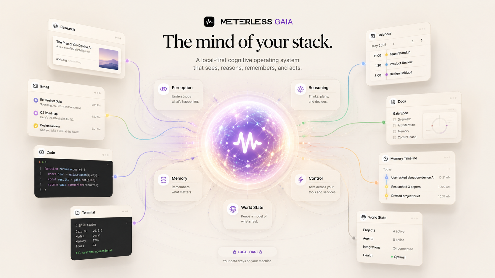

| Brains | Context windows | Providers | Memory | Models | Your work |
|---|---|---|---|---|---|
| 12 | Boundless | 7, 2 local | Persistent, shared tiers | Local or cloud | Exportable, auditable |

If you are looking for one specific feature, use Ctrl-F. Otherwise, read top to bottom.

## Talk to it like you would a person

Everything starts in the chat input. You do not need carefully written prompts. Write the way you would talk: "Draft an email to my accountant about the missing receipt from October." "Why is my code not compiling, here's the error." "Help me think through whether to move." Gaia reads the request, picks a model suited to that kind of request, and answers. If the answer needs more work, reply normally and it iterates. There is no "regenerate" button to hunt for, and you do not have to copy your last message into a new chat to try again.

You can also paste images, drag in files (PDFs, spreadsheets, text, code, screenshots), or share your screen mid-conversation. Whatever you give it becomes context for the rest of the conversation.

To send a request to a specific tool or behavior, type `@` and a menu of mentions appears. The most useful ones are covered later on this page.

## Set a goal and let Gaia work toward it

State the outcome in plain language. Type `@Goals` followed by an open-ended objective. A definition modal opens. Set what "done" looks like (for example, "inbox under fifty unread and all the rest labeled by sender") and a budget (how many turns, how many minutes). Then confirm.

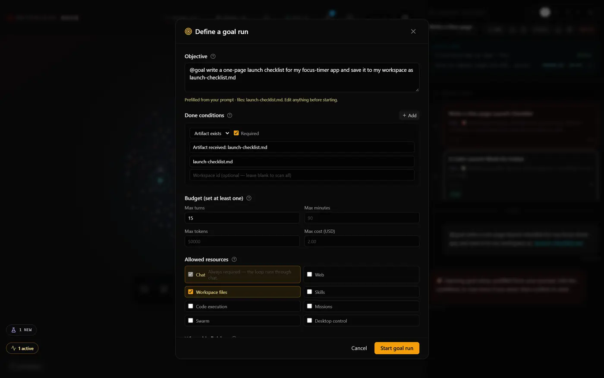

Gaia breaks the goal into an inspectable plan, picks the tools, gathers evidence, and works toward the goal in the background while you do other things. The run shows its turns, time and cost against the budget as it goes. It checks in when it needs a decision. Completion is verification-driven: the run checks its own done-conditions before it reports success. When the goal is met or the budget runs out, it stops and hands the result back for review.

The mission, its evidence and its artifacts stay available after the run, so you can rerun or adapt it later.

This is the heaviest single feature in the app. Use it for jobs that would take you an afternoon. A one-minute task does not need it.

## Plan something, then refine it before running

Type `@plan` followed by what you want planned. Gaia writes the plan in its own panel: context, steps, files involved, and how to verify it worked. It reads like a document.

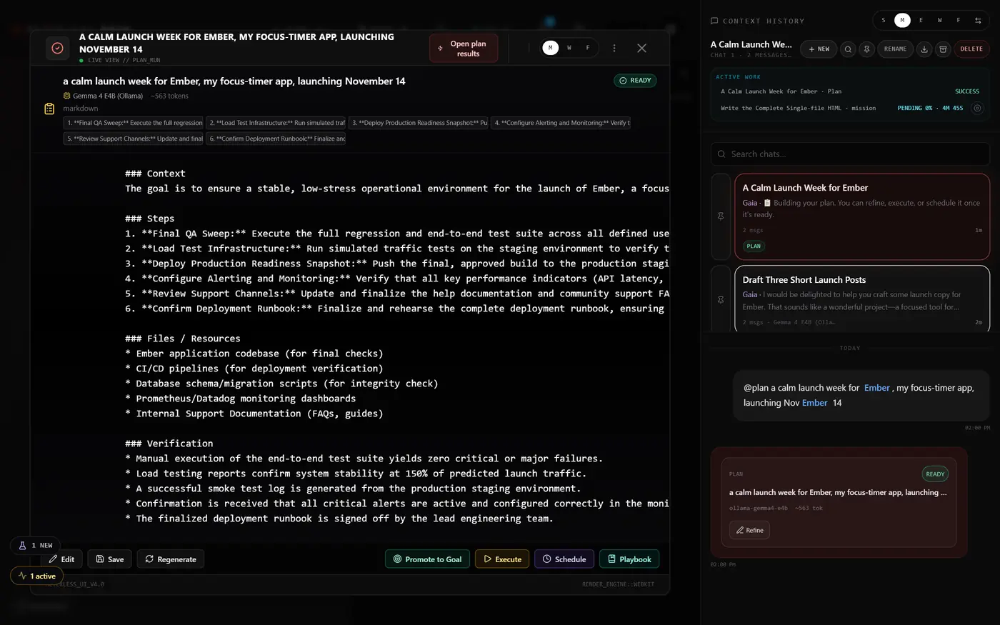

Unlike a normal chat response, the plan is editable. Highlight any sentence and a small menu offers to explain it, suggest a different version, or compare it to an alternative approach. Edit text directly with the keyboard. Move steps around. When the plan looks right, click Execute to run it now or Schedule to run it later. Plans are saved alongside your other documents, so weeks later you can pull up the same plan and run it again.

Use it whenever you want to see the shape of the work before it happens: migrations, cleanups, onboarding checklists, weekly routines, and anything else you want done the same way each time.

## Put a mission on a rhythm

Anything Gaia completes successfully can become a scheduled mission, such as daily briefings, weekly reviews, research updates or folder triage. Use `@Schedule` on a message, or Schedule on a plan, and pick a one-off time or a daily or weekly cadence. Every scheduled rerun lives in the Manage Schedules calendar (`@Schedules`).

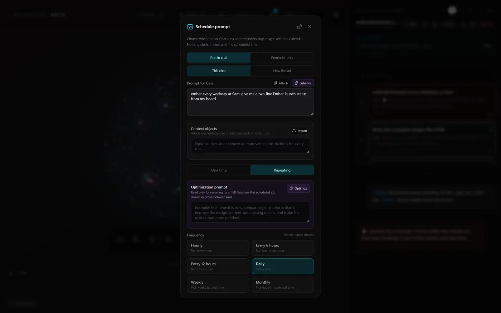

Each run keeps its history, evidence, output, and any drift from the original mission. You choose what runs automatically and what waits for your approval. From a mission you can run it now, pause it, or delete it.

Drift detection also covers missed runs. If Gaia was not available at the scheduled time, the mission resumes on its next cadence and the gap is recorded in the run log. The log never shows a run that did not happen.

## Research with receipts

Gaia uses a dedicated browser workspace to navigate real sources, read pages, capture relevant evidence, and connect claims back to where they came from. You can inspect which pages were visited, what was extracted, and how the conclusion was formed. Every important claim is linked to evidence.

Use `@research` when you want cited research rather than a chat answer. It decomposes a question into sub-questions, retrieves sources for each under a budget, and synthesizes an answer with verification and a sources appendix. Use `@Web` to pull one specific page into the conversation.

## Decompose a big question into parallel research

Some questions are too big for a single pass. "Compare AWS, GCP, and Azure pricing for a fifty-node Kubernetes cluster, then write a recommendation memo." "Survey what every major open-source project does about their code of conduct." "Find the five best public datasets on global tree cover and assess their reliability."

For these, Gaia uses a Swarm. It breaks your question into a graph of subtasks, runs them in parallel, deduplicates redundant work semantically, and merges the result. A HUD shows every node in the graph as it runs, with progress, status, and outputs. When everything finishes, you get the synthesis as a single readable result.

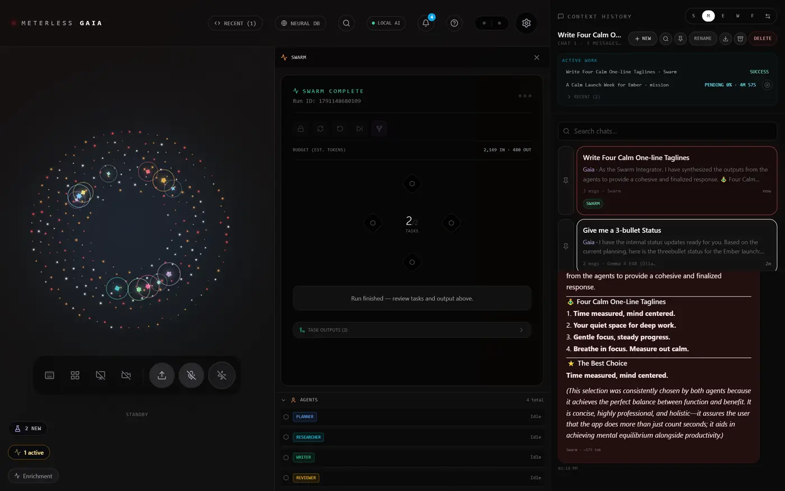

Swarms are bounded so they do not run forever: fifty subtasks maximum by default, five levels deep, with cycle detection and revert-on-violation. That keeps them fast and predictable. The swarm orchestration spec is next on the [roadmap](../../../ROADMAP.md). For a whole app built around coordinated agent teams, see [Swarms](../swarms/README.md).

## See issues while the work is still in front of you

Observer lets Gaia watch the workspace you approve and flag problems before they turn into finished mistakes. It can catch unclear copy or weak contrast in a design, a typo or a mis-parsed number in a spreadsheet, a figure in an email draft that disagrees with what memory holds, or a missing `JSON.stringify` in code.

Observer tools are opt-in toggles on the control strip. You choose what it observes, when observation begins, and when it stops. With them off, Gaia only sees your screen when you share it or start a desktop control session. See [privacy](privacy.md) for how captures are processed.

## Let it use your computer, with brakes

Gaia works through approved desktop applications using the visible interface: moving the cursor, typing, scrolling, and checking the resulting state. It uses only the access the job needs.

Type `@Control` (or `@Desktop`, or `@Take_control`) followed by a goal, and Gaia opens a window picker so you can choose which app it should drive. It then sends real mouse and keyboard input to that window. Because of this, it works with every desktop app you have, including apps with no special integration. Desktop control needs the Windows app. It is not available on the web.

The safety rules are built into the runtime:

- Gaia drives apps through your existing signed-in sessions. It never gets your passwords and has no root access.
- Control is bound to the one window you picked.
- Every action is written to a persistent audit log, so you can see exactly what was clicked and typed.
- Actions are rate-limited to 60 a second.
- Dangerous key combinations, such as Alt+F4 and Ctrl+Alt+Del, are blocked at the runtime.
- Actions the risk gate judges destructive are refused at the automation layer rather than executed.
- Esc is an emergency stop. It ends the session and cancels every queued action. A stopped session cannot be resumed; start a new one to continue.

A side panel shows every action as it happens. You can grab the mouse back, pause, cancel, or change direction at any point in the run.

Desktop steps are verified after they run. Post-action snapshots and vision checks confirm the state changed. When it did not, a closed recovery loop (detect, diagnose, act, re-verify) takes over.

## Reflect on what just happened, then suggest what's next

Gaia keeps a record of its background work after a run ends. The Ambient Work Strip curates a rolling tape of what the system has been doing (mission progress, desktop sessions, goal runs, Markovian reasoning, observer signals) and shows it in the foreground without modal interruptions.

When the perception layer notices you working at the same thing repeatedly, it can stage a proposed follow-up goal run. Staged proposals are approval-gated. Nothing runs until you approve it, and rejecting a proposal takes one click.

## Remember across days, weeks, and months

Gaia's memory is [H-MEM](../../../engines/hmem/), a three-layer hierarchical memory system that you do not have to manage. It keeps far more than the last fifty messages. Project state, prior decisions, preferences and relevant history carry across sessions, so useful work does not disappear when a conversation ends.

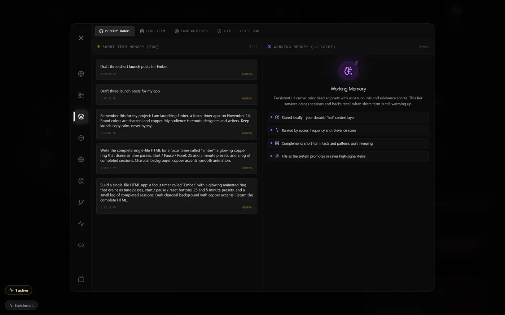

The short-term layer holds recent context. The working layer holds what the current session has mined. The long-term layer is durable. Items get promoted into it based on how often they come up, and you never have to tag them. Mention a person repeatedly across conversations and they become an entity. Keep returning to the same project and it becomes a tracked topic. Two weeks later, when you ask "what was the thing about the broken radiator," Gaia knows what you mean.

You can browse everything in the long-term memory browser (forget, correct, or export any row), see where each memory came from in the provenance audit view, and explore tracked people, projects, and topics in Entity 360. Memory is stored on your own machine and does not depend on whichever model created it.

## Search everything

One query searches across memory, artifacts, decisions and sessions. [Watch a 7-second capture](media/search-everything.mp4). To jump to anything you can open or run, press Ctrl + K for the quick-action palette.

## See what context goes to a cloud model

When a connected cloud model is used, Gaia shows a context receipt listing which context is being sent and why. See [privacy](privacy.md#context-receipts).

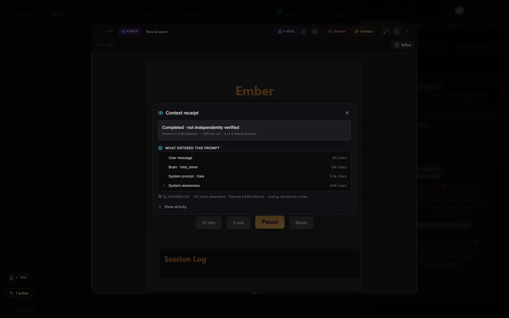

## The brains underneath

Gaia runs twelve specialist brains around one cognitive kernel. They keep memory organized, plan, observe, reason and watch for follow-ups. A mission step can show a consensus score across brains such as Oracle, Commander and Weaver. Most of the time you never pick a brain. When you want to, the `@brain:` prefix routes a request to a specific one (see [mentions](mentions.md)).


The brains are deliberately light. The brain registry ticks them on an interval and rate-limits them, so you should not notice them.

Four Meterless engines sit inside:

| Engine | What it does in Gaia |
|---|---|
| [H-MEM](../../../engines/hmem/) | Shared memory tiers. Gaia remembers across sessions without you managing it. |
| [World Model](../../../engines/world-model/) | Tracks your projects, entities, tasks and environment state |
| [Markovian](../../../engines/markovian/) | Long-horizon chunked reasoning that carries compressed state forward instead of growing the prompt |
| [Scout Intent](../../../engines/scout-intent/) | Classifies intent and routes tools |

## More than twenty built-in tools, so you don't bounce between apps

The same Gaia window contains:

- A notes editor with AI-assisted writing and a real markdown view.
- A code editor with syntax highlighting, AI completion, and the ability to run small things in place.
- An image studio with AI-powered erase, replace, and background removal.
- Dream Studio, a canvas for video and media composition.
- An app maker that generates a small one-off mini-app from a description (tip calculator, habit tracker, meal planner, anything small you would otherwise build in a spreadsheet) and lets you preview and iterate.
- A data foundry that loads CSVs, JSON, SQL databases, and Excel files for exploration and transformation.
- A calendar in the same workspace as everything else.
- An in-app browser for looking things up without leaving Gaia.
- A presentation viewer.
- A stream viewer.
- A live news and content discovery panel.
- An Entity 360 view for any person, project, or concept Gaia has tracked.
- A live data visualizer for whatever you load into the data foundry.
- A movie maker.
- A research panel that queries multiple sources at once.
- An app gallery for the mini-apps you've built.

You do not need to know which tool is which. They open automatically based on what you are doing. Paste a CSV and the data foundry opens. Ask for a mini-app and the app maker opens. Ask Gaia to edit a photo and the image studio opens.

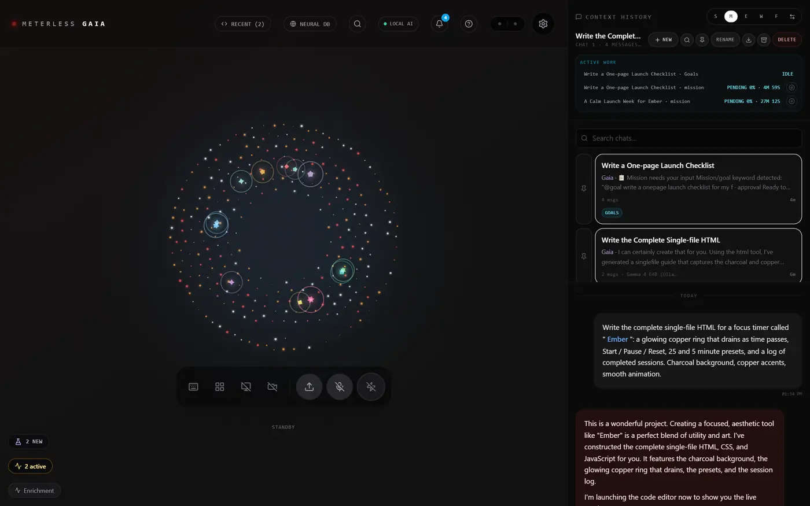

Gaia builds an app from a chat. <a href="media/gaia-builds-an-app.mp4">Play the 21-second capture</a>

## Run on local or cloud models

Gaia includes a local AI option that runs in the app through WebGPU (WebLLM). It needs no API key and no account. The first time you use the local model, Gaia downloads it into the app's cache (a few minutes, depending on which model you use). After that, the model loads from cache on every launch. You can then disconnect from the internet and most of Gaia keeps working: chat, memory, planning, missions, swarms over local sources, desktop control, and every built-in tool except the ones that need fresh web data. For bigger local models than the WebLLM options, install Ollama separately and Gaia will talk to it as another provider.

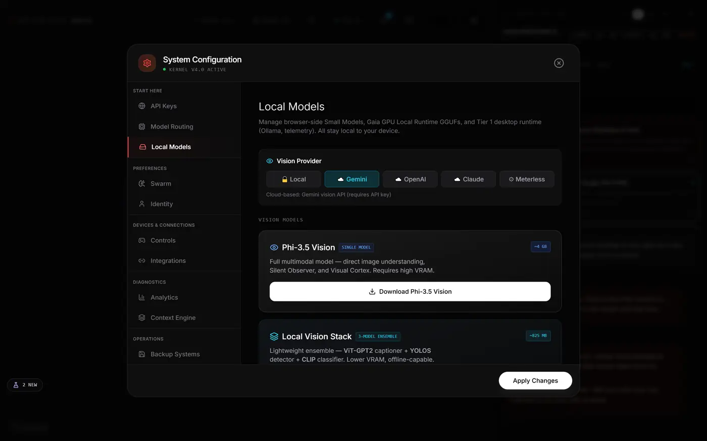

If you have your own API keys for Google, Anthropic, OpenAI, Groq, Mistral, or the OpenCode Go / OpenRouter gateways, add them in Settings → Neural Link. Gaia will route each provider the kinds of requests it handles best. Remove the keys and everything routes local again. Gaia treats the local model as a first-class path. A connected provider may receive the inputs you send and charge for model usage.

If you run [Nightshift](../nightshift/README.md), Gaia can also draw its models from the Nightshift hotspot on your own machine. See the [FAQ](faq.md#can-gaia-use-the-nightshift-hotspot-as-its-model-provider).

## Import your old AI history

If you've been using ChatGPT, Claude, or Gemini, request your conversation history export from that provider and import the file into Gaia. The source format is auto-detected, and old conversations become part of Gaia's memory and workspace. Memories, entities, and preferences are derived from them, so switching does not mean starting from zero. Every imported record is stamped with an import-run id, so a whole import can be rolled back.

Import also helps if you want to consolidate notes you have kept through AI chats in one place.

## Leave the desk, keep the controls: Companion and Lens

Companion and Lens let you follow and steer Gaia when you are away from the desktop.

<table>
  <tr>
    <td width="25%">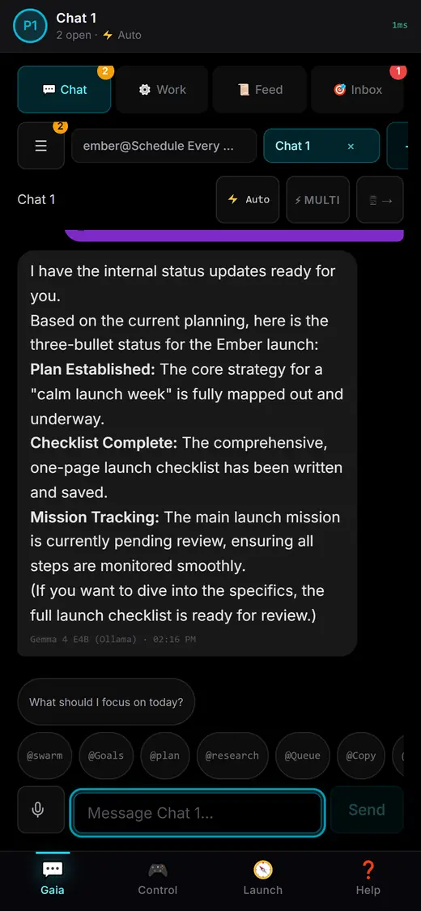</td>
    <td width="25%">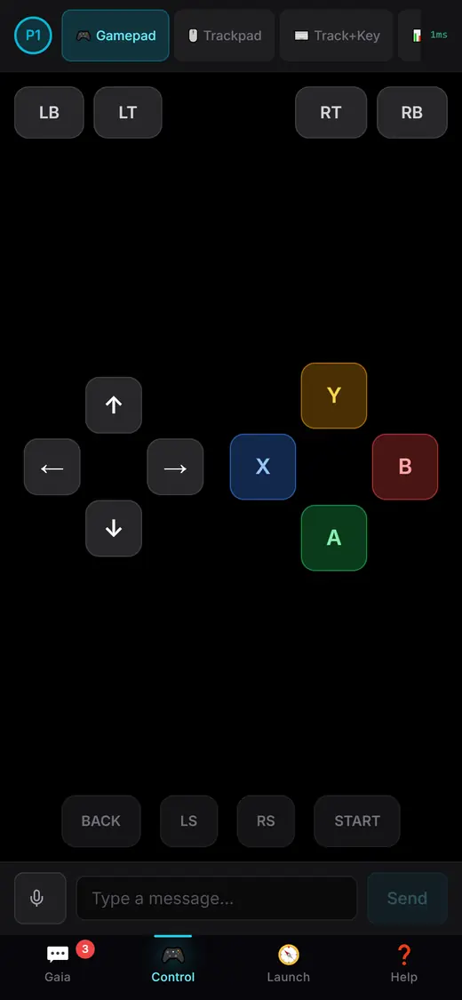</td>
    <td width="25%">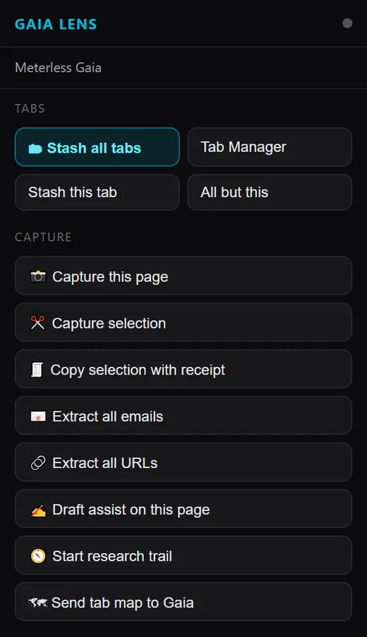</td>
    <td width="25%">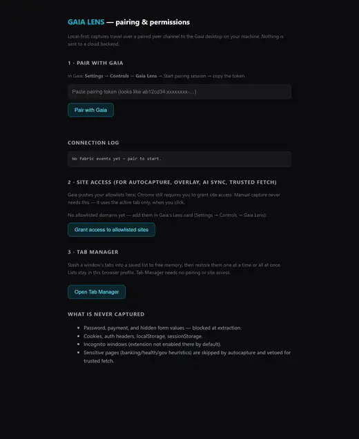</td>
  </tr>
</table>

### Companion

Companion is the phone app. Pair it with a QR code over your LAN. It gives you remote control and a conversational phone view of the desktop instance.

- Live run cards show swarm trees, budgets, and step-by-step progress.
- Approve from anywhere: swarm plans, mission decisions, and Resolve answers.
- Agents can send artifacts to your phone. Missed events replay when you rejoin.
- Send new instructions to the desktop while the work happens on your computer.

### Lens

Lens is the browser extension.

- Right-click any page to queue a mission with a source receipt. Queued missions never auto-run.
- Smart Copy leaves a receipt for every copy, and can extract the emails, URLs, and phones in it.
- Save any selection to memory.
- Draft assist fills forms from facts you approved. It never touches a submit button.

Your desktop stays in charge, and the phone and the browser act as its remote controls. You pair each one with a QR code, a new pairing replaces the old one, and one switch on your desktop pauses everything.

## Where to go next

- For the full catalogue of every `@` command in the app, see [mentions](mentions.md).
- For keyboard shortcuts that speed up daily use, see [shortcuts](shortcuts.md).
- For exactly what stays on your computer and what does not, see [privacy](privacy.md).
- For common first-week questions, see the [FAQ](faq.md).
- For every screen and capture, see the [gallery](gallery.md).
