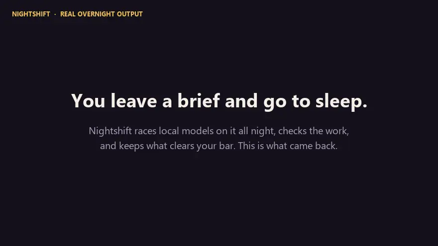
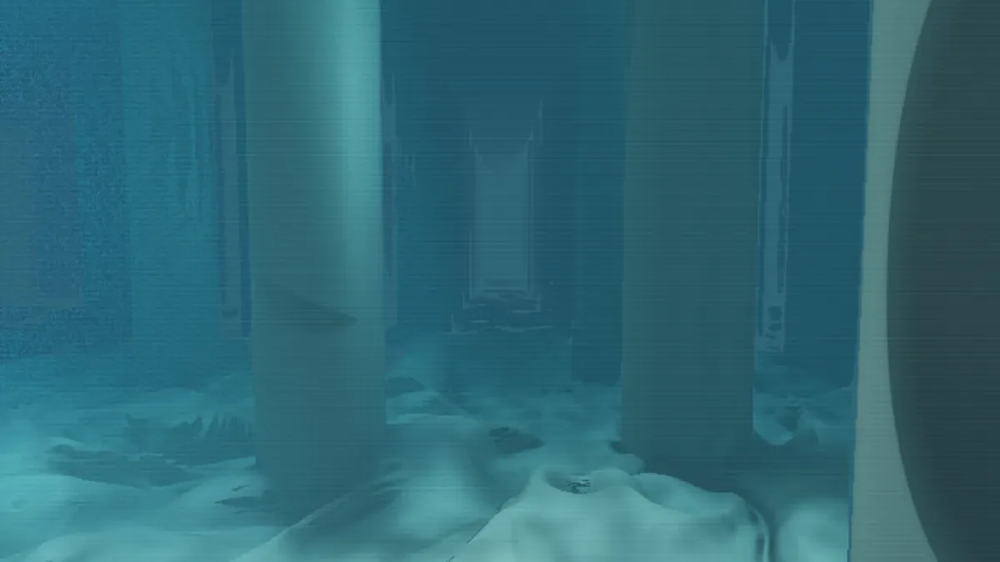
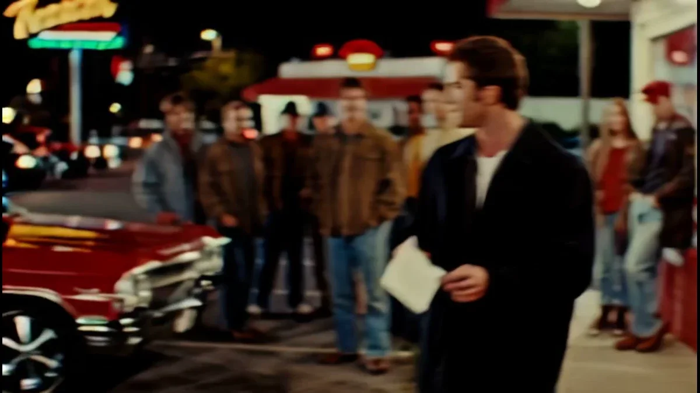

# Nightshift

**Turn your computer into an AI hotspot.**

Nightshift is the flagship Meterless product. It runs on the Mac, Windows PC or DGX Spark you already own. While you use it, it answers your apps. When you step away, it works through the jobs you left it.

Create with text, code, images, video, audio and 3D on your own machine. Connect your apps, choose local or cloud models, and come back to generated work with a record of what was checked.

**[Try Nightshift free in your browser](https://meterless.ai/Nightshift/WEB/)** · [Download for Windows](https://www.meterless.ai/windows.html) · [Preorder for Mac](https://www.meterless.ai/mac.html) · [DGX edition](https://www.meterless.ai/dgx-spark.html) · [Benchmarks](../../benchmarks/README.md)

---

## Two shifts

| | While you use it | When you step away |
|---|---|---|
| **Posture** | Depth | Swarm |
| **What it does** | Serves multimodal AI to every connected app: text, image, video, speech and more | Races queued jobs across local model lanes, then reads, clusters, judges and checks the results |
| **Who is waiting** | You are. One lane answers each request. | Nobody. The night gets the whole machine. |
| **When it switches** | The first interactive request drains jobs back to one lane | After ten minutes with no interactive traffic, in the quiet window |

Connect any app that speaks the OpenAI API to the Meterless provider and its requests land on your machine. Cursor, Claude Code, the free Meterless apps and every experiment use the same hotspot. Read [hotspot.md](hotspot.md).

---

## What came back

Every card below is a real night on one DGX Spark. Open the files. The receipts are on the site.

<table>
  <tr>
    <td width="33%" valign="top">
      
      <b>A cistern, lit from above</b> 
      Interactive HTML · 200 attempts · 94 validated · 57 min unattended · attempt 148 kept
    </td>
    <td width="33%" valign="top">
      
      <b>Last light, and 29 more frames</b> 
      Stills from a period-drama story bible · 299 attempts · 0 failed · 5h 35m · 1 local model · 30 kept
    </td>
    <td width="33%" valign="top">
      
      <b>After hours, and a scene scored</b> 
      Film + music · 141 attempts · 0 failed · 3 local models · 23 files kept · <a href="media/after-hours-film.mp4">play the clip</a>
    </td>
  </tr>
</table>

The music request was typed exactly as "make music to soundtrack the scens", late in a long night. More pieces in the [gallery](gallery.md).

---

## Knowledge work: the morning desk

Many nights produce documents rather than media. These are business deliverables written overnight by open models on one desk-side machine. A judge read every draft, proofs re-checked the numbers, and each one was graded against an answer key.

| Measure | Result |
|---|---|
| Finished business deliverables confirmed against an answer key | 18 |
| Business functions covered | 10, from finance to localization |
| Median time per deliverable, brief to accepted answer | 26 min, unattended |
| Drafts raced by open models, every one read by a judge | 91 |
| Words of finished, checked business writing | 15,424 |
| Bytes sent to a cloud service | 0 |
| Verified deliverables per run, same briefs, build 1.2.3 to 1.3.0 | 0, 3, 4, 11 |
| Business briefs within a point of a frontier cloud model, same graders | 13 of 25 |
| Electricity per verified deliverable | about 5 cents. No per-token bill. |

Example: a go-to-market memo to $5M ARR. Five drafts, three models, 28 minutes, local only. Qwen3.8 27B won with a judge score of 0.90. The grader confirmed the arithmetic: $3.1M at 108% NRR retains $3.348M, so $1.652M of new ARR needs 76 new logos and 245 opportunities at a 31% win rate.

[Open the Morning Desk: all 18 nights, every draft](https://meterless.ai/Benchmarks/KnowledgeWork/)

---

## Nightshift makes 3D

Nightshift's 3D desks turn a sentence, a photo or a pencil sketch into textured 3D models. Open image-to-3D models do the lift. Meterless finishes, repairs and paints every one, then checks it.

<table>
  <tr>
    <td width="50%"></td>
    <td width="50%"></td>
  </tr>
</table>

| Measure | Result |
|---|---|
| Polished models passing the Khronos glTF validator | 246 of 246, 0 errors, 0 warnings |
| Models from 14 Nightshift 3D desks on one DGX Spark | 50 |
| Median lift with TripoSR | 2.0 s |
| Hunyuan3D 2.1 mean grade | 4.3 of 5 |
| Median Meterless finish | 8.3 s |
| Median painted PBR | 104 s |

[Turn all 50 models in the 3D bench](https://meterless.ai/Benchmarks/3D/)

---

## Many approaches per job

A single prompt returns one answer, and different models' first answers tend to look alike. In four real Nightshift races from August 17 to September 5, 2026, each job was still turning up new approaches after attempt 250.

| Race | @25 | @50 | @100 | @150 | @200 | @250 | Final |
|---|---:|---:|---:|---:|---:|---:|---:|
| A · first race | 9 | 12 | 18 | 26 | 28 | 33 | 37 at attempt 264 |
| B · second race | 10 | 12 | 17 | 21 | 26 | 30 | 33 at attempt 288 |
| C · story room | 7 | 11 | 20 | 23 | 27 | 29 | 35 at attempt 299 |
| D · war room | 9 | 9 | 16 | 18 | 20 | 25 | 25 at attempt 253 |

A single prompt to a single tool gives you one direction. These races found 25 to 37, and were still finding more. Different models' answers to the same open question averaged 71% to 82% similarity in the [Artificial Hivemind](https://arxiv.org/abs/2510.22954) study.

---

## Nights that build on nights

Every night ends by distilling what worked. The next night starts there.

1. **Race.** Attempts spread out and settle into clusters.
2. **Distill.** The strongest cluster becomes an insight pack: what its attempts agreed on, what is still open, and the best version.
3. **Start there.** Continue the run and tonight's attempts grow out of that pack, not a blank prompt. When a recipe keeps winning, save it as a Method or a versioned Skill.

No model is retrained. What a night learns is written down where you can read it. In an illustrative example of one brief over three nights, the attempts needed to reach an accepted result fell from 180 to 61, on the same machine with the same models.

---

## Get Nightshift

| Edition | For | Status |
|---|---|---|
| **Web** | Run your first job in your browser. Nothing to install. | [Free, live now](https://meterless.ai/Nightshift/WEB/) |
| **Windows** | Windows 10 or 11, 64-bit, with a dedicated GPU. Your graphics card becomes a hotspot for your apps and a night shift for your work. CUDA on NVIDIA cards, Vulkan on others. | [Out now](https://www.meterless.ai/windows.html), Windows edition 1.2.1. [Measured on an RTX 3090](../../benchmarks/windows.md). |
| **Mac M5+** | Apple Silicon Mac with an M5 or later chip, 16 GB or more, macOS 15 or later. Hotspot for your apps plus a night shift for your work. | [Preorder](https://www.meterless.ai/mac.html), $199 USD one-time, delivery Q4 2026 |
| **Mac M1+** | Apple Silicon M1 or later. Small models on the Mac's own GPU, a local endpoint for your apps, and Nightshift jobs. | [Free download](https://www.meterless.ai/mac.html). [Measured in the app](../../benchmarks/mac-m1-m4.md). |
| **DGX** | NVIDIA DGX Spark. Serve your apps by day, hand it long-running jobs at night. | [Release details on request](https://www.meterless.ai/dgx-spark.html) |

The hotspot for your apps runs on the Windows, Mac and DGX editions. Full hardware notes in [editions.md](editions.md).

---

## Engines inside

Nightshift runs on the Meterless Runtime. The open engines in this repo are the parts you can read, implement and verify yourself.

| Engine | Where it shows up |
|---|---|
| [Markovian](../../../engines/markovian/) | The `deliberate` job kind is one long chain of chunks. Each chunk carries a compressed summary forward and checkpoints. |
| [H-MEM](../../../engines/hmem/) | Memory tiers for the apps and experiments the hotspot serves. Meterless City runs its characters' memory on it. |
| [World Model](../../../engines/world-model/) | Sourced, shared state for parallel work. Sitcomify and Meterless City keep their casts and facts in a world model. |
| [Scout Intent](../../../engines/scout-intent/) | Classifies what you are doing and routes tools accordingly. |
| Swarm orchestration | Ships inside the Meterless Suite. The spec drop is next on the [roadmap](../../../ROADMAP.md). |

---

## Docs

- [How it works](how-it-works.md): attempts, lanes, scribes, clusters, synthesis, the hotspot, and nights that build
- [Job modes](job-modes.md): kinds, selectors, judges, diversity, budgets, gates, makes, schedules and watchers
- [Hotspot](hotspot.md): connect any app to the Meterless provider
- [Editions and hardware](editions.md): web, Windows, Mac and DGX, with the measured hardware cards
- [Gallery](gallery.md): files from real nights
- [Benchmarks](../../benchmarks/README.md): every published run, failures included
