# Nightshift gallery

Files from real Nightshift nights. The output is unedited. We picked the pieces and added the titles. More, with source records, are in the [benchmark gallery](https://www.meterless.ai/benchmarks.html) and the [Morning Desk](https://meterless.ai/Benchmarks/KnowledgeWork/).

## Interactive

Interactive pieces built as HTML, from single-page scenes to small simulations.

<table>
  <tr>
    <td width="33%" valign="top">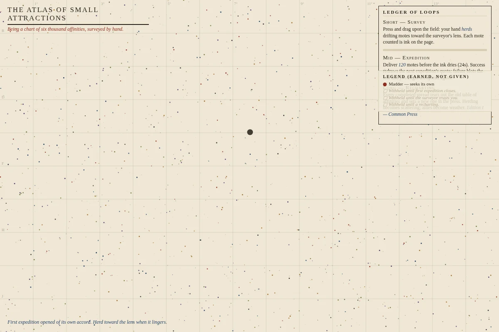 <b>The Atlas of Small Attractions</b> Interactive HTML · attempt 38. Herd a living field and follow its shifting rules.</td>
    <td width="33%" valign="top"> <b>Particle life</b> Live simulation · HTML</td>
    <td width="33%" valign="top">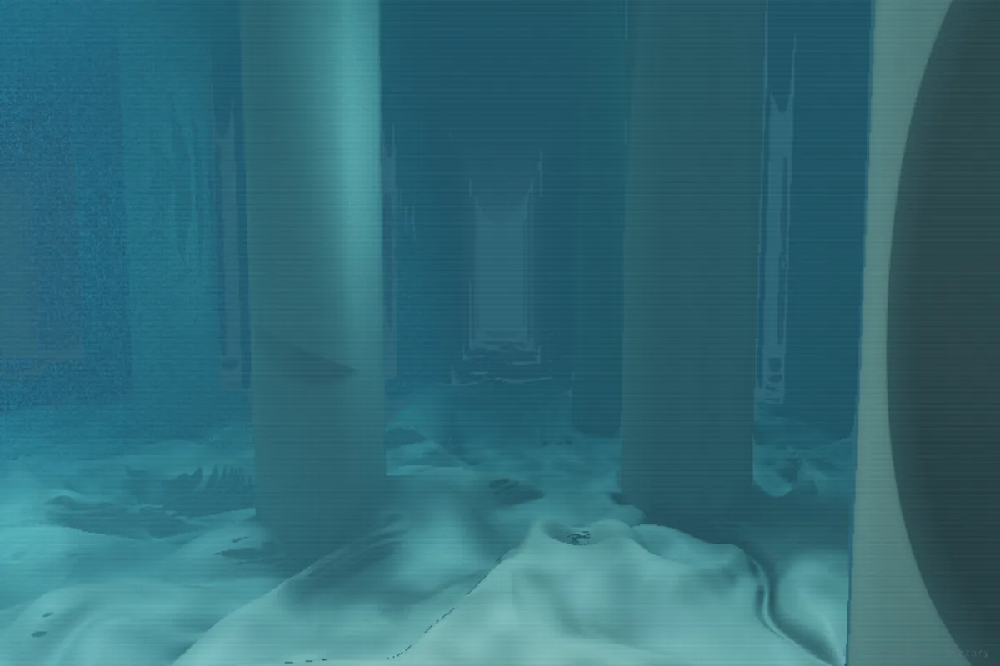 <b>A cistern, lit from above</b> Raymarched scene for a second monitor · 200 attempts · attempt 148 kept</td>
  </tr>
</table>

## Stills

Square stills from image and diorama jobs.

<table>
  <tr>
    <td width="25%">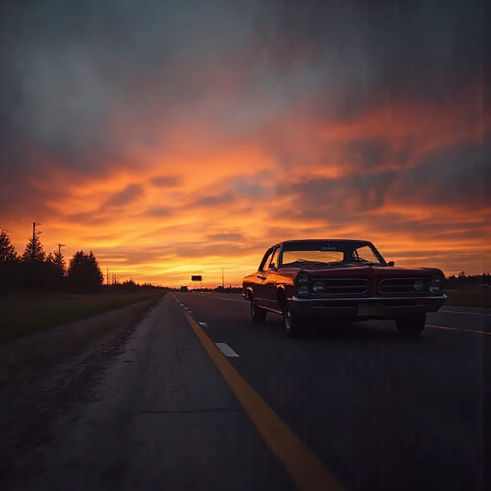 Last light</td>
    <td width="25%">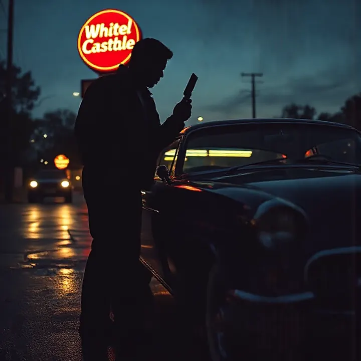 Under the sign</td>
    <td width="25%">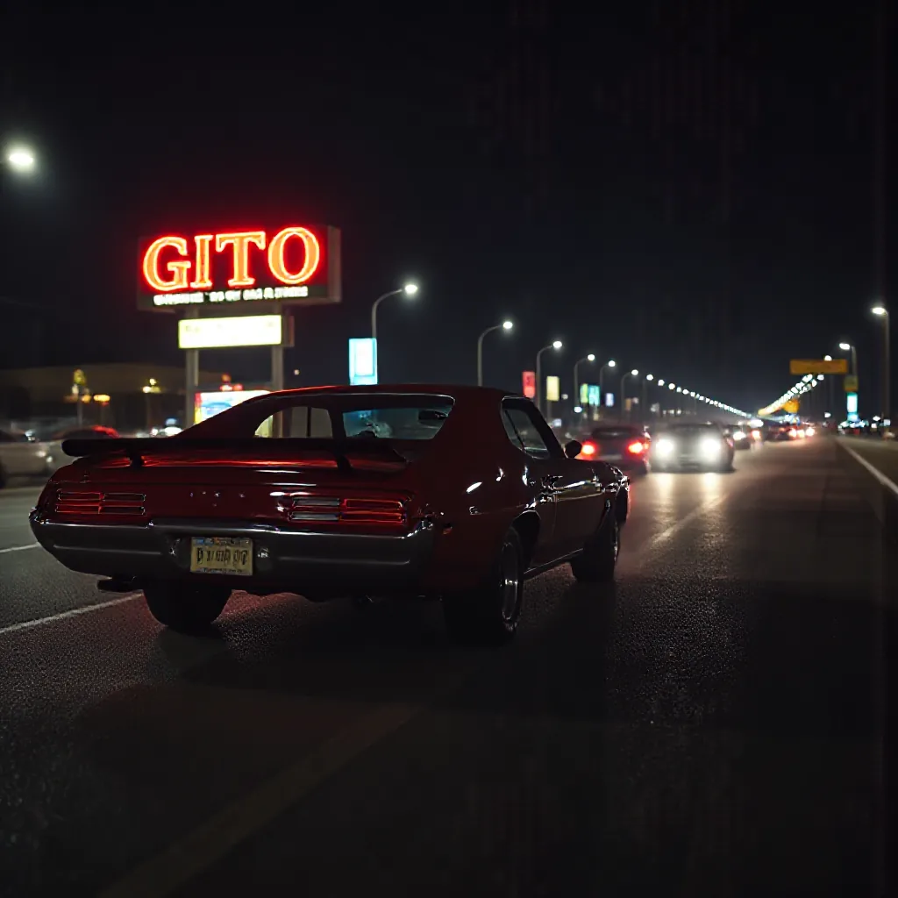 GTO, in neon</td>
    <td width="25%">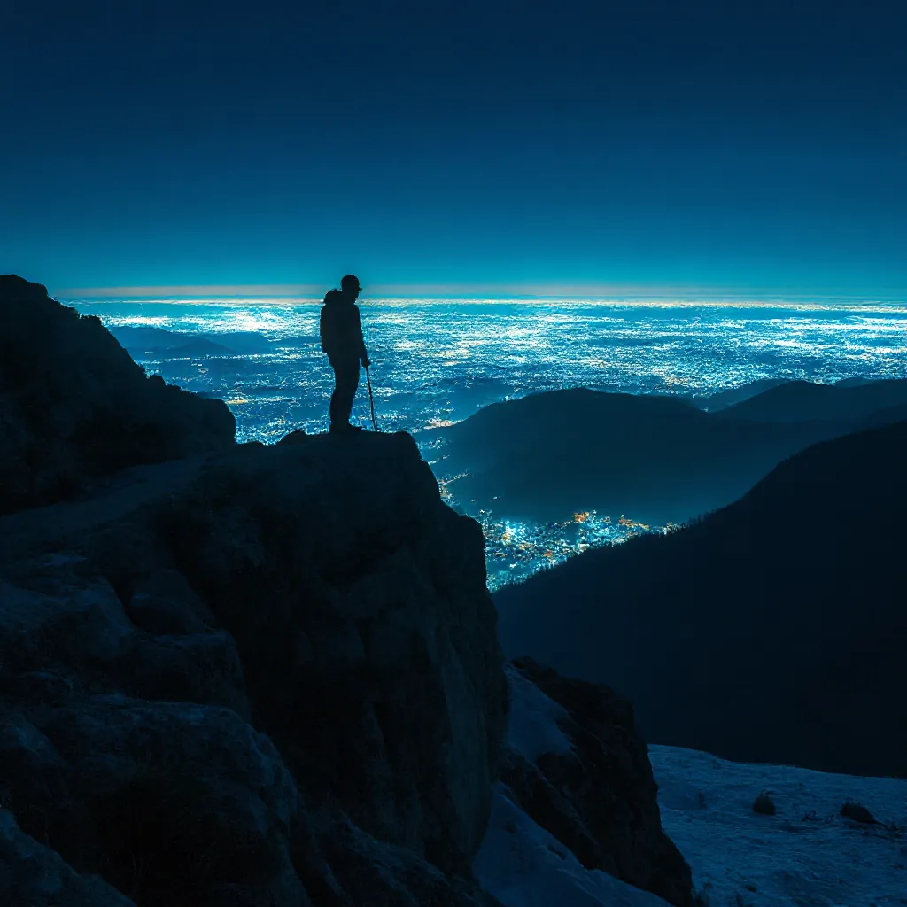 Blue hour on the coast</td>
  </tr>
  <tr>
    <td width="25%">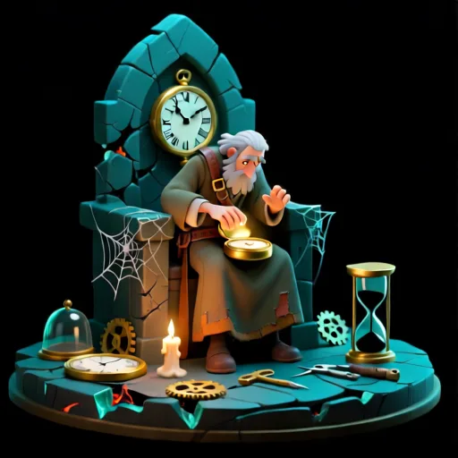 The clockmaker</td>
    <td width="25%">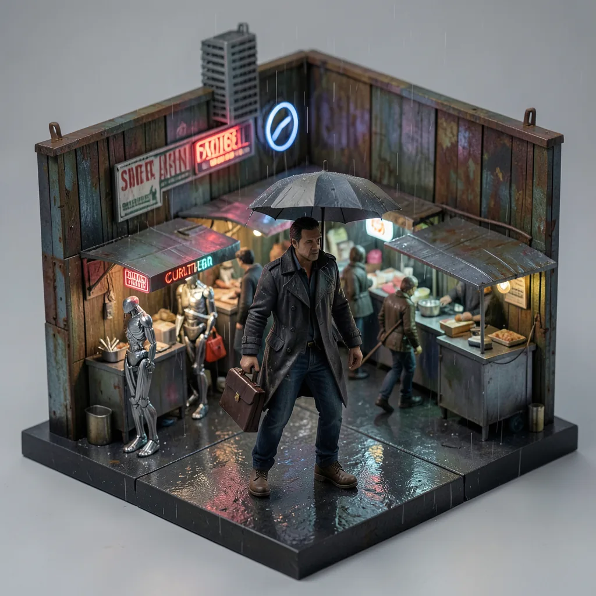 A rainy market, boxed</td>
    <td width="25%">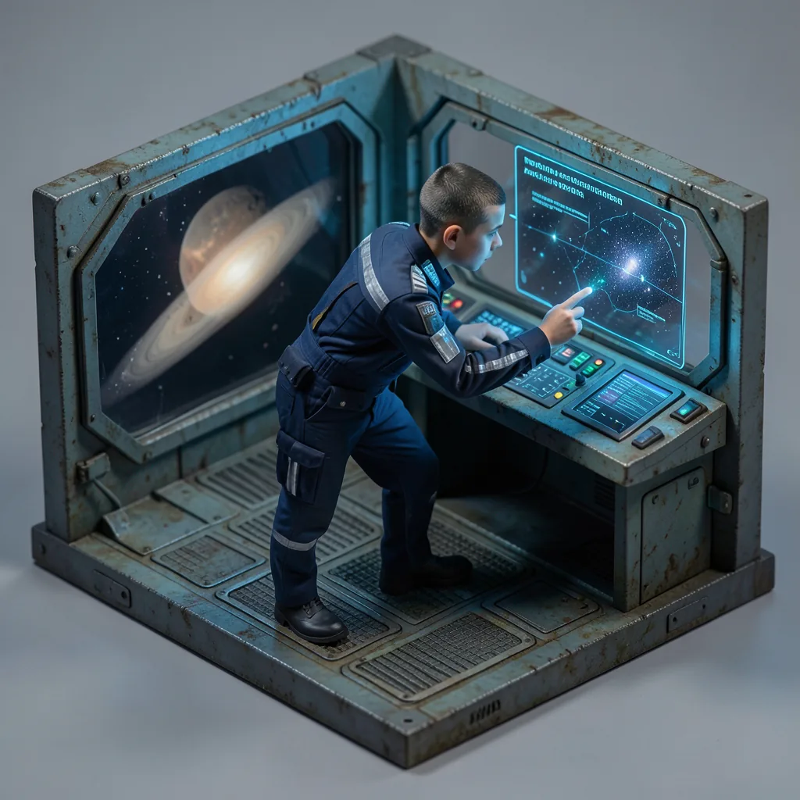 The command bridge, in miniature</td>
    <td width="25%"></td>
  </tr>
</table>

## Film and documents

Video, film stills and documents from media and writing jobs.

<table>
  <tr>
    <td width="33%" valign="top"><a href="media/after-hours-film.mp4">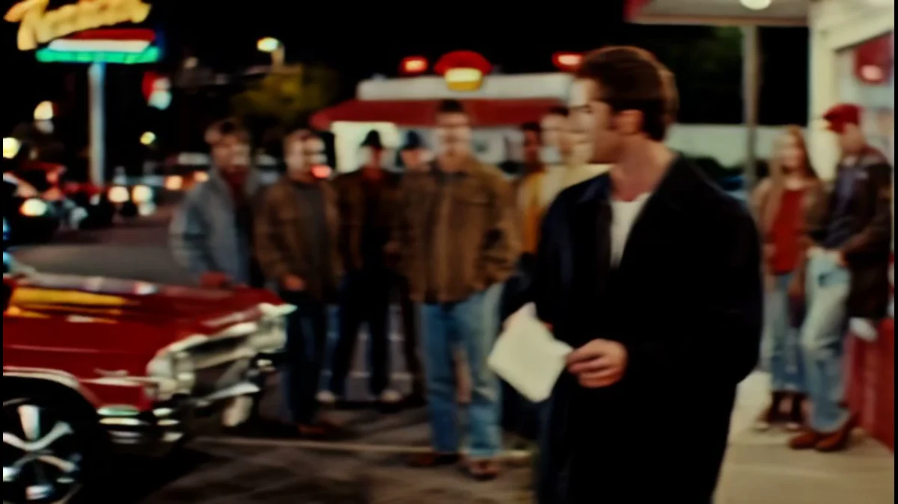</a> <b>After hours</b> Film + music · 141 attempts · <a href="media/after-hours-film.mp4">play the clip</a></td>
    <td width="33%" valign="top">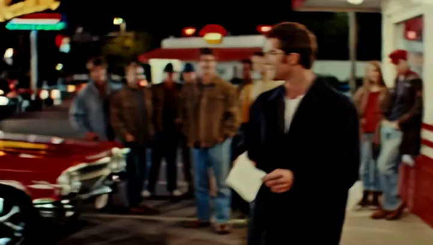 <b>The lot</b> Film still</td>
    <td width="33%" valign="top"> <b>A shot list, as a deck</b> Document · PPTX</td>
  </tr>
</table>

A diorama brief, written as a PDF:

## 3D

Finished and painted models from the 3D desks.

<table>
  <tr>
    <td width="50%"> Green glass desk lamp · Set Dresser desk · Hunyuan3D 2.1 · grade 5 of 5 · 87 s lift</td>
    <td width="50%"> Dragon · from the 3D bench</td>
  </tr>
</table>

Every 3D model from the October 10, 2026 run is in the [3D bench](https://meterless.ai/Benchmarks/3D/). The site shows them at 10k faces with 384px textures. The GLB files are larger.
