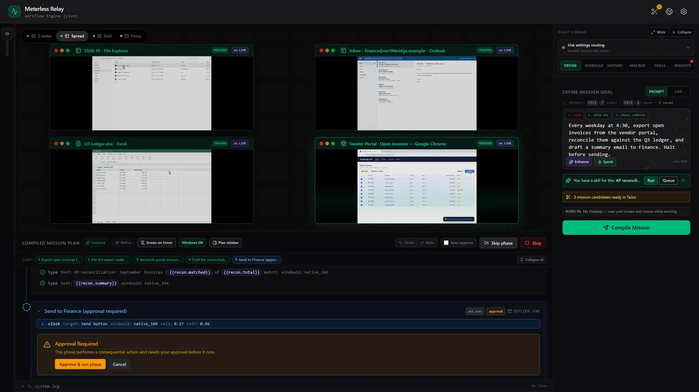
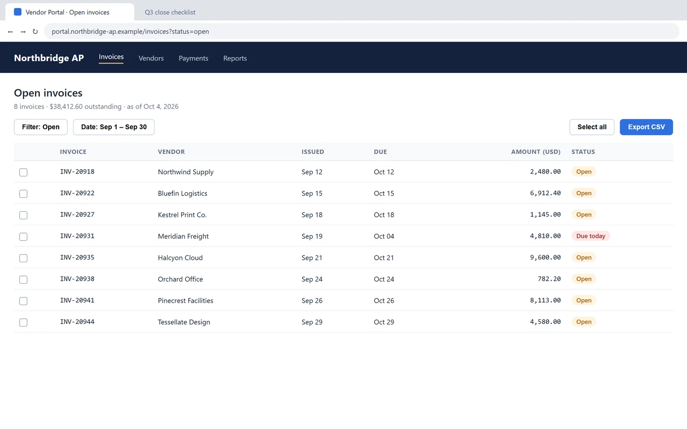
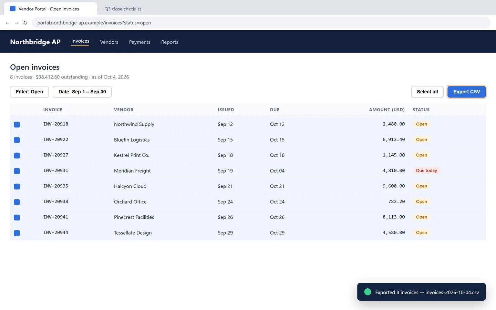
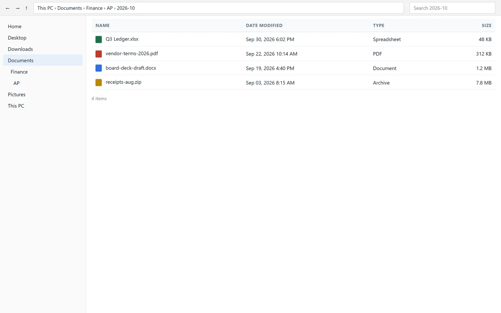
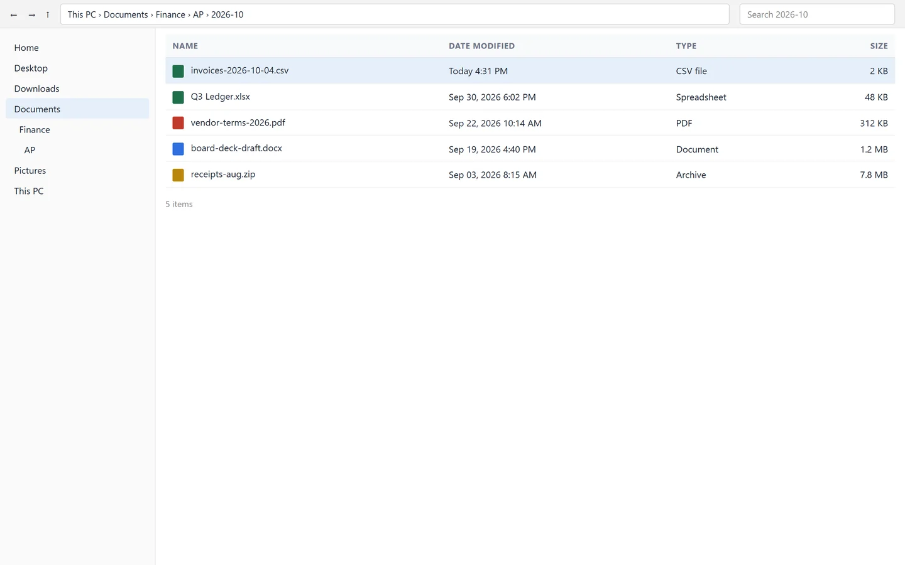
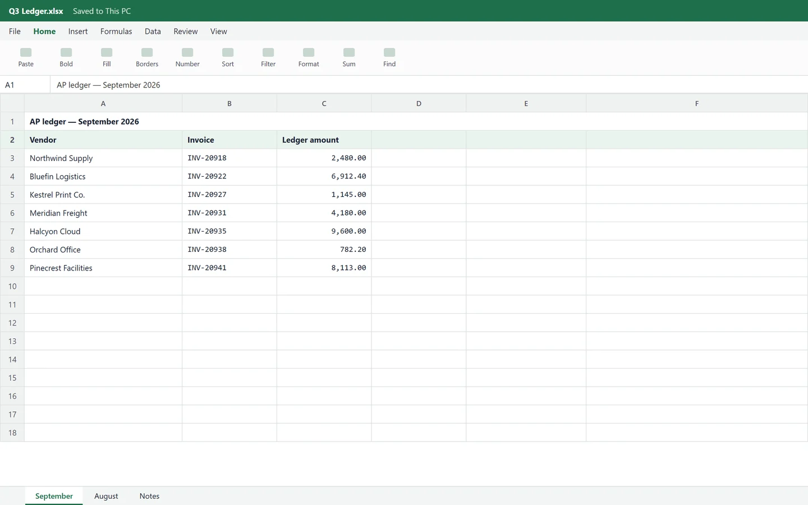
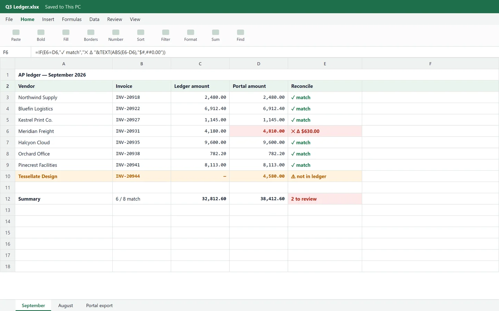
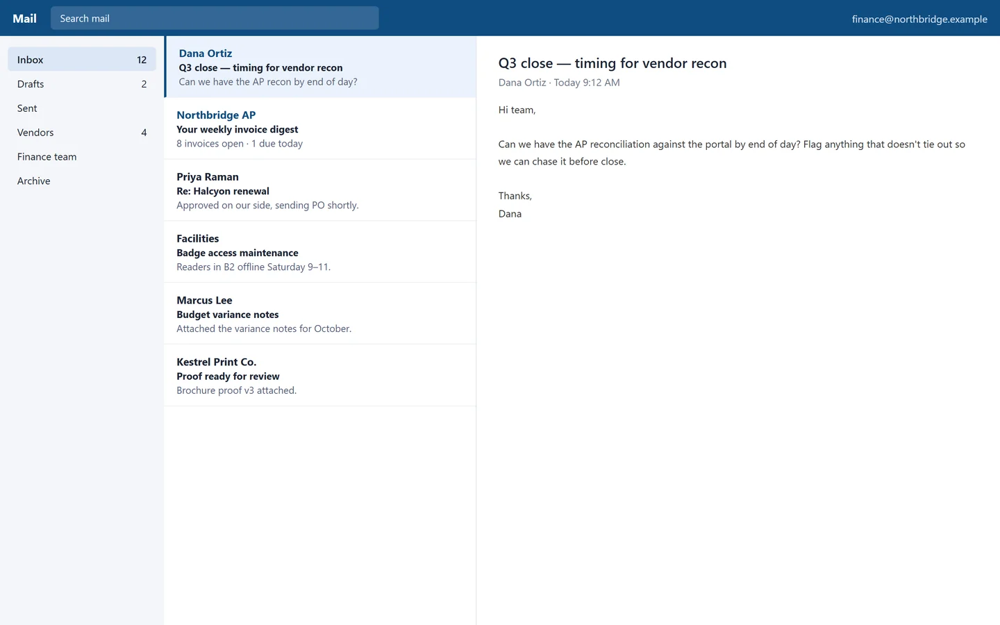
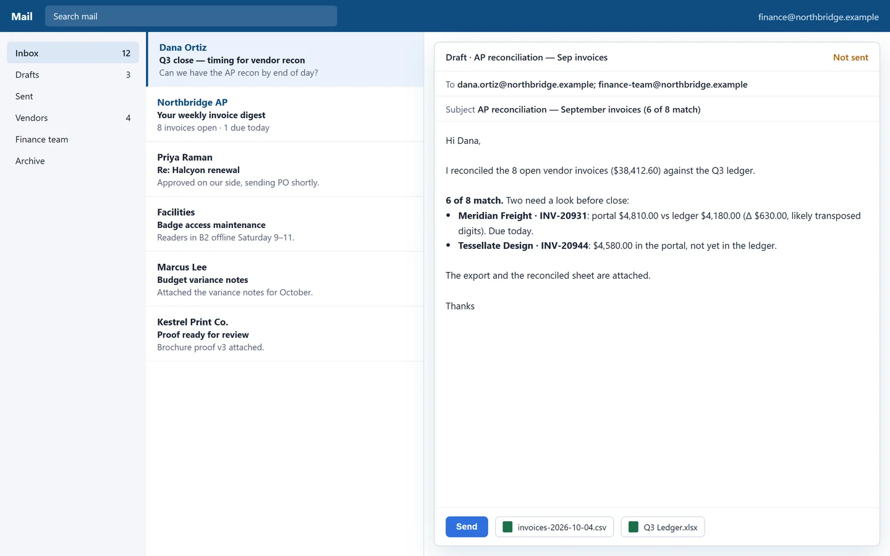

# Relay

**Describe the job. Watch it get done.**

Type one sentence. Relay reads the windows you have open, writes a plan you can edit, drives the real apps, checks every step, and stops before anything consequential. Then it remembers how, so next time costs zero model calls.

Free Windows app · v0.8.8 · 3.3 MB installer · Windows 10 and 11 · your models, or local · [meterless.ai/relay](https://meterless.ai/relay.html) · [GitHub](https://github.com/meterless/relay)

Recorded from the Relay app. Demo company and data; the windows are stand-ins so nothing private is on screen. <a href="media/relay-ap-reconciliation.mp4">Play the recording</a>

## Walkthrough: an AP reconciliation

The job: export the open invoices, reconcile them against the ledger, write Finance a summary, and do not send it without me. Here is every stage of that run, frame by frame from the app.

<table>
  <tr>
    <td width="50%" valign="top"><b>01 · Describe.</b> Say it the way you would say it to a coworker. Relay tags the intent as you type (a loop, a URL, an email) and notices it has done this before. A saved skill verified 13 times is one click away.</td>
    <td width="50%" valign="top"><b>02 · Plan.</b> A plan you can read before anything moves. Relay snapshots the windows you track, injects what it already knows about them, and compiles a mission: 5 phases, 17 steps, 4 tracked windows, 1 approval gate.</td>
  </tr>
  <tr>
    <td width="50%" valign="top"><b>03 · Run.</b> It works in your real apps, not a sandbox copy. Each step targets a control by name, so a button that moved does not break the run.</td>
    <td width="50%" valign="top"><b>04 · Stop.</b> It halts before anything you cannot take back. Sending is consequential, so the plan carries an approval gate. Approve and it finishes. Cancel and nothing was sent.</td>
  </tr>
  <tr>
    <td width="50%" valign="top"><b>05 · Prove.</b> "Completed" is not "verified". Cheap UI Automation probes run first; vision steps in only when needed. 16 pass, 1 skipped, 17 verified steps. A run that only looks finished never becomes a saved skill.</td>
    <td width="50%" valign="top"><b>What came out the other end.</b> 8 invoices, $38,412.60. Six tie out. Meridian Freight is off by $630.00, likely transposed digits. Tessellate Design is missing from the ledger. Relay captured the results into the Data Vault (<code>ap.open_total</code>, <code>ap.mismatches</code>, <code>recon.summary</code>) so the next run, a watch, or another mission can use them. The summary email sits drafted and unsent, waiting for approval.</td>
  </tr>
</table>

## Before and after

<table>
  <tr><th>Window</th><th>Before</th><th>After Relay</th></tr>
  <tr><td>Vendor portal</td><td></td><td></td></tr>
  <tr><td>File Explorer</td><td></td><td></td></tr>
  <tr><td>Q3 ledger</td><td></td><td></td></tr>
  <tr><td>Mail</td><td></td><td></td></tr>
</table>

## Skills, schedules and recording

- **Skills.** A verified run becomes a parameterized, replayable skill. Replays take the deterministic path first and only call a model to repair a step that drifted. In the demo workspace the AP skill ran 14 times: 231 of 238 steps executed with no model, and two learned repairs were folded back in as new versions.
- **Schedules and watches.** Weekdays at 4:30. Schedule any mission or skill with window-readiness checks, a missed-run policy, and auto-pause after repeated failures. Watches fire when a captured value changes.
- **Teach by doing.** Live mode and the macro recorder capture what you do, anchored to UI elements rather than pixels, and turn it into an editable mission.

## The whole app

Every screen below is the shipping app, populated with demo data.

<table>
  <tr>
    <td width="33%"><b>Schedule.</b> Missions on a cadence</td>
    <td width="33%"><b>History.</b> Every plan, reusable</td>
    <td width="33%"><b>Skills.</b> Verified runs, distilled</td>
  </tr>
  <tr>
    <td width="33%"><b>Macros.</b> Teach by doing</td>
    <td width="33%"><b>Insights.</b> Is it actually working?</td>
    <td width="33%"><b>Alerts.</b> The notification center</td>
  </tr>
  <tr>
    <td width="33%"><b>Data Vault.</b> Captured values, with history</td>
    <td width="33%"><b>Journal.</b> What changed, step by step</td>
    <td width="33%"><b>Tailor.</b> Your org knowledge into missions</td>
  </tr>
  <tr>
    <td width="33%"><b>World model.</b> It remembers your desktop</td>
    <td width="33%"><b>Command palette.</b> Ctrl + K to anything</td>
    <td width="33%"><b>Live mode.</b> Guide it in real time</td>
  </tr>
  <tr>
    <td width="33%"><b>Model routing.</b> Pick a model per task</td>
    <td width="33%"><b>Procedural memory.</b> What worked, per app</td>
    <td width="33%"><b>Queue and routines.</b> Line up the day</td>
  </tr>
</table>

## Agent bridge: CLI and MCP

The `relay` CLI and MCP server let Claude Code, Cursor, Codex, VS Code or Gemini CLI list windows, read text, click named controls, and run your saved skills. You decide each agent's tier, and consequential steps still wait for a human.

## Engines inside

| Engine | What it does in Relay |
|---|---|
| [World Model](../../../engines/world-model/) | Models the desktop and workflow state before and after each action. Relay remembers your desktop. |
| [Markovian](../../../engines/markovian/) | Next-action logic and compressed state across long workflow runs |
| [Scout Intent](../../../engines/scout-intent/) | Tags intent as you type and turns instructions into routed, verified plans |

## Docs

- [Getting started](getting-started.md)
- [Features](features.md)
- [Shortcuts](shortcuts.md)
- [Privacy](privacy.md)
- [FAQ](faq.md)
- [Troubleshooting](troubleshooting.md)

## The family

Relay is one of three free Meterless apps, alongside [Gaia](../gaia/README.md) and [Swarms](../swarms/README.md). Each runs on local or connected models, including the [Nightshift](../nightshift/README.md) hotspot. The Meterless Suite installs them together with the engines preconfigured.
