# Relay features

Relay is a free Windows app that turns one sentence into a verified desktop workflow. It reads the windows you track, writes a plan you can edit, drives the real apps, checks every step, and stops before anything consequential. Then it remembers how, so the next run costs fewer model calls, often none.

This page is the user-facing tour, organized by what you are trying to get done. For the short version, see the [Relay overview](README.md). For the architecture, see the [Meterless architecture docs](../../architecture/stack-overview.md).

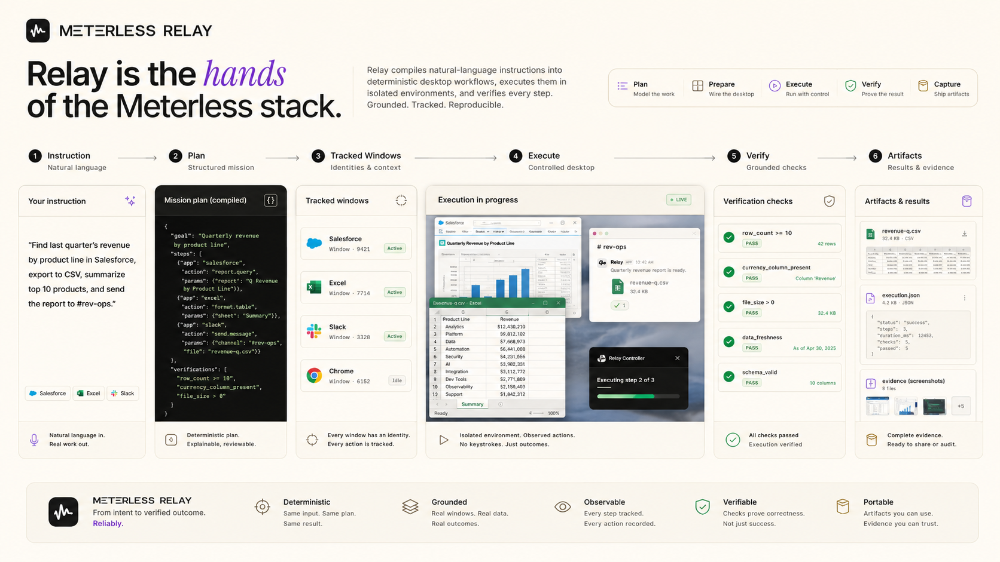

## The core loop

Every mission follows the same five stages.

| Stage | What happens |
|---|---|
| Describe | You type the job in plain language. Relay tags the intent as you type. |
| Plan | Relay snapshots your tracked windows and compiles a mission you can read and edit. |
| Run | Relay drives your real apps with native clicks, keystrokes and focus changes. |
| Stop | Relay halts at an approval gate before anything you cannot take back. |
| Prove | Every step gets a verdict. Only verified runs can become skills. |

## Describe the job

Type what you want done the way you would say it to a coworker. The instruction can be specific (*open Outlook, find the most recent email from Alex, forward it to Sam with a one-line note*) or loose (*do the morning report*). When it is loose, Relay leans on what it learned from past runs. When it is specific, Relay follows it more literally.

Relay tags the intent as you type. A loop, a URL to open and an email to compose each show up as a chip. If Relay has done this job before, it says so. A saved, verified skill is one click away, with no re-planning and no model calls.

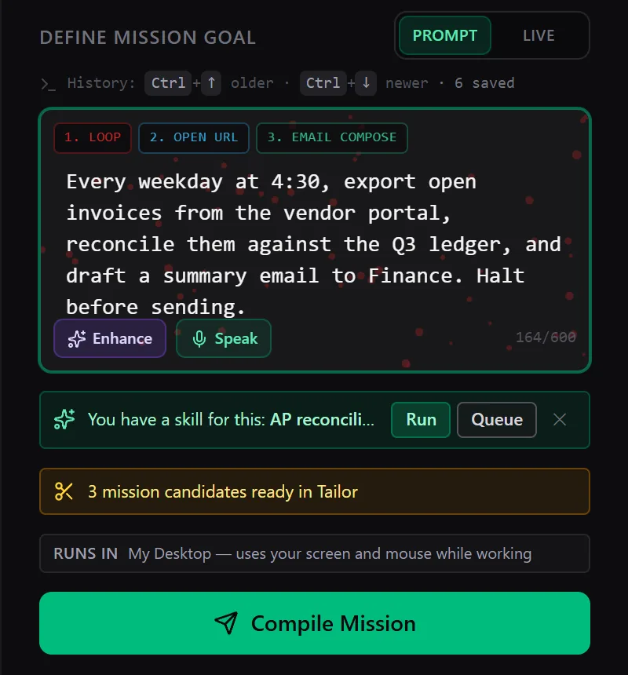

Two buttons sit next to the composer. Enhance rewrites a rough draft into a concrete goal. Speak adds voice dictation. See [shortcuts.md](shortcuts.md).

## Track the windows that matter

Relay does its best work when you tell it which windows matter. You can track up to eight windows at once. Each tracked window gets a stable identity, so Relay refers to it the same way today as yesterday, even after you close and reopen the app.

This also fixes a common automation problem. Two windows with the same title are still two windows. Relay tells them apart at the OS level.

## Read the plan before anything moves

Relay snapshots the windows you track, injects what it already knows about them, and compiles a structured mission. A mission has phases, targets, steps, failure policies and approval gates. Nothing has run yet.

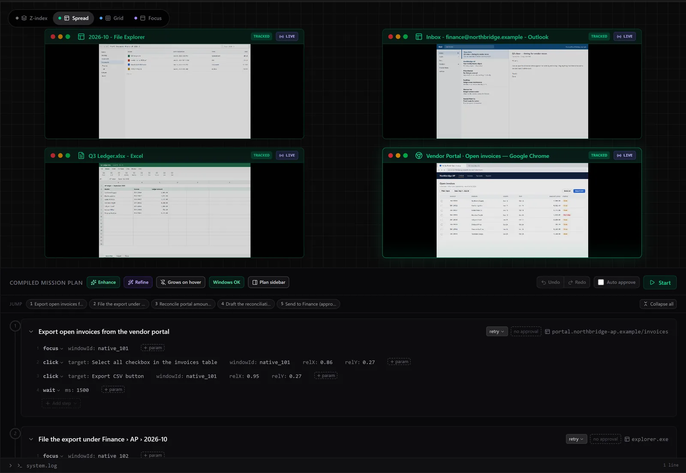

You can edit any step inline. You can mark any step as an approval gate by hand, even one Relay did not flag. You can also cancel at this stage with no harm done.

### Search the web before planning, when it helps

For goals where outside context matters (*find the current support email for company X and open a draft to them*), Relay can run a quick web search before it writes the plan. This works only when your model supports it. Gemini does it natively. The setting is in the per-mission options. When it happens, you see "Researched the web" as one of the early phases.

## Run in your real apps

Relay drives your real apps directly, with no sandbox copy. It uses native clicks, keystrokes and focus changes across the browser, File Explorer, spreadsheets and mail. Each step targets a control by name, so a button that moved does not break the run.

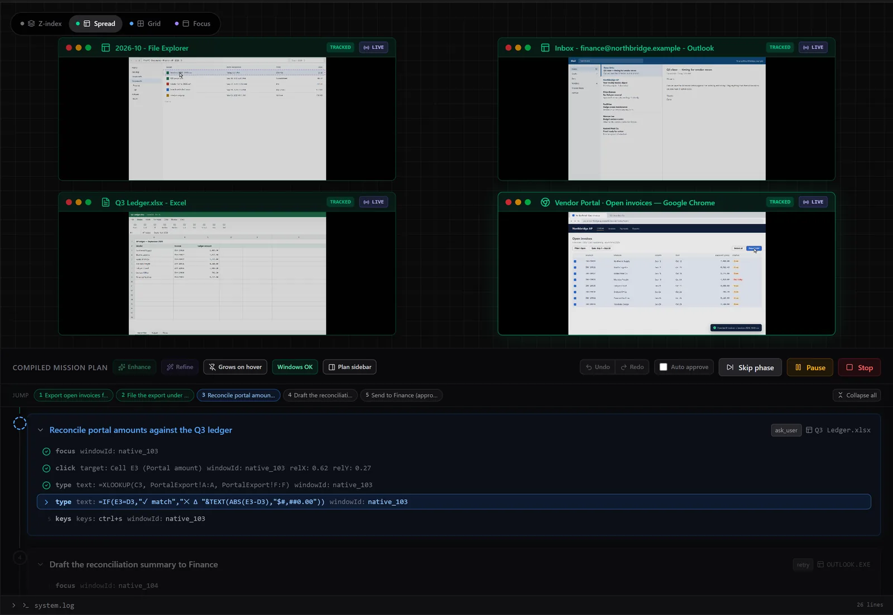

### One mission across many windows

If a workflow touches the same kind of window in several places (three Chrome tabs, two spreadsheets, four CRM accounts), track them all and write one mission. Relay keeps the windows distinct and does not mix up their data.


## Stop before anything consequential

Some steps should not run without you, such as sending an email, submitting a payment, posting publicly or deleting something. Relay marks these as approval gates.

When a plan reaches a gate, Relay pauses with the result on screen and waits. Approve and it finishes. Cancel and nothing was sent. Nothing happens in the meantime.

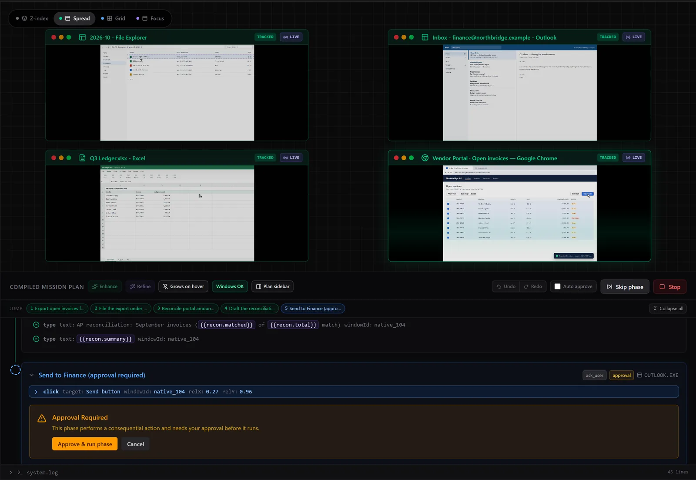

Failure policies cover the other case. When a step fails and the plan says so, Relay uses `ask_user` and waits for you instead of charging ahead.

## Prove every step

A step that completed has not necessarily done its job, so Relay gives every step a verdict.

Relay checks the cheap way first. A bounded UI Automation snapshot of the real window is checked against the step's postconditions, with no model in the loop. Vision steps in only when needed: Relay takes a screenshot of the tracked window and looks at it. The planner marks critical steps for verification. You do not have to configure this.

Verdicts have three values: verified, failed or unverifiable. Absence of evidence is reported as unverifiable, so it never counts as a false pass or a false fail.

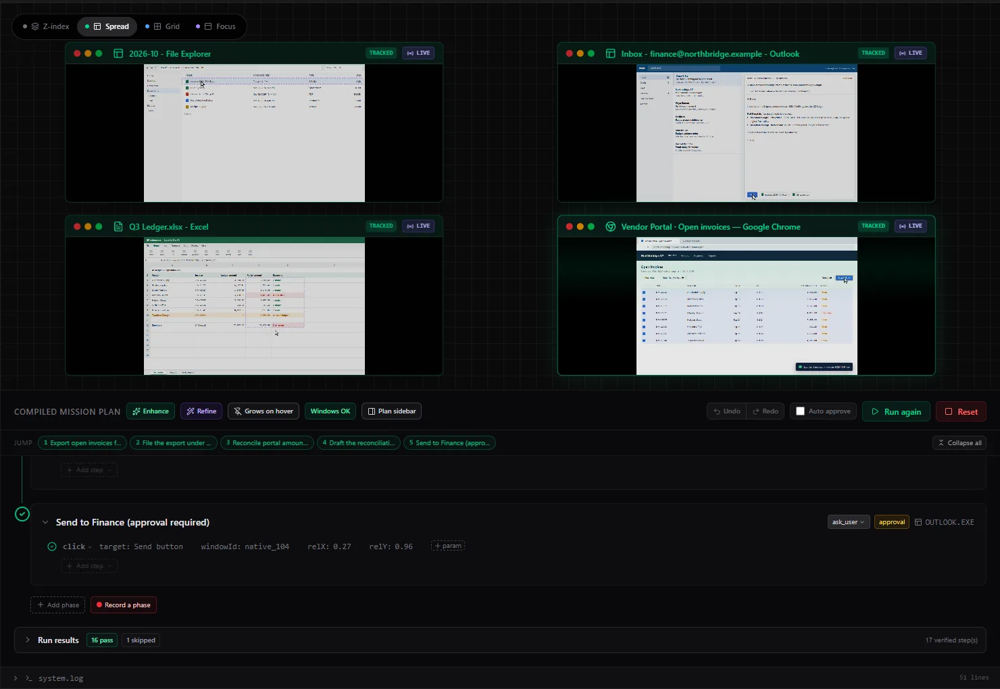

The run report shows what passed, what was skipped, and why. A run that only looks finished never becomes a saved skill.

Mechanical verification ships in shadow mode by default. It logs verdicts on every eligible run but does not fail or alter your mission until you switch enforcement on. The verification policy has three levels: strict, standard (the default) and lenient.

## Capture results into the Data Vault

Relay also captures what it finds into the Data Vault, so the next run, a watch or another mission can use it.

In the demo run, Relay wrote `ap.open_total`, `ap.mismatches` and `recon.summary`. Any plan can use a stored value with `{{vault.<key>}}`, for example `{{vault.recon.summary}}`. Today's mission can type the ticket number Monday's run captured. Each key keeps its prior values as history. Unreliable captures (inferred or unavailable) are never stored.

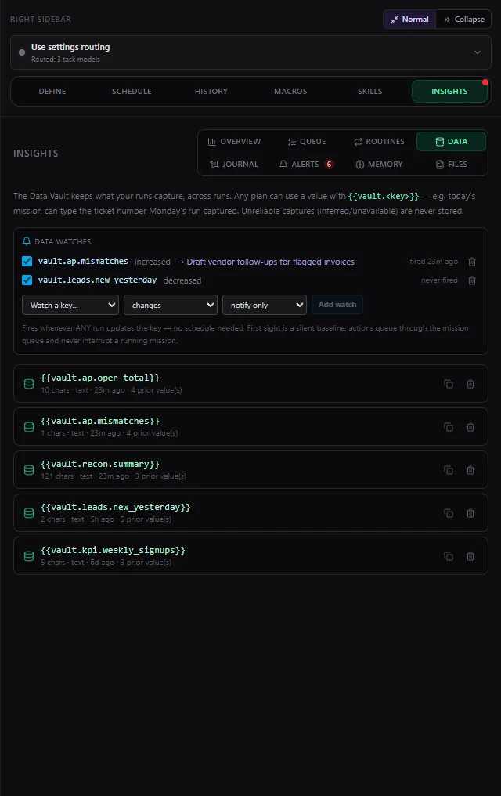

Files, screenshots and extracted tables also land in your local workspace, grouped by mission. The workspace holds the last 200 captures. Older ones roll off.

## Watch a value and react

A watch fires when a captured value changes. You pick a Data Vault key, a condition (changes, increased or decreased) and an action. The action can be a notification only or a follow-up mission. In the demo, a watch on `ap.mismatches` queues vendor follow-ups when the count goes up.

Watches need no schedule. They fire whenever any run updates the key. The first value Relay sees is a silent baseline. Triggered actions queue through the mission queue and never interrupt a running mission.

## Turn verified runs into skills

A verified run becomes a skill: a parameterized, replayable version of the job. URLs, filenames and typed text become placeholders. Each skill keeps per-step provenance, verification probes and an append-only version history. Distillation is always human-gated by a review diff before anything is saved. Missions, macros and Live mode sessions can all become skills.

Replays take the deterministic path first. They call a model only to repair a step that drifted. A learned repair is folded back in as a new version.

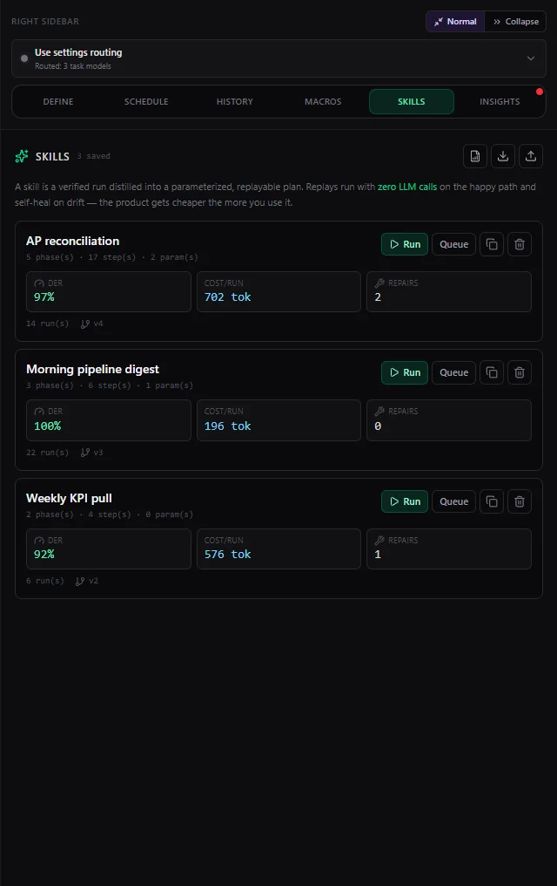

Each skill tracks a Deterministic Execution Ratio (DER), the share of steps that ran with no model call. In the demo workspace, the AP reconciliation skill ran 14 times. 231 of its 238 steps executed with no model, a DER of 97%. Two repairs were learned and folded back in as new versions.

## Schedule missions and skills

Any saved mission or skill can run on a schedule, such as weekdays at 4:30. Schedules run once, daily, weekly or monthly, anchored to a wall-clock time. You can schedule a macro recording directly too.

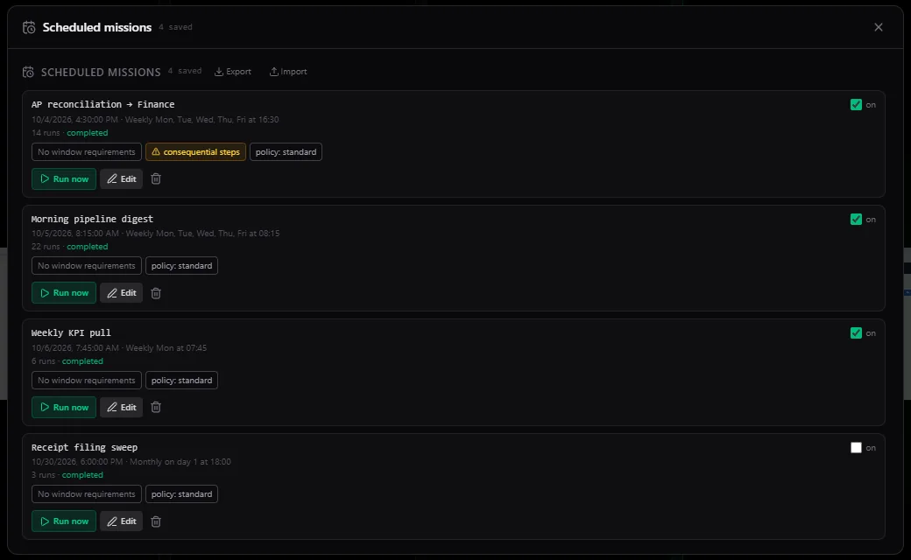

Before each run, Relay checks window readiness. It derives the windows the plan needs and finds, focuses or opens each one. A missed-run policy covers runs missed while the app was closed. If a schedule fails repeatedly, Relay pauses it automatically so a broken job does not keep running. Jobs with consequential steps are tagged in the list, and their approval gates still wait for you.

## Teach by doing

If a job is easier to show than describe, show it. Live mode and the macro recorder capture what you do, anchored to UI elements rather than pixels, and turn it into an editable mission.

### Record a macro

The macro recorder captures Relay's own automation steps. In the Windows desktop app, it also captures your manual OS input on a tracked native window. Every recorded window is anchored to the desktop world model. Replays resolve windows through a four-tier window resolver. A recording can be replayed, queued, scheduled or compiled into a mission.

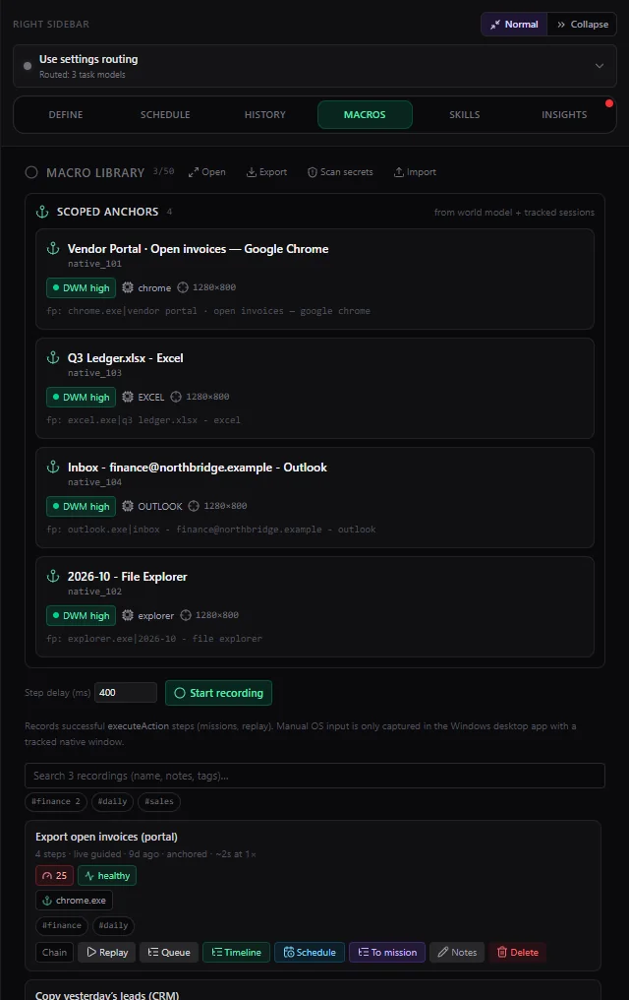

Recordings are editable assets. The Timeline Editor lets you delete and reorder steps, edit typed text and delays, insert waits, mask a value as a secret, or promote a literal to a parameter. Edits are kept as append-only revisions. Each recording carries a health badge and a fidelity score from 0 to 100, so you know which routines are safe to rerun.

If the UI drifts and a replayed step fails, a budgeted vision pass can correct the target. The fix is offered as a new revision for you to accept. It is never applied silently.

Password fields are captured as masked steps, never plaintext. Masked values are re-prompted at replay time.

### Guide it in Live mode

Live mode is a guided real-time loop. You give one instruction at a time against tracked windows. That includes plain-language clicks such as "click the Apply button," which resolve to real UI elements, and point or region annotations you draw on the window. Relay decides a single action, runs it, verifies the result and records each successful step.

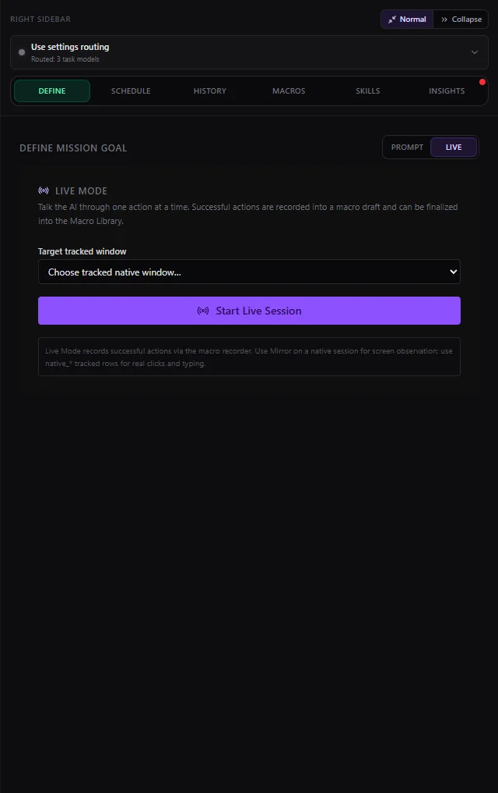

Destructive actions (Send, Submit, Delete, Pay) pause the session for explicit confirmation. When you finish, a review lets you toggle, edit and rename steps before saving. Relay can draft a skill straight from the session. Sessions can be paused and resumed later.

## Remember what worked

Relay learns as it goes. It keeps three kinds of memory, all on your machine.

### Procedural memory

Every time a mission or skill run completes, Relay takes notes per app: which action, in which program, how many steps, how often it worked. Successes raise confidence. Failures lower it. The top matches for a new goal are injected into the planner as "have I done this before" hints. Influence fades over time if a procedure stops being used (a 30-day half-life), so stale habits do not dominate fresh plans. You do not have to turn this on.

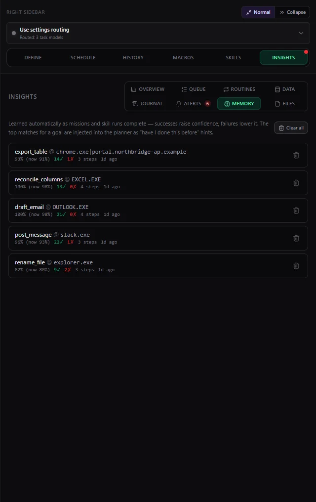

### World model

Relay remembers your desktop. It keeps a model of the programs, locations and entities it has seen, with a timeline of recent events. This is what lets a saved mission find its windows again after a restart.

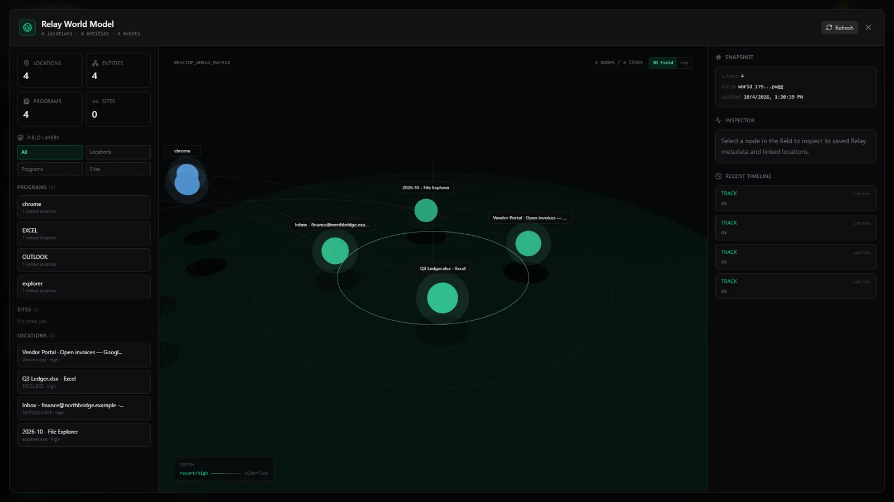

### History

Every goal you type is saved (last 100). Every plan Relay writes is saved (last 80). Scroll past goals with Ctrl+↑/↓ in the composer, or browse History. Load any past plan, run it again, or fork it as the start of a new mission. History entries can be exported and imported (merge by id, later wins).

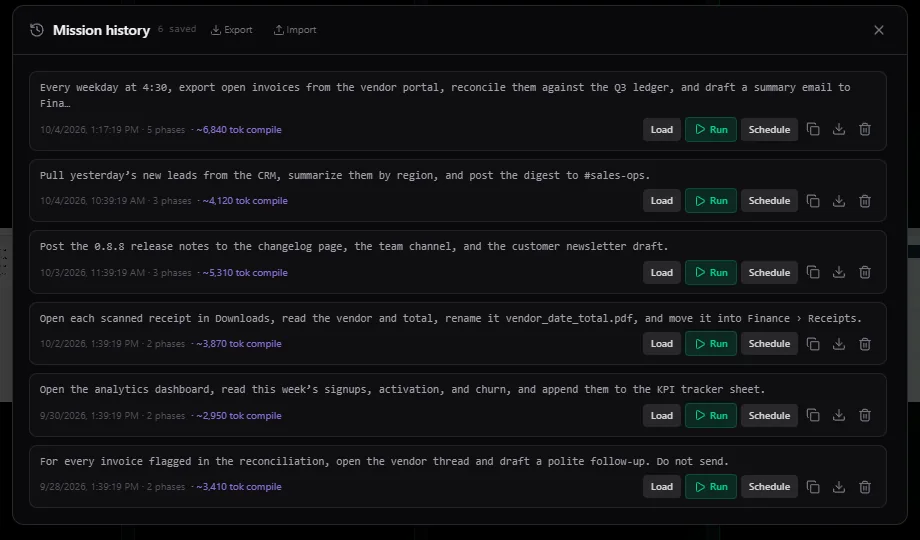

## Bring your org knowledge with Tailor

Tailor turns what your organization already knows into missions. Drop in documents, folders, zips, chat history or macro exports, or tell and show Relay directly. Tailor maps the processes, systems, roles and deliverables it finds, flags contradictions, and proposes mission candidates. You decide which to walk, promote or dismiss. Tailor's corpus stays local.

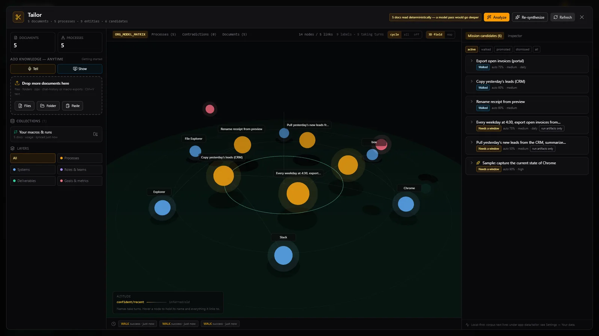

## Pick a model per task

You do not have to commit to one model. Relay routes three tasks separately:

| Task | Used for |
|---|---|
| Desktop planning | Compiling goals into multi-window mission plans |
| Vision analysis | Verifying screen states and reading UI elements |
| Deep reasoning | Complex decisions during workflow execution |

Relay supports Google Gemini, Anthropic Claude, OpenAI GPT, the OpenCode Go open-weight gateway, OpenRouter, and the Meterless Runtime. A right-sidebar override can force every task onto one model. You configure keys under Settings → API Keys and routing under Settings → Model Routing. A dot next to each option shows whether that provider's key is configured.

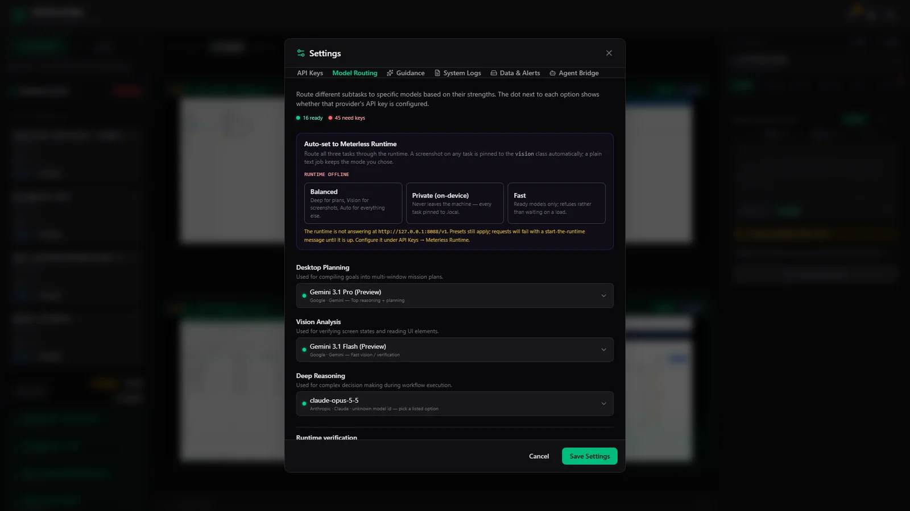

### Use local models through the Nightshift hotspot

Relay can run on your own hardware. Point it at the Meterless Runtime that [Nightshift](../nightshift/README.md) serves as an [OpenAI-compatible hotspot](../nightshift/hotspot.md), by default at `http://127.0.0.1:8088/v1`. Configure it under Settings → API Keys → Meterless Runtime.

Model Routing can then route all three tasks through the runtime with one preset:

- Balanced: deep for plans, vision for screenshots, auto for everything else.
- Private (on-device): every task is pinned to local, so nothing leaves the machine.
- Fast: ready models only. It refuses rather than waiting on a load.

A screenshot on any task is pinned to the runtime's vision class automatically. If the runtime is not answering, the presets still apply and requests fail with a message to start the runtime. One hotspot can serve several machines on your network. Local prefill can be slow on long contexts. See [the hotspot page](../nightshift/hotspot.md#when-the-hotspot-is-the-wrong-tool) for when that matters.

Most people leave the defaults alone. If you run high volume and want to tune for cost, speed or privacy, this is the place.

## Give your coding agent hands: the agent bridge

The `relay` CLI and MCP server give coding agents hands on the desktop. Claude Code, Cursor, Codex, VS Code and Gemini CLI can list windows, read text, click named controls and run your saved skills.

You decide each agent's tier under Settings → Agent Bridge. Consequential steps still wait for a human approval, whoever started the run.

## Run the day from one place

A few surfaces help you manage the day's work.

| Surface | What it does |
|---|---|
| Command palette | Press Ctrl + K to jump to anything. |
| Queue and routines | Line up the day's missions, skills and macros. |
| Insights | Shows whether your automations are working. |
| Alerts | The notification center. |
| Journal | Shows what changed, step by step. |

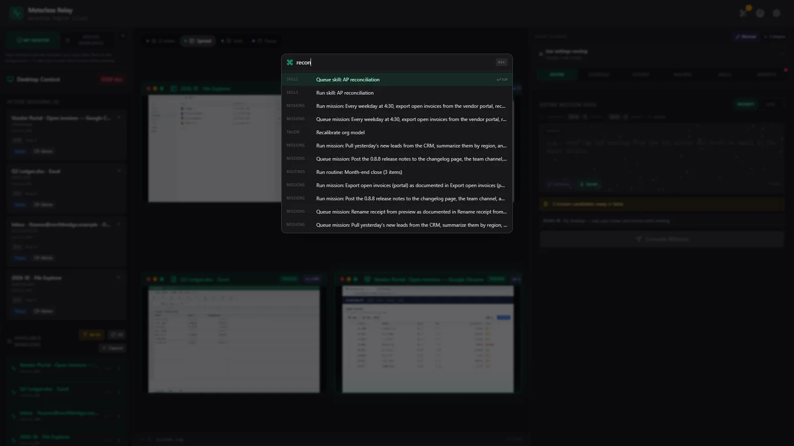

<table>
  <tr>
    <td width="50%">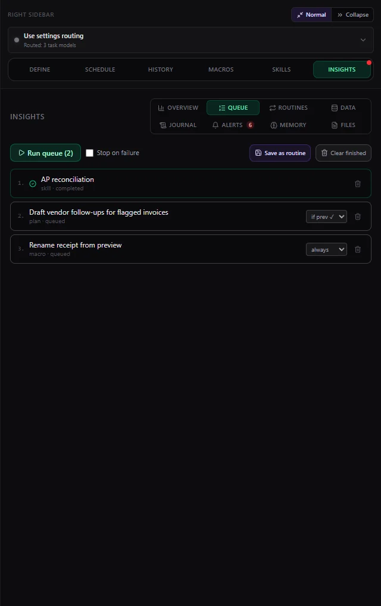</td>
    <td width="50%">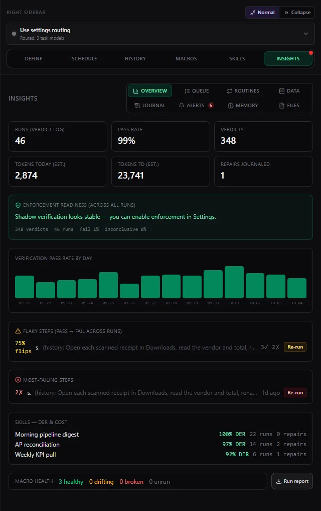</td>
  </tr>
  <tr>
    <td width="50%">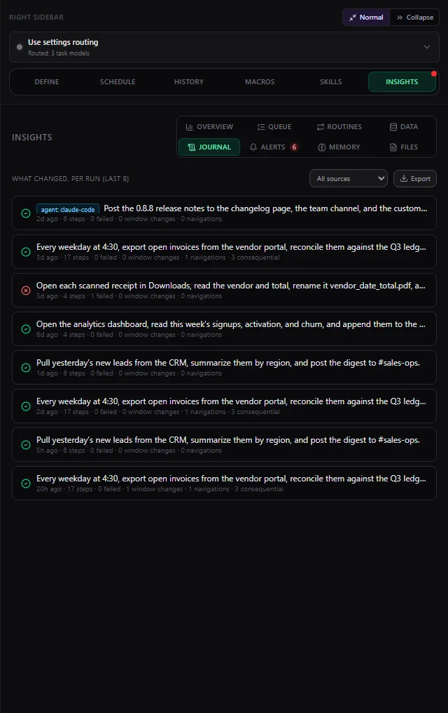</td>
    <td width="50%">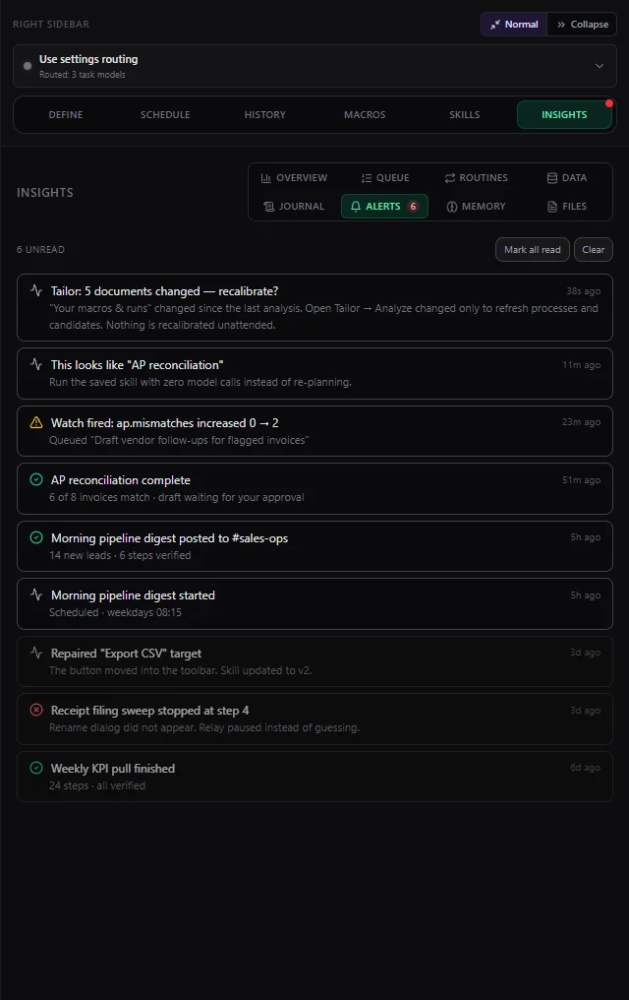</td>
  </tr>
</table>

## Keep everything local

Your tracked windows, goals, plans, skills, recordings, Data Vault values, procedural memory and captured artifacts all live on your computer. What leaves the machine is what goes to the model provider you configured. With the Private preset on a local runtime, nothing leaves at all. Read [privacy.md](privacy.md) for the details.

---

Ready to try it? The [getting started guide](getting-started.md) gets you to a first verified run in a few minutes.
