# Getting started with Relay

This guide takes you from a fresh download to your first verified run on your own computer in about five minutes. No prior setup is needed.

## What you need

- Windows 10 or 11.
- A model. Bring an API key for a cloud provider, or run models locally through the Meterless Runtime.
- Relay itself. It is free.

## 1. Download and install

Relay is a free Windows app with a 3.3 MB installer. The current version is v0.8.8. Get it from either place:

- [meterless.ai/relay](https://meterless.ai/relay.html)
- [GitHub releases](https://github.com/meterless/relay/releases/latest)

Want all three free Meterless apps? The Meterless Suite installer bundles Gaia, Relay and Swarms with the engines preconfigured. Get it from the [free tools page](https://www.meterless.ai/tools.html).

Run the installer. GitHub releases offer an `.msi` and an NSIS setup `.exe`. Either works. It is a standard Windows installer that asks where to put the app, so you can click through. The app lands in your Start menu under Meterless Relay.

The first launch can take a little longer while Relay sets up its local storage. After that, it opens in a couple of seconds.

If Windows SmartScreen says it is an unrecognized app, click More info and then Run anyway. SmartScreen builds reputation for new releases over time. The [troubleshooting page](troubleshooting.md) covers this too.

## 2. Connect a model

Relay does its thinking with an AI model you choose. Open Settings and go to the API Keys tab.

**Option A: a cloud API key.** Relay supports Google Gemini, Anthropic, OpenAI, OpenCode Go and OpenRouter. Paste your key into the box for the provider you want and click Test connection. A green check means you are set. If you do not have a key, a free Gemini API key from Google AI Studio is the easiest start. It takes about a minute.

**Option B: local models.** If you run [Nightshift](../nightshift/README.md) on a Mac or DGX edition, Relay can use its [hotspot](../nightshift/hotspot.md). Configure it under API Keys → Meterless Runtime. The default address is `http://127.0.0.1:8088/v1`. Then open Model Routing and pick a preset. Private (on-device) pins every task to local, so nothing leaves the machine.

You can mix the two. Model Routing lets you pick a model per task: desktop planning, vision analysis and deep reasoning.

## 3. Track a window

Window tracking sets Relay apart from other automation tools. New users often skip this step and then wonder why nothing works. Take thirty seconds and do it properly.

Open the app you want Relay to control. It can be a browser, Excel, QuickBooks, your CRM, or whatever else you use.

In Relay, open the Tracked Windows panel on the left. Click Add window. A list of every open window appears. Click the one you just opened. It now shows in the tracked windows panel with a preview thumbnail.

You can track up to eight windows at once. Most useful workflows use two or three.

## 4. Describe the job

Click the big text box in the middle. Type what you want in plain language. Do not write it like a script. The more it sounds like something you would say to a coworker, the better Relay handles it.

Examples that work well:

> *Open Notepad and write a one-line note that says "Reviewed at 3pm."*

> *In the Chrome window I tracked, go to my dashboard and screenshot the top chart.*

> *Open the spreadsheet on my second monitor, copy the values in column B, and paste them into a new email in Outlook.*

As you type, Relay tags the intent (a loop, a URL, an email) and shows a skill match if it has done this job before. A verified skill runs with one click and no re-planning.

When you are ready, press Enter or click the send arrow.

## 5. Read the plan before you run it

Before it clicks anything, Relay snapshots your tracked windows, adds what it already knows about them, and compiles a mission. The mission is broken into phases, with targets, steps, failure policies and approval gates.

Read it. If a step looks wrong, edit it inline. If the whole plan looks wrong, click Cancel and reword your goal. If it looks right, click Run.

A few seconds of review here is how you build trust in the automation, so later runs need less watching.

## 6. Watch the first run

While Relay runs, your mouse moves on its own. Do not fight it. Relay uses native clicks and keystrokes in your real apps, and each step targets a control by name. If you need to stop, use the pause control in Relay. The workflow engine pauses cleanly between steps, and you can resume when you are ready.

## 7. Approve what matters

When the plan reaches an approval gate, Relay pauses with the result on screen and waits. Gates are on by default for anything that sends, posts, pays or deletes. Approve and it finishes. Cancel and nothing happens.

If a step fails and its failure policy says to ask, Relay stops and asks you instead of guessing.

## 8. Check the verdicts

When the run ends, read the run report. Every step has a verdict. Relay checks with cheap UI Automation probes first and uses vision only when needed. The report shows what passed, what was skipped, and why.

Values the run captured go to the Data Vault, where later runs and watches can use them. Files and screenshots go to your local workspace, grouped by mission.

## 9. Keep what works

A verified run can become a skill. Relay shows you a review diff first, and nothing is saved until you accept it. Next time, the skill replays deterministically and calls a model only to repair a step that drifted.

From there you can:

- **Run it again.** Press Ctrl+↑ in the goal box to bring back your last goal, or open History and rerun any past plan.
- **Schedule it.** Run it every weekday at 4:30, with window-readiness checks before each run.
- **Watch a value.** Fire a mission when a captured value changes.

Similar jobs also get shorter and faster on their own as procedural memory builds up. You do not have to turn that on.

---

## Where to go next

- Everything Relay can do is in [features.md](features.md).
- Keyboard shortcuts, including Ctrl + K for the command palette, are in [shortcuts.md](shortcuts.md).
- What stays on your machine is in [privacy.md](privacy.md).
- If something is not working, check [troubleshooting.md](troubleshooting.md).
