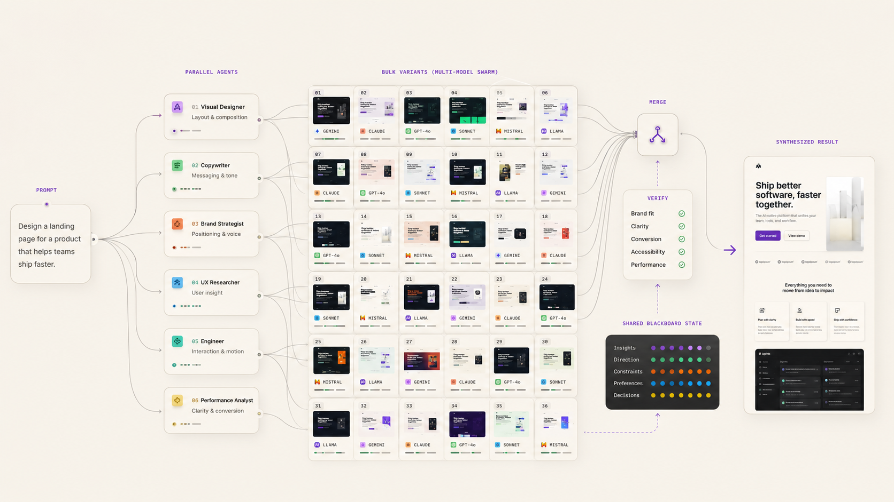

# Swarms features

**The swarm builds itself. You keep it.**

This page covers what Swarms does, organized by what you can get done with it. Swarms is free and open source under Apache 2.0. The current release is v0.9.3.

| Swarm size | Context cost | Providers | Swarm design | Runs | Price |
|---|---|---|---|---|---|
| 300+ agents | O(1) | 5, 2 local | Auto-generated | Locally, in-browser | Free, open source |

## Ways to use it

There is a web version that runs in your browser at [meterless.ai/Swarms](https://meterless.ai/Swarms/), and a desktop version you install as a Windows app (.msi or .exe installer). Get the desktop version from the latest installer on the [Releases page](https://github.com/meterless/swarms/releases/latest). The [Meterless Suite](https://www.meterless.ai/tools.html) installs Gaia, Relay and Swarms together with the engines preconfigured.

The web and desktop versions share the same codebase and features, with two desktop-only additions. Agents can use the built-in web search and web fetch tools (the Forage stage for research runs), and you can pair a phone as a remote. The desktop version launches a little faster, stores your data in its own app data folder on disk, and opens fully offline. The web version is one click away, works on any operating system with a modern browser, and stores your data inside the browser. Mac and Linux desktop installers are planned but not available yet.

You can use both, but they do not share data with each other automatically. Each install keeps its own local storage. Skills can be exported from one and imported into the other. Artifacts can be downloaded and carried across by hand.

## One goal, an auto-generated team

This is the headline feature. Type one goal and Swarms auto-generates the whole agent team: specialized agents planned, parallelized, reconciled and verified. You do not design the swarm yourself.

Before the workers start, a planner maps the goal into distinct directions. The results come back as different ideas rather than one idea reworded.

You can ask for two variants or fifty, and swarms scale past 300 agents. Results arrive as each one finishes, so you can start reading the early ones while later ones are still running.

If a variant fails (a network blip or a provider error, for example), only that one fails. The rest keep going. The engine retries transient failures automatically (up to a configurable retry limit, default 2 per task). Rate-limit and quota failures are reported as such rather than retried.

Swarms has topologies for research, comparison, coding, analysis, writing, batch work and verification. You create and refine them in natural language, with local control by default.

## The reasoning graph you own

The graph that produced an answer is worth more than the answer itself. Other AI tools make you pay to re-run the model every time. Swarms saves the reasoning as a graph (a DAG) you own and can run again. A sample batch graph has 147 nodes, 382 edges, depth 14, 22 critics and 19 merges.

1. Inspect any node to see its model, tokens and score.
2. Edit the graph to refine it: select, describe, diff, apply.
3. Swap any model onto any node.
4. Rerun it from history, branch it, or schedule it.

Context cost stays O(1) across multi-pass refinement, through the [Markovian](../../../engines/markovian/) engine.

## Swap any model on any node

Every node in the graph can run on a different model. Use a frontier model for the hard parts and a cheap model for the rest. A first run might go to a frontier model. Later runs can go to cheap or local models on the same refined graph.

## A ranked gallery of outputs

Every output lands in a ranked gallery: research briefs, code, comparisons, analysis, writing or creative variants.

- It generates HTML, CSS patches, SVG, YAML graphs, TypeScript, SQL, JSON, Markdown and more.
- It ranks every item by goal-fit, lineage and renderability.
- It reconciles patches against their target and collapses similar variants into families.

## Refine one branch at a time

Open any artifact and hit Refine. Click any element to comment on it, edit inline, and re-run from there. Only that branch re-runs. The rest of the swarm does not restart.

Each artifact keeps its history and lineage, so you can see where it came from and what changed.

## Reading the room before you send

A small chip sits near the prompt box. As you type, it shows what kind of work the app thinks this is. This build ships 107 intent modes across about eleven categories (code, memory, swarm, mission, workspace, specialized dev, quality, AI/automation, collaboration, admin, data/viz), each with its own color and label. The broader canonical intent taxonomy is specified in the [scout-intent engine](https://github.com/meterless/meterless/tree/main/engines/scout-intent). The chip also shows a confidence number.

High confidence means the app understood you. Low confidence means it has a guess but is not sure, and rephrasing is probably worthwhile. The detected intent drives which skills get injected into your prompt, so checking the chip can save you a bad run.

You can ignore the chip entirely. It does not change anything unless you let it.

## Bringing your own AI

You connect the providers you want, local or connected. Options include Google Gemini, OpenAI, Anthropic Claude, OpenRouter, OpenCode Go, and any other endpoint that follows the OpenAI chat completions format. Add as many as you want. Switch between them per run, or per node.

Different models are good at different things. The app lets you assign a default model for each kind of work. You might use Gemini Flash for fast drafts, Claude Opus for long reasoning work, and GPT-5 for code. Pick whatever combination matches what you pay for.

The keys live on your machine. The app never sends them anywhere except to the provider they belong to.

## Use the Nightshift hotspot as a provider

If you run [Nightshift](../nightshift/README.md) on your own machine, its [hotspot](../nightshift/hotspot.md) serves Swarms as an OpenAI-compatible provider. The default base URL is `http://127.0.0.1:8088/v1`. Requests carry `Authorization: Bearer <token>`. The runtime writes the token to `<stateDir>/proxy-token`.

Your model ids are routing modes, not model files. The runtime routes to the fleet you have.

| Id | Meaning |
|---|---|
| `meterless/auto` | Let the runtime decide |
| `meterless/fast` | Lowest latency |
| `meterless/deep` | Most capable route |
| `meterless/cheap` | Lowest cost |
| `meterless/local` | Never leave the machine |
| `meterless/fusion` | Combine routes |

This pairs well with model swapping. Put `meterless/deep` on the hard nodes and `meterless/cheap` or `meterless/local` on the rest.

## Working with your files

Drag any file onto the prompt box. The app accepts PDFs, Word documents, plain text, Markdown, CSVs, code files, images and audio. It works out what kind of file it is and handles it accordingly.

For text-readable files, the contents go straight into the prompt. The model sees them as if you had pasted them in. For PDFs, the app extracts the text first and feeds that in. Images and audio are handled through the local tool catalog. Images can be OCR'd, converted, resized, cropped, or compressed, and audio files can be converted between formats. All of it happens on your machine.

Files dropped into the app never leave your computer except through the model call you explicitly send. There is no upload to our servers. We do not have servers for that.

## Generating real files back

You can ask the app to produce a PDF, a Markdown document, an HTML page, a CSV, an XLSX spreadsheet, a DOCX document, a PPTX deck, a chart, or a ZIP archive as output. It generates them locally, hands you a download, and the result sits in your history.

The document generators are real libraries running in the app. PDF uses html2pdf.js, and the Office formats use the `xlsx`, `docx`, and `pptxgenjs` packages. The CSV generator escapes per RFC 4180 so commas and quotes inside fields do not break anything. Charts render through matplotlib in a local Python (Pyodide) runtime, and audio conversion runs through ffmpeg compiled to WebAssembly.

Use this when you want a deliverable rather than text on screen. A request like "Write me a one-page report on X and give it back as a PDF" works.

## A memory that lasts across sessions

The app keeps a running understanding of what you have been working on. When you write a new prompt, it checks whether anything from your past runs is relevant, and if so, includes a small block of that context with your prompt.

The app does not send your whole history. It sends a small, ranked, filtered slice (top five memories above a relevance threshold, blended across semantic similarity, keywords, tags, entities, and recency). You can see what got included in any run, and you can review and delete any memory the app is holding from the Memories panel.

The memory lives in a database on your computer. Nothing in it is sent anywhere except as part of the prompts you actively send to your AI provider.

If the project, memory and results need to persist across sessions as a workspace, continue the work in [Gaia](../gaia/README.md).

## Skills you can switch on or off

A skill is a small block of instruction text that gets added to your prompt automatically when the app detects you are doing the matching kind of work. For example, a code-quality skill kicks in when you ask for a code review and asks the model to follow a structured review format.

The app registers 18 curated skills out of the box, and 17 of them ship enabled (one is off by default). They cover things like HTML output, data visualization, code quality, TypeScript, debugging, security, refactoring, architecture, commits/PRs/changelogs, and task decomposition. Alongside those, there is a larger discovery library of additional skills that ships disabled. Browse it in Settings, read what each one does, and turn on the ones you want. Once enabled, a skill fires automatically whenever its matching intent comes up. You can also write your own skills to bake in a personal style or habit, and export or import them as files.

## Running graphs on a schedule

Any graph can be scheduled to run automatically. Save a prompt as a scheduled run. It can run once a day at 8am, every Monday morning, on the first of the month, or on whatever cadence you want. When the schedule fires, the app runs it and the results show up in your history.

The schedule lives on your computer. The app needs to be open at the scheduled time for the run to fire. If the app was closed when a slot was due, the schedule's catch-up policy decides what happens next: skip the missed slots (the default), run once for the latest missed slot, or replay all of them. There is also a conflict policy for when a run is already in flight (skip, queue, or replace).

Scheduling suits work where the prompt stays the same and the answer changes. Examples include a daily summary of the news headlines you care about, a weekly check on what changed in a competitor's documentation, and a monthly draft of an internal report skeleton. With model swapping, a scheduled graph can run on cheap or local models once a frontier run has refined it.

## History you can reopen

Every run you do is saved with its plan, per-task statuses, and every artifact that came back. It is written to the local database on every event rather than only at the end, so even a crashed or cancelled run can be reopened later with its DAG and partial artifacts intact. The history view lists your runs and lets you reopen, branch or re-run them.

## Exporting

Artifacts can be copied or downloaded. HTML artifacts download as a zip that bundles the page together with its referenced stylesheets, scripts, and images, plus a manifest, so the saved page opens the way it rendered. On the desktop app this goes through the native save dialog. On the web it is a normal browser download.

Your skills can be exported and imported as files, which is the supported way to carry your custom skills to another install.

## Settings worth knowing about

Settings holds more than most people need, but a few options matter.

The routing tab lets you say "use this model for code generation, this one for architecture, this one for research, this one for missions, and this one for merges." Each app mode is routed independently, and the merger route defaults to following the worker route unless you point it elsewhere. Two Mixed entries (Premium / Fast) rotate each task through a different keyed model from that tier.

The engine tab controls the Markovian chunk configuration, including the per-call token ceiling. If your variants are getting cut off mid-sentence, raise it here.

The swarm tab holds the fan-out settings: maximum variants per run (default 300, up to 500), maximum concurrent agents (default 6, range 4 to 64), and the prompt-enrichment toggles (temperature variance, role postures, merger synthesis prompt).

The Memories view shows what the app has remembered and lets you delete any of it. The full picture of what does and does not leave your machine is in [privacy](privacy.md).

## Engines inside

| Engine | What it does in Swarms |
|---|---|
| Swarm orchestration | DAG planning, dynamic specialists, merge and verify |
| [Scout Intent](../../../engines/scout-intent/) | Intent modes that classify what kind of work a prompt is |
| [Markovian](../../../engines/markovian/) | O(1) context cost across multi-pass refinement |

## Things the app does not do (yet)

It does not generate images from scratch. It can manipulate images you give it (resize, crop, convert formats, compress) but it does not call image generation APIs.

It does not stream voice in or out. You can give it an audio file and have a model transcribe or summarize it, but there is no live microphone mode.

It does not sync between machines. Your data stays on whichever computer you ran it on. To use something elsewhere, download artifacts or export skills and carry them across by hand.
