# Getting started with Swarms

This page takes you from opening Swarms to running your first swarm in about five minutes.

Swarms is free and open source under Apache 2.0. The current release is v0.9.3.

## Three ways to get Swarms

There is a web version and a desktop version. They do the same things. Pick the one that fits how you work.

- **Web version.** This is the fastest start. [Launch Swarms in your browser](https://meterless.ai/Swarms/). There is nothing to install. It works on Windows, Mac, Linux, or anywhere with a modern browser (Chrome, Edge, Firefox, or Safari). Your data lives in the browser's local storage on the machine you opened it on.
- **Desktop version.** This is a Windows installer (.msi or .exe). Download the latest installer from the [Releases page](https://github.com/meterless/swarms/releases/latest). Your data lives in the app's own data folder on your disk. The app launches a little faster and survives clearing your browser data. Mac and Linux installers are planned but not available yet.
- **Meterless Suite.** This installs Gaia, Relay and Swarms together, with the engines preconfigured. Get it from the [free tools page](https://www.meterless.ai/tools.html).

Whichever you choose, only the first step below differs. The rest are the same.

## What you need before you start

You need a model provider. Swarms works with local or connected models.

The easiest connected option is a Google AI Studio key. Google gives you a free key in about thirty seconds, and the app's default routing points at Gemini on a fresh install, so that key works immediately.

If you run Nightshift on your own machine, you can use its hotspot as a local provider instead. See [Use the Nightshift hotspot](#use-the-nightshift-hotspot) below.

You do not need to install anything else, including Python, Node or Docker.

## Step 1: Open the app

**If you are using the web version:** open [meterless.ai/Swarms](https://meterless.ai/Swarms/). Bookmark the page so you can find it again. The first load takes a few seconds longer than later ones because the browser is caching the app.

**If you are using the desktop version:** download the latest installer from the [Releases page](https://github.com/meterless/swarms/releases/latest). Double-click it. Windows might pause for a moment to scan it. Click through the installer. It is the normal Next, Next, Install flow. When it finishes, the app opens on its own.

**If you are using the Meterless Suite:** run the Suite installer from the [free tools page](https://www.meterless.ai/tools.html) and open Swarms from it.

The first desktop launch takes longer than later ones. The app is setting up its local database, registering itself, and pre-loading a few things it needs. Give it up to thirty seconds. A black or empty window for a moment is normal.

## Step 2: Get an API key

If you already have one for Google, OpenAI, Anthropic, or OpenRouter, skip this step. If you are using the Nightshift hotspot, skip to [Use the Nightshift hotspot](#use-the-nightshift-hotspot).

Otherwise, here is the quickest path:

Open your browser and go to aistudio.google.com. Sign in with a Google account. Click "Get API key" in the sidebar. Click "Create API key." Copy the long string that appears. Keep it somewhere you can paste from in a moment.

The free Google tier is generous enough to use the app casually for weeks without paying anything. You can switch to another provider later if you want.

## Step 3: Paste the key into the app

Back in the app, open Settings and go to the Cloud Models section, API Keys tab. Find the row for the provider whose key you copied (Google, in the example above). Paste the key into the field and save.

Once a valid key is in place, that provider's models light up in the model picker instead of showing as dimmed or unavailable. If they stay unavailable, the key probably has a typo or extra spaces. Delete it, paste again, and save again.

## Step 4: Close Settings and look at the main window

There is one text box at the bottom of the window. There is space above it where results will appear. Near the text box there is a small chip that says something like "no intent yet."

That chip reads along as you type. Try typing the word "write" into the box. The chip changes color and label as the app works out what kind of work you are asking for. You can ignore it for now.

## Step 5: Run your first swarm

Type one goal. Try this exactly:

> Write three different opening lines for an email asking a former colleague to grab coffee.

Press Enter, or click the send button on the right side of the text box.

Swarms plans the work and runs it with the model you set up in step 3. After a few seconds, three results land in the gallery above the text box. Each one has a different opening line. Click any result to open it. Click the copy icon to copy that line to your clipboard.

You have now run your first swarm.

## Step 6: Try a bigger one

In the same text box, type:

> Give me ten different headline ideas for a blog post about learning to cook at thirty.

The number "ten" tells the app to fan out to ten parallel variants. Send it. Watch the results stream in.

When they finish, the gallery ranks them by goal-fit, lineage and renderability. Scroll through them, copy the ones you like, and click the X on the ones you do not. The kept results stay in your history.

## What just happened

Swarms auto-generated an agent team for your goal. A planner first asked the model for ten different angles. Then ten parallel writers ran, each starting from a different angle. That is why the variants do not read like copies of each other. Without the planning step, you would get ten slight rephrasings of the same idea.

If one variant fails, only that one fails. The rest keep going. When they finish, Swarms ranks and reconciles them.

The run is saved as a reasoning graph. Every node records its model, tokens and score. That graph is yours. You can inspect it, edit it, swap models on any node and rerun it later.

## Use the Nightshift hotspot

If you run [Nightshift](../nightshift/README.md) on your own machine, Swarms can use it as a model provider. The [hotspot](../nightshift/hotspot.md) is OpenAI-compatible. Add it as an endpoint that follows the OpenAI chat completions format.

| Setting | Value |
|---|---|
| Base URL | `http://127.0.0.1:8088/v1` |
| Auth | `Authorization: Bearer <token>`. The runtime writes the token to `<stateDir>/proxy-token`. |
| Model ids | Routing modes such as `meterless/auto`, `meterless/fast`, `meterless/deep`, `meterless/cheap` and `meterless/local` |

Pick `meterless/local` when the work must never leave the machine.

## What to try next

A few things people tend to explore after their first run:

- Open any result and hit Refine. Click an element, describe the change, and re-run from there. Only that branch re-runs.
- Open the graph and inspect a node. You see the model, tokens and score for that step. Swap a cheaper model onto the easy nodes and keep a frontier model on the hard ones.
- Drop a file onto the text box and ask a question about it. PDFs, text files, code, CSVs, and Markdown all work. The app reads them and feeds the content into your prompt.
- Open the Models tab in Settings and try a different model for the next run. The same prompt can feel very different on Claude, Gemini, or an open-source model through OpenRouter. There is no wrong choice. The keys you set up stay set up.
- Look at your history. Every run you do gets saved to your machine. You can open it next week and see exactly what you asked and what came back. None of it leaves your computer unless you export it.

If the project and memory need to persist across sessions, continue the work in [Gaia](../gaia/README.md).

For the full picture of what the app can do, see [features](features.md). If something is not working, [troubleshooting](troubleshooting.md) is the next stop.
