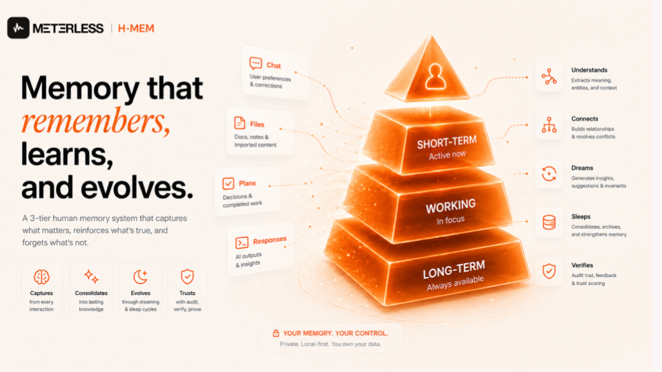
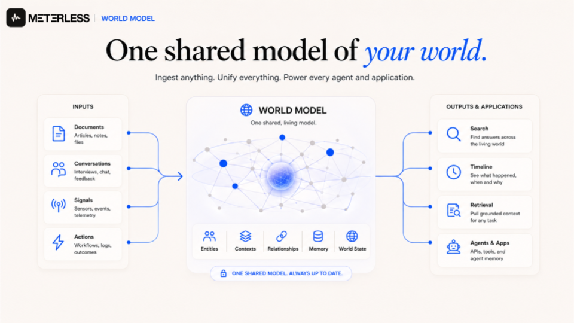
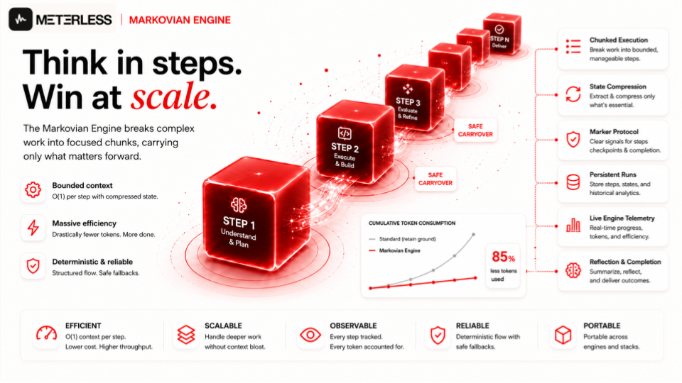
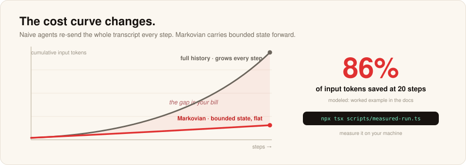
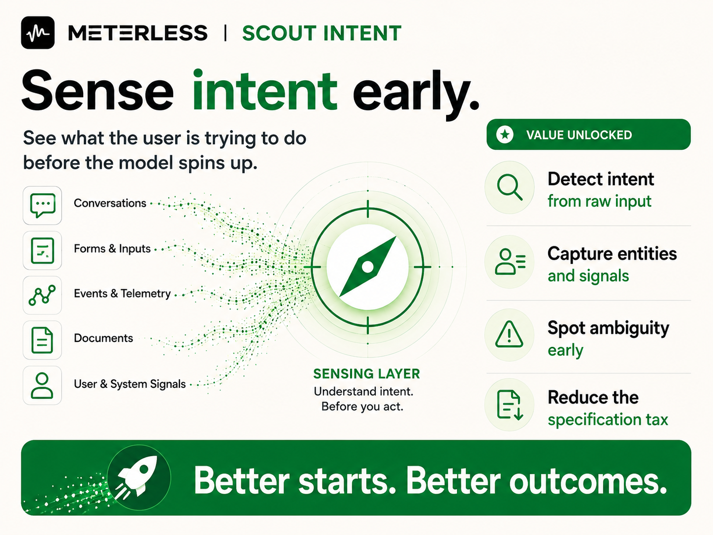

# The Meterless Engines

[](#pick-your-engine)
[](#built-for-coding-agents)
[](../AGENTS.md)
[](../LICENSE)

Most agent failures come from missing context, not from the model. These four engines are the context layer that [Nightshift](../docs/products/nightshift/README.md) and the free Meterless apps run on: durable memory, grounded state, flat-cost reasoning, and intent routing. They run locally and work with any model provider.



An engine here is an implementation spec for coding agents, not an npm package. Each folder has a full `AGENTS.md` contract, runnable examples, workshops, and a conformance suite that tells you when your build is correct. Clone a folder, give it to your agent, and finish when the suite passes:

```bash
npx degit meterless/meterless/engines/hmem my-hmem
# then: "Implement the H-MEM engine in this project following AGENTS.md."
```

---

## Pick your engine

| If your agent | Use | Status | Check |
|---|---|---|---|
| Forgets what users told it last week, and can't explain what it does recall | [H-MEM](#h-mem) | Spec + runnable reference | [conformance](hmem/conformance/) |
| Invents entities, or you rebuild domain state for every app | [World Model](#world-model) | Spec + runnable reference | [conformance](world-model/conformance/) |
| Spends more tokens per step the longer a run goes | [Markovian](#markovian) | Spec + runnable reference | [conformance](markovian/conformance/) |
| Acts before it understands, or your routing code is the buggiest part of the stack | [Scout Intent](#scout-intent) | Spec | [eval harness](scout-intent/evals/) |

Each folder is self-contained, with its own `AGENTS.md`, docs, examples and workshops. Use one engine or all four.

---

## H-MEM

Hierarchical memory for agents: short-term, working and long-term tiers, stored locally, with an audit trail.



Agents that serve real users run into three memory problems: stale facts, recall nobody can explain, and memory that degrades over time. A better embedding model does not fix any of them. H-MEM specifies a tiered memory with mining, retrieval, dreaming, sleep, trust and conflict resolution.



What H-MEM adds over a plain vector store:

- **8-signal hybrid ranking.** Recall is scored on more than similarity.
- **Provenance on every record.** Source, confidence and lineage.
- **A defined lifecycle.** Capture, enrich, retrieve, dream, sleep.
- **Human-approved synthesis.** Dreaming proposes new memories, you approve them, and `derivedFrom` links them to their sources.
- **Preview-first maintenance.** Sleep consolidates memory with backup and restore, and shows you the plan first.
- **Append-only trust ledger.** Every change is recorded.
- **Contradiction handling.** Conflicts are detected, scored and resolved on the record instead of by last write.

Example: the question "Why did the agent say March 14?" is answered by a five-line ledger trace. The fact was mined from a user correction, conflicted with an older value, was resolved by a named person, and was retrieved at a known score.

Memory also makes later runs cheaper. In the demo, the same 12-step task runs cold and then warm. The warm run starts with H-MEM memory and finishes in 8 chunks instead of 12. It runs locally in about 90 seconds with no API keys:


```bash
npx degit meterless/meterless/engines/hmem my-hmem
cd my-hmem/reference && npm install && npm test     # working reference, green in about a minute
npx tsx ../examples/01-add-memory/index.ts          # watch a memory get mined, stored, audited
```

[Spec](hmem/AGENTS.md) · [Architecture](hmem/docs/architecture.md) · [Examples](hmem/examples/) · [Workshops](hmem/workshops/) · [Demos](hmem/demos/) · [Conformance](hmem/conformance/) · [Overview page](../docs/engines/hmem.md)

---

## World Model

A shared, persistent graph of the entities, contexts and relationships in your domain.



Most AI products eventually need a persistent picture of their domain. Teams often build it three times: as JSON blobs, then a Postgres schema, then a knowledge graph that is hard to edit or audit. World Model specifies one design you can query, inspect and evolve.



- **Canonical store.** An append-only event log is the single source of truth.
- **Derived views.** Graph, timeline, search and custom projections, all rebuildable from the log.
- **Idempotent ingest.** The same input produces the same event log, so replay is always safe.
- **Stable IDs.** Content-addressable and alias-aware. They survive merges and re-imports.
- **Operator control plane.** A browser UI to inspect, merge, edit, rebuild and repair, specified as part of the engine.

Because every view is rebuilt from the log, bug fixes do not need migrations. Schema versioning is required.

```bash
npx degit meterless/meterless/engines/world-model my-world-model
# then: "Implement the World Model engine in this project following AGENTS.md."
```

[Spec](world-model/AGENTS.md) · [Architecture](world-model/docs/architecture.md) · [Examples](world-model/examples/) · [Workshops](world-model/workshops/) · [Control plane](world-model/control-plane/) · [Conformance](world-model/conformance/) · [Overview page](../docs/engines/world-model.md)

---

## Markovian

Bounded-context reasoning for long runs. Each step carries a small compressed state instead of the full history.



In a long agent run, every step usually appends to the history. By step 30 the full transcript goes out on every call. Larger context windows postpone the problem without solving it. Markovian splits long work into bounded chunks and carries only compressed state forward. Cost per step stays flat, and cost per run grows linearly instead of quadratically.



- **Chunk manager.** Schedules bounded-context calls.
- **Marker protocol.** `[STATE_CHECKPOINT]`, `[TASK_COMPLETE]` and pause markers are typed signals the engine reads, instead of prose summaries.
- **Compression cascade.** Keeps decisions and entities, drops prose.
- **Run history.** Per-step records for replay, inspection and diffs.
- **Contained failures.** A confused step affects one chunk, not the whole run.

The [token economics demo](markovian/token-economics-demo/) shows the difference with sliders: the naive cost curve grows quadratically while Markovian stays flat.

```bash
npx degit meterless/meterless/engines/markovian my-markovian
cd my-markovian/reference && npx tsx scripts/measured-run.ts   # measure the savings yourself
```

[Spec](markovian/AGENTS.md) · [Efficiency model](markovian/docs/efficiency-model.md) · [Token economics](markovian/token-economics-demo/) · [Examples](markovian/examples/) · [Workshops](markovian/workshops/) · [Conformance](markovian/conformance/) · [Overview page](../docs/engines/markovian.md)

---

## Scout Intent

A decision pipeline that runs before any action: detect intent, check risk, choose tools, and sign an execution contract.



Every agent stack grows a routing and policy layer. It usually starts as a few if-statements and becomes the buggiest part of the codebase. Scout makes that layer its own engine, placed between user input and execution.



- **Sense.** Classify intent with confidence bands. The deterministic trigger scan takes under 16 ms.
- **Interpret.** Bind entities and parameters.
- **Guard.** Injection detection, RBAC, scope and PII checks.
- **Route.** A capability graph resolves abstract verbs to concrete tools.
- **Recommend.** Pick the model profile, set the cost ceiling, and sign the execution contract.

Downstream engines refuse unsigned plans, so Scout sits in front of everything. Decisions are scored. An adversarial corpus is included, and a locked regression set gates every release.

```bash
npx degit meterless/meterless/engines/scout-intent my-scout
# build against the spec, then gate your implementation with the eval harness
```

[Spec](scout-intent/AGENTS.md) · [Docs](scout-intent/docs/) · [Eval harness](scout-intent/evals/) · [Examples](scout-intent/examples/) · [Workshops](scout-intent/workshops/) · [Overview page](../docs/engines/scout-intent.md)

---

## How the engines connect

Each engine works alone. Used together, they pass data like this:

| From → To | What flows |
|---|---|
| Scout → all engines | Signed execution contracts. Engines refuse out-of-scope plans at the boundary. |
| Scout → Markovian | Work classified as long-horizon is routed to bounded-context reasoning. |
| H-MEM → Markovian | Memory seeds the first chunk. The final output is mined back into memory. |
| World Model → H-MEM | World facts sync into memory. |
| World Model → Scout | Context plans are answered with grounded entities. |
| Markovian ↔ World Model | A snapshot before a chain, and a reconcile after it. |

---

## Built for coding agents

Each engine includes the loop that tells your coding agent when it is done:

```text
degit the folder  →  agent implements from AGENTS.md  →  conformance suite green  =  done
```

```bash
HMEM_IMPL=<your build> npx tsx conformance/runner.ts
```

There are no packages to wait for and no runtime to license. The spec is the deliverable, under [Apache 2.0](../LICENSE).

---

## Where the engines run today

- Markovian is Nightshift's `deliberate` job kind: one long chain of chunks, each carrying a compressed summary forward.
- Meterless City runs an 8B model with Markovian state, H-MEM memory and a World Model event log for each character.
- In the [agent framework benchmark](../docs/benchmarks/agent-frameworks.md), the reference engines used as a context layer raised Haiku 4.5's score by 4.29 points.

More in [docs/architecture/learnings.md](../docs/architecture/learnings.md).

## What ships next

New engines arrive as tagged releases (`<engine>-v<semver>`). Next are swarm-orchestration, which already runs inside Gaia and Swarms, and runtime, which already runs [Nightshift](../docs/products/nightshift/README.md). Details in [ROADMAP.md](../ROADMAP.md).
